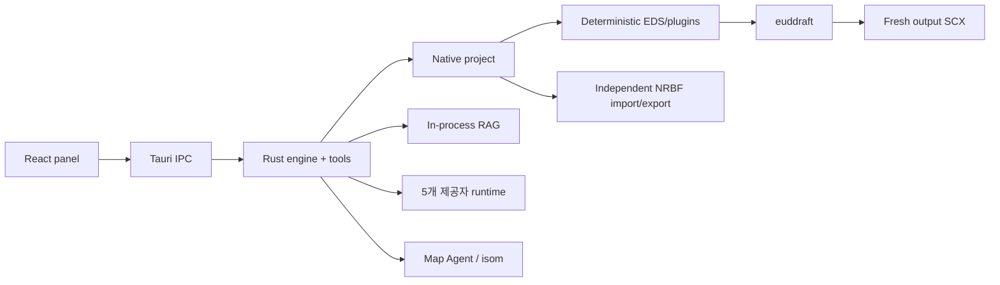

# eud-agent

> 스타크래프트 EUD 맵을 위한 Native AI 저작 도구 — canonical epScript/DAT 프로젝트, 검토 가능한 에이전트 변경, 직접 euddraft 빌드.

[English](./README.md)

`eud-agent`는 Tauri 2, Rust, React, TypeScript로 만든 Windows 데스크톱 앱입니다. 자연어로 맵 동작을 설명하면 에이전트가 실제 프로젝트와 맵을 읽고, 고정된 레퍼런스를 검색하고, typed tool로 epScript/DAT를 수정한 뒤 changeset 검토를 거쳐 euddraft로 결과 맵을 빌드합니다.

EUD Editor 3는 **runtime 의존성이 아닙니다**. 기존 `.e3s` 프로젝트는 독립 MS-NRBF 호환 계층으로 가져오고 내보낼 수 있습니다.

## 앱이 직접 소유하는 것

- versioned `project.eap` manifest
- confined `src/**/*.eps`·`src/**/*.py` 소스 트리, 순서가 있는 Python 진입점, 정확한 EPS MainFile
- sparse standard DAT/XDAT/TBL/requirements/buttons JSON
- deterministic EDS/plugin 생성
- bounded euddraft 실행과 structured diagnostics
- semantic journal, 승인/거부, rollback, restart persistence
- in-process BGE-M3 RAG와 pinned epScript preflight
- SCX/CHK 조회와 안전한 Map Agent mutation
- Codex, Claude Code, Antigravity, OpenCode Go, Ollama 기반 multi-session 대화, plan, ASK, changeset review

## 요구 사항

| 요구 사항 | 설명 |
|---|---|
| Windows 10/11 x64 | MSVC Rust target, 시스템 WebView2 runtime |
| euddraft | 최초 설정에서 최신 버전 자동 다운로드. 기존 폴더, `euddraft.exe`, `euddraft.py` 직접 지정도 지원 |
| 원본 맵 | `.scx` 또는 `.scm` |
| AI 제공자 | Codex, Claude Code, Antigravity, OpenCode Go, Ollama 중 하나 이상 설정 |
| StarCraft data | 지형/렌더링 자동 탐지가 실패할 때 설정 |

EUD Editor는 선택 사항입니다. 내보낸 호환 E3S를 다시 열 때만 필요합니다.

## 프로젝트 시작

일반 실행 시마다 **프로젝트 시작** 화면이 표시됩니다. 저장된 마지막 프로젝트를 자동으로 열지는 않습니다.

- 최근에 성공적으로 연 프로젝트 최대 20개를 최신순으로 표시합니다. 이름·경로 검색과 목록에서 제거를 지원하며, 제거해도 실제 파일은 삭제하지 않습니다.
- `.eap` 파일을 열거나 Native 프로젝트 폴더를 직접 선택할 수 있습니다.
- SCX/SCM에서 새 프로젝트를 만들거나 기존 E3S와 참조 맵을 빈 폴더로 가져올 수 있습니다.
- Windows 설치본은 `.eap`를 전용 프로젝트 아이콘과 연결합니다. `.eap` 파일을 더블클릭하면 해당 프로젝트로 바로 시작하며, 앱이 실행 중이면 기존 창으로 열기 요청을 전달합니다. 다른 JSON 파일의 연결은 변경하지 않습니다.
- 작업 중에는 상단 **프로젝트 전환**을 사용합니다. 빌드·에이전트·검토 작업 중이거나 맵 작업 창이 열려 있으면 전환을 막습니다. 전달된 파일 열기 요청은 보류되며 작업 완료 후 **다시 열기**로 진행할 수 있습니다.

## 최초 환경 설정

1. 프로젝트를 선택하거나 생성합니다.
2. 별도 지정하지 않으면 최신 [armoha/euddraft 배포본](https://github.com/armoha/euddraft)을 자동 다운로드. 기존 euddraft 폴더·파일을 선택해도 됩니다. 다운로드는 SHA-256 검증 후 `%LOCALAPPDATA%/eud-agent/euddraft`에 설치하며, 직접 지정한 경로를 우선 사용합니다.
3. checksum으로 검증되는 RAG/model asset 준비
4. AI 제공자 선택 및 연결

이미 준비된 환경 설정은 재사용합니다. **설정 → 프로젝트**의 열기/만들기/가져오기/내보내기도 계속 사용할 수 있습니다.

## Native 프로젝트 구조

```text
my-project/
├── project.eap             # 프로젝트 설정을 직접 담는 JSON manifest
├── src/
│   ├── main.eps
│   └── bootstrap.py         # 선택적 direct eudplib 소스
├── dat/
│   ├── standard.json
│   ├── xdat.json
│   ├── tbl.json
│   ├── requirements.json
│   └── buttons.json
├── maps/
│   └── source.scx
├── plugins/
├── build/
└── compat/
    └── editor-project.e3s   # E3S import 프로젝트만
```

schema v2 Manifest, EPS/Python tree, sparse DAT JSON이 canonical입니다. EDS, generated build helper/binary, output SCX, E3S는 build/compatibility artifact입니다.

`.eap`는 **EUD Agent Project**의 약자로, 연결용 파일이 아니라 프로젝트 이름·맵 경로·MainFile·설정·플러그인·순서가 있는 Python 진입점·정확한 PyPI 의존성 선언·해결된 wheel lock·E3S 호환 정보를 직접 담는 JSON manifest입니다. 한 폴더에 `.eap`가 하나라면 파일 이름을 바꿔도 열기와 저장이 유지됩니다. 소스·DAT·맵은 별도 파일이므로 이동할 때는 프로젝트 폴더 전체를 함께 옮기세요.

기존 `project.json` 또는 `.eudproj`는 파일 열기의 이전 형식 필터나 프로젝트 폴더 열기로 전환할 수 있습니다. 검증 후 `project.json`을 `project.eap`로 원자적으로 이름 변경하고 기존 연결 파일을 제거합니다. 이미 `.eap`와 이전 형식이 함께 있거나 `.eap`가 여러 개면 임의로 덮어쓰지 않고 중단합니다.

## E3S 호환 범위

가져오기/내보내기가 지원하는 상태:

- CUI epScript tree와 MainFile
- source/output map 참조
- standard DAT와 XDAT
- TBL, requirements, button sets
- 지원되는 main settings와 ordered EDS plugins

GUIEps, GUIPy, RawText, ClassicTrigger-as-MainFile은 조용히 손실시키지 않고 명시적으로 거부합니다. EPS-only Native 프로젝트는 정상적으로 빌드되지만, E3S 내보내기에는 가져올 때 보존한 compatibility base가 필요합니다. direct Python 소스·진입점·의존성·lock 중 하나라도 있으면 Editor가 손실 없이 표현할 수 없으므로 E3S 내보내기를 명시적으로 거부합니다.

## Direct eudplib Python

epScript가 기본 저작 언어입니다. 프로젝트 로컬 `src/**/*.py`는 완전히 신뢰되는 first-class 소스이며, manifest에서 선택한 진입점만 지정 순서대로 하나의 frozen `euddraft.exe` 프로세스에서 EPS MainFile보다 먼저 실행됩니다. 모든 Python 소스는 revision, snapshot, search, review, rollback에 포함됩니다.

의존성 preparation 뒤 `python_dependencies_set`을 호출해 완전한 exact `name==version` PyPI 목록을 반영합니다. eud-agent는 고정된 `uv` 0.11.3을 준비하고 모든 wheel URL/tag/SHA-256을 `project.eap`에 기록하며 frozen runtime 실빌드 probe를 거칩니다. 오프라인에서는 검증된 `%LOCALAPPDATA%/eud-agent/python-*` cache만 재사용합니다. `build_run`은 의존성 상태를 변경하지 않습니다.

E3S 가져오기는 이 PC에 **원래 E3S 경로로 저장된 하네스**가 있으면 승인 문서·계획, 프로젝트 메모리, DAT 위키, 일반 대화·맵 대화 기록도 복사합니다. 과거에 작은따옴표가 포함된 이름으로 저장된 메모리·세션도 인식합니다. 대화는 새 세션 ID로 복사하며 이름·제공자/모델 설정·시각·로그를 보존합니다. 이전 실행 연결·보류 중 승인·작업 상태·맵 후보 작업은 재개하지 않으며 원본은 그대로 둡니다. 연결이 모호하거나 파일이 없거나 손상되었거나 대상 자료와 충돌하면 해당 항목을 안내합니다. 기존 파일을 덮어쓰거나 정상 자료까지 모두 중단하지 않습니다. 하네스는 E3S에 내장되지 않으므로 다른 PC의 하네스를 E3S 파일만으로 복원할 수는 없습니다.

과거에 승인된 루트 문서와 `.md` 이외의 텍스트 문서도 보존하며, 삭제 이력만 남은 파일은 다시 만들지 않습니다. 가져오지 못한 일반 문서·계획·메모리·위키·대화는 범위, 경로, 사유를 함께 표시합니다. **검토한 N개를 제외하고 가져오기**를 눌렀을 때만 현재 검토한 항목을 제외하고 나머지를 가져옵니다. 문제가 달라지면 다시 동의를 받으며, **다시 확인**은 제외를 승인하지 않습니다. 원본은 보존합니다. E3S 자체·원본 맵·대상 폴더의 필수 조건이나 되돌리기가 실패한 경우는 별도 오류와 상세 사유를 표시합니다.

이제 하네스 자료는 프로젝트와 함께 이동합니다. `.eud-agent/workspace/`에는 승인 문서, `.eud-agent/state/`에는 승인 메타데이터와 이관 기록, `.eud-agent/memory/`에는 메모리와 `wiki/ledger.json`을 저장합니다. 기존 AppData 자료는 현재 프로젝트 소속을 확실하게 확인할 수 있을 때만 복사하고, 원본과 기존 로컬 파일은 덮어쓰지 않습니다. 폴더를 옮겨도 저장된 워크스페이스 ID를 유지하며, 이관 후 로컬에서 지운 파일을 옛 AppData 자료로 다시 만들지 않습니다. 대화·실행 작업·세션 워크스페이스·인증 정보·캐시는 프로젝트에 넣지 않고 PC의 AppData에 둡니다.

제품 runtime은 `BinaryFormatter`를 실행하거나 Editor assembly를 로드하지 않습니다. 호환 acceptance에서만 원본 .NET runtime으로 export fixture deserialize를 독립 검증합니다.

## AI로 직접 검증하고 빌드하기

배포된 설치 파일을 믿지 않아도 됩니다. 아래 두 프롬프트를 Claude Code, Codex 같은 코딩 에이전트에 그대로 붙여 넣으면, 에이전트가 이 저장소의 소스를 직접 읽어 악성 코드가 없는지 검사하고(1), 검사한 그 소스로 설치 파일을 직접 빌드해 설치합니다(2). 두 프롬프트는 같은 태그를 쓰도록 짜여 있으니, (1)에서 검사한 커밋을 (2)에서 그대로 빌드하세요.

### (1) 코드 분석으로 악성 코드 검사하기

````text
너는 소프트웨어 공급망 보안 감사자다. https://github.com/raravel/eud-agent 저장소에
바이러스, 백도어, 정보 탈취, 원치 않는 원격 실행 같은 악성 동작이 있는지 소스 코드로 검사하고
한국어 보고서를 작성해라.

## 규칙
- 검사만 한다. 이 단계에서는 어떤 코드도 실행하거나 빌드하지 마라.
  `cargo build`/`cargo test`/`cargo tauri`는 build.rs를, `npm install`/`npm ci`는 패키지
  설치 스크립트를 실행하므로 금지한다. git, 파일 읽기, 검색 명령만 써라.
- 빈 폴더에 `git clone https://github.com/raravel/eud-agent.git` 한 뒤, 가장 최근 릴리스 태그
  (`git tag --sort=-creatordate` 맨 위의 `vX.Y.Z`)를 `git checkout` 하고, 그 커밋 해시를
  보고서 맨 위에 적어라. 사용자가 다른 태그나 커밋을 지정했다면 그것을 써라.
- 아래 "의도된 동작" 목록은 참고일 뿐 근거가 아니다. 각 항목이 정말 설명대로 동작하는지
  코드로 직접 확인하고, 설명과 다르면 발견 사항으로 보고해라.
- 모든 주장에는 `파일경로:줄번호` 근거를 붙여라. 확인하지 못한 것은 "미확인"으로 적어라.

## 이 앱이 무엇인가
Windows용 Tauri 2 데스크톱 앱(Rust 백엔드 `src-tauri/`, React 패널 `panel/`, C++ 지형 엔진
`native/isom/` + `crates/isom-sys`)이다. 스타크래프트 EUD 맵 프로젝트를 AI 에이전트로 편집하고
euddraft로 빌드한다.

## 의도된 동작 (검증 대상)
- 네트워크: 사용자가 고른 AI 제공자 API(Codex, Claude Code, Antigravity, OpenCode Go/Zen,
  Ollama)와의 통신, euddraft·uv·FFmpeg·RAG 모델 자산 다운로드(SHA-256 고정 검증),
  GitHub 릴리스의 업데이트 확인(`src-tauri/tauri.conf.json`의 updater endpoint, minisign 공개키).
- 외부 프로세스: euddraft, FFmpeg/FFprobe, uv, git, Codex/Claude Code CLI, SCMDraft 2 실행.
- 자격 증명: 제공자 API 키·OAuth 토큰을 로컬(Windows 자격 증명/macOS 키체인 또는 앱 데이터)에
  저장하고 해당 제공자에게만 보낸다.
- 파일: 사용자가 연 프로젝트 폴더, `%APPDATA%/eud-agent`, `%LOCALAPPDATA%/eud-agent`,
  스타크래프트 설치 폴더의 `Maps/eud-agent/`(빌드 결과 복사)에 쓴다.
- `native/trace_injector.rs`: 다른 프로세스의 메모리를 읽고 쓰는 x86 도구다. 앱이 직접 띄운
  스타크래프트 테스트 클라이언트의 단일 인스턴스 커널 객체 이름을 바꿔 사용자의 게임과 격리하는
  용도라고 되어 있다. 대상 프로세스를 어떻게 고르는지, 앱이 띄운 프로세스 외의 것을 건드릴 수
  있는지 특히 꼼꼼히 확인해라.

## 반드시 볼 곳
1. 빌드 시 실행되는 코드: `src-tauri/build.rs`, `crates/isom-sys/build.rs`, `crates/isom/build.rs`,
   `native/isom/` 의 MSBuild 프로젝트(.sln/.vcxproj의 커스텀 빌드 단계), `panel/package.json`의
   scripts, `panel/package-lock.json`에서 install/postinstall 스크립트가 있는 패키지.
2. 저장소에 커밋된 바이너리: `git ls-files` 로 .exe/.dll/.lib/.bin/.zip 등을 찾아 출처와 사용처를
   확인해라(예: 외부에서 가져온 바이너리는 배포처의 서명이 있어야 한다. 실행 없이
   `Get-AuthenticodeSignature` 로 서명만 확인하는 것은 허용한다).
3. 네트워크: 소스 전체에서 `https://`, `http://`, IP 주소, `reqwest`, `fetch(`, WebSocket을 찾아
   모든 목적지를 표로 정리하고, 각 목적지로 무엇이 전송되는지 적어라. 사용자의 프로젝트 파일,
   자격 증명, 시스템 정보가 사용자가 고른 AI 제공자 외의 곳으로 나가는지 확인해라.
4. 프로세스 실행: `Command::new`, `std::process`, `CreateProcess`, `ShellExecute`, PowerShell/cmd
   호출을 모두 찾아 실행 대상과 인자가 어디서 오는지 확인해라.
5. 다운로드 후 실행: 내려받은 파일을 해시 검증 없이 실행하는 경로가 있는지 확인해라
   (`vendor/ffmpeg/manifest.json`, euddraft/uv/RAG 설치 코드).
6. 권한·지속성: 레지스트리, 시작 프로그램, 예약 작업, 서비스 등록, 방화벽, UAC 상승,
   `src-tauri/installer/hooks.nsh`(설치 프로그램 훅), `src-tauri/capabilities/*.json`(웹뷰 권한).
7. 은닉 징후: 난독화, 긴 base64/hex 덩어리, 런타임 코드 생성·eval, 하드코딩된 비밀,
   빌드 환경 변수로 주입되는 값(`option_env!`, `env!`)의 용도.
8. 메모리 조작: `WriteProcessMemory`, `VirtualAllocEx`, `CreateRemoteThread`, DLL 주입,
   `PAGE_EXECUTE_READWRITE` 사용처 전부.

## 보고서 형식
1. 결론 한 줄: "악성 동작 발견 안 됨" / "의심 항목 있음" / "악성 동작 발견" 중 하나와 근거 요약.
2. 검사한 커밋 해시와 검사 범위(본 디렉터리, 보지 못한 부분).
3. 발견 사항 표: 심각도(치명/높음/중간/낮음/정보), 위치(`파일:줄`), 내용, 악성인지
   "위험하지만 의도된 기능"인지에 대한 판단과 이유.
4. 네트워크 목적지 표와 외부 프로세스 표.
5. 사람이 직접 더 확인해야 할 항목.
````

### (2) 직접 빌드해서 설치하기

````text
너는 Windows 빌드 도우미다. https://github.com/raravel/eud-agent 를 소스에서 직접 빌드해
이 PC에 설치하는 것을 끝까지 도와라. 진행 상황과 질문은 한국어로 말해라.

## 규칙
- 대상은 Windows 10/11 x64다. 다른 OS라면 멈추고 알려라.
- 무언가를 설치하거나 시스템 설정을 바꾸기 전에는 무엇을 왜 설치하는지 말하고 동의를 받아라.
  이미 설치된 도구는 버전만 확인하고 넘어가라.
- 사용자가 (1) 보안 검사에서 쓴 태그나 커밋을 알려주면 반드시 그 커밋을 빌드해라.
  없으면 가장 최근 릴리스 태그를 쓰고, 빌드한 커밋 해시를 마지막에 알려라.
- 명령이 실패하면 오류 전문을 읽고 원인을 고친 뒤 다시 시도해라. 실패를 건너뛰지 마라.

## 1. 필요한 도구 확인/설치
- Git (`git --version`). 긴 경로 문제를 막기 위해 `git config --global core.longpaths true`.
- Visual Studio 2022 Build Tools 의 "C++를 사용한 데스크톱 개발" 워크로드(MSVC v143, Windows SDK).
  C++ 지형 엔진(`native/isom`)을 MSBuild로 빌드하는 데 필요하다. 확인:
  `& "C:\Program Files (x86)\Microsoft Visual Studio\Installer\vswhere.exe" -latest -find "MSBuild\**\Bin\MSBuild.exe"`
  설치: `winget install Microsoft.VisualStudio.2022.BuildTools --override "--quiet --wait --add Microsoft.VisualStudio.Workload.VCTools --includeRecommended"`
- Rust stable(MSVC 툴체인): `rustup` 이 없으면 `winget install Rustlang.Rustup`.
  그다음 `rustup default stable-x86_64-pc-windows-msvc` 와
  `rustup target add i686-pc-windows-msvc` (빌드 스크립트가 x86 보조 도구를 함께 컴파일한다).
- Node.js LTS (`node --version`, 없으면 `winget install OpenJS.NodeJS.LTS`).
- Tauri CLI: `cargo install tauri-cli --version "^2.0.0" --locked`.
- 새로 설치한 도구가 PATH에 잡히도록 필요하면 새 터미널에서 이어가라.

## 2. 소스 받기
- 짧은 경로(예: `C:\src`)에서 `git clone https://github.com/raravel/eud-agent.git` 후
  `cd eud-agent`, `git checkout <태그 또는 커밋>`, `git rev-parse HEAD` 로 커밋을 기록해라.

## 3. 빌드
- `npm ci --prefix panel`
- 공식 릴리스는 업데이트 서명 키로 서명되는데 개인 빌드에는 그 키가 없다. 저장소 루트에
  `tauri.local.json` 파일을 만들고 내용을 `{"bundle":{"createUpdaterArtifacts":false}}` 로 써서
  업데이트 서명 단계만 끈다(소스는 수정하지 않는다).
- `cargo tauri build --bundles nsis --config tauri.local.json`
  (첫 빌드는 Rust 의존성과 C++ 엔진 컴파일로 수십 분 걸릴 수 있다. 시간 제한을 넉넉히 둬라.)
- 결과물: `target\release\bundle\nsis\eud-agent_<버전>_x64-setup.exe`.
  파일 경로와 SHA-256(`Get-FileHash`)을 사용자에게 보여줘라.

## 4. 설치
- 위 setup.exe 를 실행한다(현재 사용자 설치, 관리자 권한 불필요).
- 코드 서명이 없는 개인 빌드라 SmartScreen 경고가 뜰 수 있다. 사용자에게 "추가 정보 →
  실행"을 누르면 된다고 안내해라.
- 설치 후 앱이 실행되어 프로젝트 선택 화면이 뜨는지 사용자에게 확인받아라.

## 5. 알려야 할 차이점
- 앱은 시작 시 GitHub 공식 릴리스의 업데이트를 확인한다. 업데이트를 받으면 직접 빌드한 앱이
  공식 서명 빌드로 바뀐다. 직접 빌드한 버전을 유지하려면 업데이트 알림을 받지 말라고 안내해라.
- Antigravity 로그인에 쓰는 OAuth 클라이언트 값은 공식 빌드에만 주입되므로, 개인 빌드에서는
  Antigravity 제공자를 쓸 수 없다. 다른 제공자(Codex, Claude Code, OpenCode, Ollama)는 동작한다.

## 자주 나는 오류
- `vswhere.exe not found` / `could not locate MSBuild.exe`: 1단계의 Build Tools C++ 워크로드 누락.
  다른 위치에 있으면 `MSBUILD` 환경 변수에 MSBuild.exe 전체 경로를 지정한다.
- `i686-pc-windows-msvc` 관련 오류: `rustup target add i686-pc-windows-msvc` 누락.
- `LNK` 링크 오류나 경로 길이 오류: 더 짧은 폴더로 다시 clone 한다.
- 서명 키(`TAURI_SIGNING_PRIVATE_KEY`) 오류: `--config tauri.local.json` 을 빠뜨렸다.
````

## 개발/검증

```powershell
cargo check -p eud-agent --lib
cargo test -p eud-agent

npm --prefix panel ci
panel\node_modules\.bin\tsc.cmd -b panel\tsconfig.json
npm --prefix panel test -- --run
npm --prefix panel run build
```

실제 euddraft와 E3S 검증 절차는 [`hivemind/docs/verify.md`](./hivemind/docs/verify.md)에 있습니다.

### macOS (로컬 개발)

배포 플랫폼은 Windows입니다. macOS(Apple silicon)에서는 Xcode command-line tools, Rust, Node.js/npm, Tauri CLI로 개발용 빌드/실행이 가능합니다.

```sh
cargo install tauri-cli --locked
(cd panel && npm ci)
scripts/dev_run.sh                 # cargo tauri dev, src-tauri/tauri.macos.conf.json 자동 병합
cargo test -p eud-agent
```

macOS 차이점:

- euddraft: 공식 `euddraft<버전>-macos.zip`의 확장자 없는 `euddraft` 실행 파일(또는 `euddraft.py`)을 선택합니다. 앱 내 업데이트는 `-macos` 릴리스를 받습니다.
- 앱 데이터: `~/Library/Application Support/eud-agent`(Roaming 대응), `~/Library/Caches/eud-agent`(LocalAppData 대응).
- 제공자 API 키는 로그인 키체인에 저장되고, 제공자 프로필은 소유자 전용(0700/0600) 권한을 사용합니다.
- Codex는 실행 파일 지정 또는 `PATH`에서 찾습니다(관리형 다운로드 없음). Claude Code는 서명된 `darwin` 빌드를 설치합니다.
- Windows 전용: 관리형 FFmpeg(사운드 가져오기), 관리형 uv/Python 패키지 의존성, 런타임 trace 테스트(StarCraft x86 클라이언트), SCMDraft 공유 잠금 검사.

## 구조



상세 계약: [`architecture.md`](./hivemind/docs/architecture.md), [`rules.md`](./hivemind/docs/rules.md), [`tech-stack.md`](./hivemind/docs/tech-stack.md).

## 서드파티 데이터

`native/eud-editor-compat` 리소스에는 오픈소스 EUD Editor의 data definition, offset, TBL baseline, helper source가 compatibility/generator 계약으로만 포함됩니다. 원본 라이선스를 함께 제공합니다. EUD Editor 실행 파일과 assembly는 재배포하지 않습니다.
