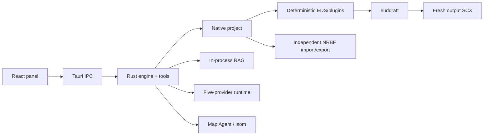

# eud-agent

> Native AI authoring for StarCraft EUD maps: canonical epScript/DAT projects, reviewable agent edits, and direct euddraft builds.

[한국어](./README.ko.md)

`eud-agent` is a standalone Windows desktop application built with Tauri 2, Rust, React, and TypeScript. Describe a map behavior in natural language; the agent reads the real project and map, retrieves pinned references, edits epScript or DAT through typed tools, shows a reviewable changeset, and builds the output map through euddraft.

EUD Editor 3 is **not** a runtime dependency. Existing `.e3s` projects can be imported and exported through an independent MS-NRBF compatibility layer.

## What it owns

- versioned `project.eap` manifest;
- confined `src/**/*.eps` and `src/**/*.py` source tree, ordered Python entrypoints, and exact EPS MainFile;
- sparse standard DAT, XDAT, TBL, requirement, and button JSON;
- deterministic EDS/plugin generation;
- direct bounded euddraft execution and structured diagnostics;
- semantic journal, accept/reject, rollback, and restart persistence;
- in-process BGE-M3 RAG and pinned epScript preflight;
- SCX/CHK map inspection and safe Map Agent mutations;
- multi-session Codex, Claude Code, Antigravity, OpenCode Go, and Ollama conversations, plans, ASK, and changeset review.

## Requirements

| Requirement | Notes |
|---|---|
| Windows 10/11 x64 | MSVC Rust target; system WebView2 runtime |
| euddraft | Latest release downloads automatically during setup; an existing folder, `euddraft.exe`, or `euddraft.py` can also be selected |
| Source map | `.scx` or `.scm` |
| AI provider | Codex, Claude Code, Antigravity, OpenCode Go, or Ollama; configure at least one during setup |
| StarCraft data | Needed by terrain/rendering features; configure when auto-detection is insufficient |

EUD Editor is optional and needed only if you choose to open an exported compatibility E3S.

## Starting a project

Every ordinary launch shows the project launcher instead of automatically reopening the saved project.

- Up to 20 successfully opened projects appear newest-first, with name/path search and list-only removal. Removing a recent entry never deletes project files.
- Open an `.eap` file or select a Native project folder.
- Create from SCX/SCM or import a legacy E3S and its referenced map into an empty folder.
- The Windows installer associates `.eap` with a dedicated project icon. Double-click the `.eap` file to start directly in that project; if the app is already running, the request goes to its existing window. Other JSON file associations are unchanged.
- Use **Switch project** in the workspace header. Builds, active agent/review work, and open map-work windows block switching. Forwarded file requests remain pending and can be explicitly retried after the work finishes.

## First-time environment setup

1. Select or create a project.
2. Let the app download the latest [armoha/euddraft release](https://github.com/armoha/euddraft), or select an existing euddraft folder/file. Downloads are SHA-256 verified and installed under `%LOCALAPPDATA%/eud-agent/euddraft`; an explicitly selected local path takes precedence.
3. Let the app verify/download checksummed RAG/model assets.
4. Select and connect an AI provider.

Already prepared environment settings are reused. Project open/create/import/export also remains available under **Settings → Project**.

## Native project layout

```text
my-project/
├── project.eap             # JSON manifest containing project settings directly
├── src/
│   ├── main.eps
│   └── bootstrap.py         # optional direct eudplib source
├── dat/
│   ├── standard.json
│   ├── xdat.json
│   ├── tbl.json
│   ├── requirements.json
│   └── buttons.json
├── maps/
│   └── source.scx
├── plugins/
├── build/
└── compat/
    └── editor-project.e3s   # imported projects only
```

The schema-v2 manifest, EPS/Python source tree, and sparse DAT JSON are canonical. EDS, generated build helpers/binaries, output SCX, and E3S are generated compatibility/build artifacts.

`.eap` means **EUD Agent Project**. It is the JSON manifest itself, containing the project name, map paths, MainFile, settings, plugins, ordered Python entrypoints, exact PyPI dependency declarations, their resolved wheel lock, and E3S compatibility metadata—not a pointer file. A project folder must contain exactly one `.eap`; renaming it preserves opening and subsequent saves. Sources, DAT, and maps remain separate files, so move the entire project folder together.

Open an old `project.json` or `.eudproj` through the legacy file-picker filter, or open its project folder, to migrate. After validation, the app atomically renames `project.json` to `project.eap` and removes the old descriptors. Coexisting old/new authorities or multiple `.eap` files are rejected rather than overwritten.

## E3S compatibility

Import/export supports:

- CUI epScript tree and MainFile;
- source/output map references;
- standard DAT and XDAT;
- TBL, requirements, and button sets;
- supported main settings and ordered EDS plugins.

GUIEps, GUIPy, RawText, and ClassicTrigger-as-MainFile are rejected explicitly instead of being silently lost. Native EPS-only projects build normally but require an imported compatibility base before E3S export. A project containing any direct Python source, entrypoint, dependency, or lock is rejected for E3S export because Editor cannot represent it losslessly.

## Direct eudplib Python

epScript remains the primary authoring language. Project-local `src/**/*.py` is first-class, fully trusted code: only manifest-selected entrypoints execute, in order, before the EPS MainFile in one frozen `euddraft.exe` process. All Python sources still participate in revision, snapshots, search, review, and rollback.

Use dependency preparation followed by `python_dependencies_set` to commit a complete exact `name==version` PyPI list. eud-agent provisions pinned `uv` 0.11.3, records every resolved wheel URL/tag/SHA-256 in `project.eap`, probes the frozen runtime, and reuses only verified `%LOCALAPPDATA%/eud-agent/python-*` caches offline. `build_run` never changes dependency state.

E3S import also copies this machine's harness associated with the **original E3S full path**: accepted documents, approved plans, project memory, the DAT wiki, and EPS/Map conversation history. Historical quoted memory/session keys are recognized. Conversations receive fresh native session IDs while retaining their names, provider/model settings, timestamps, and logs; old execution connections, pending reviews, task state, and map candidates are not resumed. Originals remain unchanged. Ambiguous bindings, unavailable files, corruption, and occupied destinations are reported as optional omissions instead of overwriting data or aborting every recoverable item. Harness data is not embedded in E3S, so the file alone cannot restore another computer's harness.

Historical accepted root-level and non-Markdown text documents are preserved; deletion tombstones never recreate files. The import review lists each unavailable item's scope, path, and reason, including missing ordinary documents/plans, memory/wiki failures, and session conflicts. **검토한 N개를 제외하고 가져오기** authorizes only the currently reviewed omissions; changed issues require renewed consent. Recheck grants no exclusions. Healthy remaining data is imported without changing originals. Core E3S/map/destination failures and failed rollback remain errors with accessible details.

Durable harness data now travels with the project: `.eud-agent/workspace/` holds accepted documents, `.eud-agent/state/` holds trusted approval metadata and the migration receipt, and `.eud-agent/memory/` holds memory and `wiki/ledger.json`. Existing AppData data is copied only when its project binding is unambiguous; originals are retained and existing local files win. The stored workspace ID survives moving the project folder. A completed migration is not replayed when a local file is later deleted. Conversations, running jobs, session workspaces, credentials, and caches remain machine-local AppData, not inside the project.

The product never executes `BinaryFormatter` or loads Editor assemblies. Real compatibility acceptance independently deserializes exported fixtures with the original .NET runtime.

## AI로 직접 검증하고 빌드하기

배포된 설치 파일을 믿지 않아도 됩니다. 아래 두 프롬프트를 Claude Code, Codex 같은 코딩 에이전트에 그대로 붙여 넣으면, 에이전트가 이 저장소의 소스를 직접 읽어 악성 코드가 없는지 검사하고(1), 검사한 그 소스로 설치 파일을 직접 빌드해 설치합니다(2). 두 프롬프트는 같은 태그를 쓰도록 짜여 있으니, (1)에서 검사한 커밋을 (2)에서 그대로 빌드하세요.

### (1) 코드 분석으로 악성 코드 검사하기

````text
너는 소프트웨어 공급망 보안 감사자다. https://github.com/raravel/eud-agent 저장소에
바이러스, 백도어, 정보 탈취, 원치 않는 원격 실행 같은 악성 동작이 있는지 소스 코드로 검사하고
한국어 보고서를 작성해라.

## 규칙
- 검사만 한다. 이 단계에서는 어떤 코드도 실행하거나 빌드하지 마라.
  `cargo build`/`cargo test`/`cargo tauri`는 build.rs를, `npm install`/`npm ci`는 패키지
  설치 스크립트를 실행하므로 금지한다. git, 파일 읽기, 검색 명령만 써라.
- 빈 폴더에 `git clone https://github.com/raravel/eud-agent.git` 한 뒤, 가장 최근 릴리스 태그
  (`git tag --sort=-creatordate` 맨 위의 `vX.Y.Z`)를 `git checkout` 하고, 그 커밋 해시를
  보고서 맨 위에 적어라. 사용자가 다른 태그나 커밋을 지정했다면 그것을 써라.
- 아래 "의도된 동작" 목록은 참고일 뿐 근거가 아니다. 각 항목이 정말 설명대로 동작하는지
  코드로 직접 확인하고, 설명과 다르면 발견 사항으로 보고해라.
- 모든 주장에는 `파일경로:줄번호` 근거를 붙여라. 확인하지 못한 것은 "미확인"으로 적어라.

## 이 앱이 무엇인가
Windows용 Tauri 2 데스크톱 앱(Rust 백엔드 `src-tauri/`, React 패널 `panel/`, C++ 지형 엔진
`native/isom/` + `crates/isom-sys`)이다. 스타크래프트 EUD 맵 프로젝트를 AI 에이전트로 편집하고
euddraft로 빌드한다.

## 의도된 동작 (검증 대상)
- 네트워크: 사용자가 고른 AI 제공자 API(Codex, Claude Code, Antigravity, OpenCode Go/Zen,
  Ollama)와의 통신, euddraft·uv·FFmpeg·RAG 모델 자산 다운로드(SHA-256 고정 검증),
  GitHub 릴리스의 업데이트 확인(`src-tauri/tauri.conf.json`의 updater endpoint, minisign 공개키).
- 외부 프로세스: euddraft, FFmpeg/FFprobe, uv, git, Codex/Claude Code CLI, SCMDraft 2 실행.
- 자격 증명: 제공자 API 키·OAuth 토큰을 로컬(Windows 자격 증명/macOS 키체인 또는 앱 데이터)에
  저장하고 해당 제공자에게만 보낸다.
- 파일: 사용자가 연 프로젝트 폴더, `%APPDATA%/eud-agent`, `%LOCALAPPDATA%/eud-agent`,
  스타크래프트 설치 폴더의 `Maps/eud-agent/`(빌드 결과 복사)에 쓴다.
- `native/trace_injector.rs`: 다른 프로세스의 메모리를 읽고 쓰는 x86 도구다. 앱이 직접 띄운
  스타크래프트 테스트 클라이언트의 단일 인스턴스 커널 객체 이름을 바꿔 사용자의 게임과 격리하는
  용도라고 되어 있다. 대상 프로세스를 어떻게 고르는지, 앱이 띄운 프로세스 외의 것을 건드릴 수
  있는지 특히 꼼꼼히 확인해라.

## 반드시 볼 곳
1. 빌드 시 실행되는 코드: `src-tauri/build.rs`, `crates/isom-sys/build.rs`, `crates/isom/build.rs`,
   `native/isom/` 의 MSBuild 프로젝트(.sln/.vcxproj의 커스텀 빌드 단계), `panel/package.json`의
   scripts, `panel/package-lock.json`에서 install/postinstall 스크립트가 있는 패키지.
2. 저장소에 커밋된 바이너리: `git ls-files` 로 .exe/.dll/.lib/.bin/.zip 등을 찾아 출처와 사용처를
   확인해라(예: `vendor/webview2/*.dll` 은 Microsoft 서명이 있어야 한다. 실행 없이
   `Get-AuthenticodeSignature` 로 서명만 확인하는 것은 허용한다).
3. 네트워크: 소스 전체에서 `https://`, `http://`, IP 주소, `reqwest`, `fetch(`, WebSocket을 찾아
   모든 목적지를 표로 정리하고, 각 목적지로 무엇이 전송되는지 적어라. 사용자의 프로젝트 파일,
   자격 증명, 시스템 정보가 사용자가 고른 AI 제공자 외의 곳으로 나가는지 확인해라.
4. 프로세스 실행: `Command::new`, `std::process`, `CreateProcess`, `ShellExecute`, PowerShell/cmd
   호출을 모두 찾아 실행 대상과 인자가 어디서 오는지 확인해라.
5. 다운로드 후 실행: 내려받은 파일을 해시 검증 없이 실행하는 경로가 있는지 확인해라
   (`vendor/ffmpeg/manifest.json`, euddraft/uv/RAG 설치 코드).
6. 권한·지속성: 레지스트리, 시작 프로그램, 예약 작업, 서비스 등록, 방화벽, UAC 상승,
   `src-tauri/installer/hooks.nsh`(설치 프로그램 훅), `src-tauri/capabilities/*.json`(웹뷰 권한).
7. 은닉 징후: 난독화, 긴 base64/hex 덩어리, 런타임 코드 생성·eval, 하드코딩된 비밀,
   빌드 환경 변수로 주입되는 값(`option_env!`, `env!`)의 용도.
8. 메모리 조작: `WriteProcessMemory`, `VirtualAllocEx`, `CreateRemoteThread`, DLL 주입,
   `PAGE_EXECUTE_READWRITE` 사용처 전부.

## 보고서 형식
1. 결론 한 줄: "악성 동작 발견 안 됨" / "의심 항목 있음" / "악성 동작 발견" 중 하나와 근거 요약.
2. 검사한 커밋 해시와 검사 범위(본 디렉터리, 보지 못한 부분).
3. 발견 사항 표: 심각도(치명/높음/중간/낮음/정보), 위치(`파일:줄`), 내용, 악성인지
   "위험하지만 의도된 기능"인지에 대한 판단과 이유.
4. 네트워크 목적지 표와 외부 프로세스 표.
5. 사람이 직접 더 확인해야 할 항목.
````

### (2) 직접 빌드해서 설치하기

````text
너는 Windows 빌드 도우미다. https://github.com/raravel/eud-agent 를 소스에서 직접 빌드해
이 PC에 설치하는 것을 끝까지 도와라. 진행 상황과 질문은 한국어로 말해라.

## 규칙
- 대상은 Windows 10/11 x64다. 다른 OS라면 멈추고 알려라.
- 무언가를 설치하거나 시스템 설정을 바꾸기 전에는 무엇을 왜 설치하는지 말하고 동의를 받아라.
  이미 설치된 도구는 버전만 확인하고 넘어가라.
- 사용자가 (1) 보안 검사에서 쓴 태그나 커밋을 알려주면 반드시 그 커밋을 빌드해라.
  없으면 가장 최근 릴리스 태그를 쓰고, 빌드한 커밋 해시를 마지막에 알려라.
- 명령이 실패하면 오류 전문을 읽고 원인을 고친 뒤 다시 시도해라. 실패를 건너뛰지 마라.

## 1. 필요한 도구 확인/설치
- Git (`git --version`). 긴 경로 문제를 막기 위해 `git config --global core.longpaths true`.
- Visual Studio 2022 Build Tools 의 "C++를 사용한 데스크톱 개발" 워크로드(MSVC v143, Windows SDK).
  C++ 지형 엔진(`native/isom`)을 MSBuild로 빌드하는 데 필요하다. 확인:
  `& "C:\Program Files (x86)\Microsoft Visual Studio\Installer\vswhere.exe" -latest -find "MSBuild\**\Bin\MSBuild.exe"`
  설치: `winget install Microsoft.VisualStudio.2022.BuildTools --override "--quiet --wait --add Microsoft.VisualStudio.Workload.VCTools --includeRecommended"`
- Rust stable(MSVC 툴체인): `rustup` 이 없으면 `winget install Rustlang.Rustup`.
  그다음 `rustup default stable-x86_64-pc-windows-msvc` 와
  `rustup target add i686-pc-windows-msvc` (빌드 스크립트가 x86 보조 도구를 함께 컴파일한다).
- Node.js LTS (`node --version`, 없으면 `winget install OpenJS.NodeJS.LTS`).
- Tauri CLI: `cargo install tauri-cli --version "^2.0.0" --locked`.
- 새로 설치한 도구가 PATH에 잡히도록 필요하면 새 터미널에서 이어가라.

## 2. 소스 받기
- 짧은 경로(예: `C:\src`)에서 `git clone https://github.com/raravel/eud-agent.git` 후
  `cd eud-agent`, `git checkout <태그 또는 커밋>`, `git rev-parse HEAD` 로 커밋을 기록해라.

## 3. 빌드
- `npm ci --prefix panel`
- 공식 릴리스는 업데이트 서명 키로 서명되는데 개인 빌드에는 그 키가 없다. 저장소 루트에
  `tauri.local.json` 파일을 만들고 내용을 `{"bundle":{"createUpdaterArtifacts":false}}` 로 써서
  업데이트 서명 단계만 끈다(소스는 수정하지 않는다).
- `cargo tauri build --bundles nsis --config tauri.local.json`
  (첫 빌드는 Rust 의존성과 C++ 엔진 컴파일로 수십 분 걸릴 수 있다. 시간 제한을 넉넉히 둬라.)
- 결과물: `target\release\bundle\nsis\eud-agent_<버전>_x64-setup.exe`.
  파일 경로와 SHA-256(`Get-FileHash`)을 사용자에게 보여줘라.

## 4. 설치
- 위 setup.exe 를 실행한다(현재 사용자 설치, 관리자 권한 불필요).
- 코드 서명이 없는 개인 빌드라 SmartScreen 경고가 뜰 수 있다. 사용자에게 "추가 정보 →
  실행"을 누르면 된다고 안내해라.
- 설치 후 앱이 실행되어 프로젝트 선택 화면이 뜨는지 사용자에게 확인받아라.

## 5. 알려야 할 차이점
- 앱은 시작 시 GitHub 공식 릴리스의 업데이트를 확인한다. 업데이트를 받으면 직접 빌드한 앱이
  공식 서명 빌드로 바뀐다. 직접 빌드한 버전을 유지하려면 업데이트 알림을 받지 말라고 안내해라.
- Antigravity 로그인에 쓰는 OAuth 클라이언트 값은 공식 빌드에만 주입되므로, 개인 빌드에서는
  Antigravity 제공자를 쓸 수 없다. 다른 제공자(Codex, Claude Code, OpenCode, Ollama)는 동작한다.

## 자주 나는 오류
- `vswhere.exe not found` / `could not locate MSBuild.exe`: 1단계의 Build Tools C++ 워크로드 누락.
  다른 위치에 있으면 `MSBUILD` 환경 변수에 MSBuild.exe 전체 경로를 지정한다.
- `i686-pc-windows-msvc` 관련 오류: `rustup target add i686-pc-windows-msvc` 누락.
- `LNK` 링크 오류나 경로 길이 오류: 더 짧은 폴더로 다시 clone 한다.
- 서명 키(`TAURI_SIGNING_PRIVATE_KEY`) 오류: `--config tauri.local.json` 을 빠뜨렸다.
````

## Development

```powershell
# Rust
cargo check -p eud-agent --lib
cargo test -p eud-agent

# Panel
npm --prefix panel ci
panel\node_modules\.bin\tsc.cmd -b panel\tsconfig.json
npm --prefix panel test -- --run
npm --prefix panel run build
```

Real build and E3S acceptance commands are documented in [`hivemind/docs/verify.md`](./hivemind/docs/verify.md).

### macOS (local development)

Windows is the release platform. macOS (Apple silicon) builds and runs for development with Xcode command-line tools, Rust, Node.js/npm, and the Tauri CLI:

```sh
cargo install tauri-cli --locked
(cd panel && npm ci)
scripts/dev_run.sh                 # cargo tauri dev; merges src-tauri/tauri.macos.conf.json
cargo test -p eud-agent
```

Platform differences on macOS:

- euddraft: select the extensionless `euddraft` launcher from the official `euddraft<version>-macos.zip` (or `euddraft.py`); the in-app update downloads the `-macos` release asset.
- App data: `~/Library/Application Support/eud-agent` (Roaming equivalent) and `~/Library/Caches/eud-agent` (LocalAppData equivalent).
- Provider API keys live in the login Keychain; provider profiles use owner-only (0700/0600) permissions.
- Codex resolves from the executable override or `PATH` (no managed download); Claude Code installs the signed `darwin` build.
- Windows-only: managed FFmpeg (sound import), managed uv / Python package dependencies, runtime trace tests (StarCraft x86 client), and the SCMDraft no-share map-lock probe.

## Architecture



See [`hivemind/docs/architecture.md`](./hivemind/docs/architecture.md), [`rules.md`](./hivemind/docs/rules.md), and [`tech-stack.md`](./hivemind/docs/tech-stack.md).

## Third-party data

The bundled `native/eud-editor-compat` resource contains open-source EUD Editor data definitions, offsets, TBL baselines, and helper source used solely as a compatibility/generation contract. Its original license is included. EUD Editor executables and assemblies are not redistributed.
