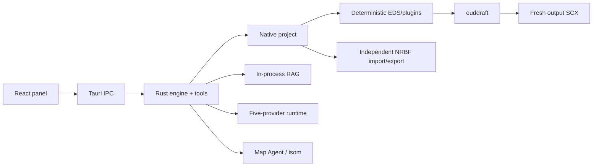

# eud-agent

> Native AI authoring for StarCraft EUD maps: canonical epScript/DAT projects, reviewable agent edits, and direct euddraft builds.

[한국어](./README.ko.md)

`eud-agent` is a standalone Windows desktop application built with Tauri 2, Rust, React, and TypeScript. Describe a map behavior in natural language; the agent reads the real project and map, retrieves pinned references, edits epScript or DAT through typed tools, shows a reviewable changeset, and builds the output map through euddraft.

EUD Editor 3 is **not** a runtime dependency. Existing `.e3s` projects can be imported and exported through an independent MS-NRBF compatibility layer.

## What it owns

- versioned `project.eap` manifest;
- confined `src/**/*.eps` and `src/**/*.py` source tree, ordered Python entrypoints, and exact EPS MainFile;
- sparse standard DAT, XDAT, TBL, requirement, and button JSON;
- deterministic EDS/plugin generation;
- direct bounded euddraft execution and structured diagnostics;
- semantic journal, accept/reject, rollback, and restart persistence;
- in-process BGE-M3 RAG and pinned epScript preflight;
- SCX/CHK map inspection and safe Map Agent mutations;
- multi-session Codex, Claude Code, Antigravity, OpenCode Go, and Ollama conversations, plans, ASK, and changeset review.

## Requirements

| Requirement | Notes |
|---|---|
| Windows 10/11 x64 | MSVC Rust target; system WebView2 runtime |
| euddraft | Latest release downloads automatically during setup; an existing folder, `euddraft.exe`, or `euddraft.py` can also be selected |
| Source map | `.scx` or `.scm` |
| AI provider | Codex, Claude Code, Antigravity, OpenCode Go, or Ollama; configure at least one during setup |
| StarCraft data | Needed by terrain/rendering features; configure when auto-detection is insufficient |

EUD Editor is optional and needed only if you choose to open an exported compatibility E3S.

## Starting a project

Every ordinary launch shows the project launcher instead of automatically reopening the saved project.

- Up to 20 successfully opened projects appear newest-first, with name/path search and list-only removal. Removing a recent entry never deletes project files.
- Open an `.eap` file or select a Native project folder.
- Create from SCX/SCM or import a legacy E3S and its referenced map into an empty folder.
- The Windows installer associates `.eap` with a dedicated project icon. Double-click the `.eap` file to start directly in that project; if the app is already running, the request goes to its existing window. Other JSON file associations are unchanged.
- Use **Switch project** in the workspace header. Builds, active agent/review work, and open map-work windows block switching. Forwarded file requests remain pending and can be explicitly retried after the work finishes.

## First-time environment setup

1. Select or create a project.
2. Let the app download the latest [armoha/euddraft release](https://github.com/armoha/euddraft), or select an existing euddraft folder/file. Downloads are SHA-256 verified and installed under `%LOCALAPPDATA%/eud-agent/euddraft`; an explicitly selected local path takes precedence.
3. Let the app verify/download checksummed RAG/model assets.
4. Select and connect an AI provider.

Already prepared environment settings are reused. Project open/create/import/export also remains available under **Settings → Project**.

## Native project layout

```text
my-project/
├── project.eap             # JSON manifest containing project settings directly
├── src/
│   ├── main.eps
│   └── bootstrap.py         # optional direct eudplib source
├── dat/
│   ├── standard.json
│   ├── xdat.json
│   ├── tbl.json
│   ├── requirements.json
│   └── buttons.json
├── maps/
│   └── source.scx
├── plugins/
├── build/
└── compat/
    └── editor-project.e3s   # imported projects only
```

The schema-v2 manifest, EPS/Python source tree, and sparse DAT JSON are canonical. EDS, generated build helpers/binaries, output SCX, and E3S are generated compatibility/build artifacts.

`.eap` means **EUD Agent Project**. It is the JSON manifest itself, containing the project name, map paths, MainFile, settings, plugins, ordered Python entrypoints, exact PyPI dependency declarations, their resolved wheel lock, and E3S compatibility metadata—not a pointer file. A project folder must contain exactly one `.eap`; renaming it preserves opening and subsequent saves. Sources, DAT, and maps remain separate files, so move the entire project folder together.

Open an old `project.json` or `.eudproj` through the legacy file-picker filter, or open its project folder, to migrate. After validation, the app atomically renames `project.json` to `project.eap` and removes the old descriptors. Coexisting old/new authorities or multiple `.eap` files are rejected rather than overwritten.

## E3S compatibility

Import/export supports:

- CUI epScript tree and MainFile;
- source/output map references;
- standard DAT and XDAT;
- TBL, requirements, and button sets;
- supported main settings and ordered EDS plugins.

GUIEps, GUIPy, RawText, and ClassicTrigger-as-MainFile are rejected explicitly instead of being silently lost. Native EPS-only projects build normally and export to E3S on a bundled blank EUD Editor 3 project when they were never imported. A project containing any direct Python source, entrypoint, dependency, or lock is rejected for E3S export because Editor cannot represent it losslessly.

## Direct eudplib Python

epScript remains the primary authoring language. Project-local `src/**/*.py` is first-class, fully trusted code: only manifest-selected entrypoints execute, in order, before the EPS MainFile in one frozen `euddraft.exe` process. All Python sources still participate in revision, snapshots, search, review, and rollback.

Use dependency preparation followed by `python_dependencies_set` to commit a complete exact `name==version` PyPI list. eud-agent provisions pinned `uv` 0.11.3, records every resolved wheel URL/tag/SHA-256 in `project.eap`, probes the frozen runtime, and reuses only verified `%LOCALAPPDATA%/eud-agent/python-*` caches offline. `build_run` never changes dependency state.

E3S import also copies this machine's harness associated with the **original E3S full path**: accepted documents, approved plans, project memory, the DAT wiki, and EPS/Map conversation history. Historical quoted memory/session keys are recognized. Conversations receive fresh native session IDs while retaining their names, provider/model settings, timestamps, and logs; old execution connections, pending reviews, task state, and map candidates are not resumed. Originals remain unchanged. Ambiguous bindings, unavailable files, corruption, and occupied destinations are reported as optional omissions instead of overwriting data or aborting every recoverable item. Harness data is not embedded in E3S, so the file alone cannot restore another computer's harness.

Historical accepted root-level and non-Markdown text documents are preserved; deletion tombstones never recreate files. The import review lists each unavailable item's scope, path, and reason, including missing ordinary documents/plans, memory/wiki failures, and session conflicts. **검토한 N개를 제외하고 가져오기** authorizes only the currently reviewed omissions; changed issues require renewed consent. Recheck grants no exclusions. Healthy remaining data is imported without changing originals. Core E3S/map/destination failures and failed rollback remain errors with accessible details.

Durable harness data now travels with the project: `.eud-agent/workspace/` holds accepted documents, `.eud-agent/state/` holds trusted approval metadata and the migration receipt, and `.eud-agent/memory/` holds memory and `wiki/ledger.json`. Existing AppData data is copied only when its project binding is unambiguous; originals are retained and existing local files win. The stored workspace ID survives moving the project folder. A completed migration is not replayed when a local file is later deleted. Conversations, running jobs, session workspaces, credentials, and caches remain machine-local AppData, not inside the project.

The product never executes `BinaryFormatter` or loads Editor assemblies. Real compatibility acceptance independently deserializes exported fixtures with the original .NET runtime.

## Verify and build it yourself with AI

You do not have to trust the published installer. Paste the two prompts below into a coding agent such as Claude Code or Codex: the agent reads this repository's source to check it for malicious code (1), then builds and installs the app from that same source (2). Both prompts target the same tag, so build in (2) the commit you audited in (1).

### (1) Audit the source for malicious code

````text
You are a software supply-chain security auditor. Inspect the source code of
https://github.com/raravel/eud-agent for malicious behavior such as viruses, backdoors,
data exfiltration, or unwanted remote execution, and write a report.

## Rules
- Inspect only. Do not run or build any code at this stage.
  `cargo build`/`cargo test`/`cargo tauri` run build.rs and `npm install`/`npm ci` run package
  install scripts, so they are forbidden. Use only git, file reading, and search commands.
- Run `git clone https://github.com/raravel/eud-agent.git` in an empty folder, `git checkout` the
  newest release tag (the top `vX.Y.Z` of `git tag --sort=-creatordate`), and put that commit hash
  at the top of the report. If the user named another tag or commit, use that instead.
- The "Intended behavior" list below is a guide, not evidence. Confirm in the code that each item
  really behaves as described, and report any difference as a finding.
- Back every claim with a `path:line` reference. Mark anything you could not confirm as "unverified".

## What this app is
A Tauri 2 desktop app for Windows (Rust backend `src-tauri/`, React panel `panel/`, C++ terrain
engine `native/isom/` + `crates/isom-sys`). It edits StarCraft EUD map projects with AI agents and
builds them with euddraft.

## Intended behavior (to verify)
- Network: traffic to the AI provider APIs the user selects (Codex, Claude Code, Antigravity,
  OpenCode Go/Zen, Ollama); downloads of euddraft, uv, FFmpeg, and RAG model assets (pinned SHA-256
  verification); update checks against GitHub releases (the updater endpoint and minisign public
  key in `src-tauri/tauri.conf.json`).
- External processes: euddraft, FFmpeg/FFprobe, uv, git, the Codex/Claude Code CLIs, SCMDraft 2.
- Credentials: provider API keys and OAuth tokens are stored locally (Windows Credential Manager,
  macOS Keychain, or app data) and sent only to that provider.
- Files: writes to the project folder the user opened, `%APPDATA%/eud-agent`,
  `%LOCALAPPDATA%/eud-agent`, and `Maps/eud-agent/` in the StarCraft install folder (a copy of the
  build output).
- `native/trace_injector.rs`: an x86 tool that reads and writes another process's memory. Its stated
  purpose is to rename the single-instance kernel object of a StarCraft test client the app launched
  itself, isolating it from the user's own game. Check carefully how it chooses its target process
  and whether it can touch any process the app did not launch.

## Must inspect
1. Code that runs at build time: `src-tauri/build.rs`, `crates/isom-sys/build.rs`,
   `crates/isom/build.rs`, the MSBuild projects in `native/isom/` (custom build steps in
   .sln/.vcxproj), the scripts in `panel/package.json`, and packages in `panel/package-lock.json`
   that have install/postinstall scripts.
2. Binaries committed to the repository: find .exe/.dll/.lib/.bin/.zip and similar with
   `git ls-files` and confirm their origin and use (for example, `vendor/webview2/*.dll` must carry a
   Microsoft signature; checking only the signature with `Get-AuthenticodeSignature`, without
   running anything, is allowed).
3. Network: search the whole source for `https://`, `http://`, IP addresses, `reqwest`, `fetch(`,
   and WebSockets; tabulate every destination and what is sent to it. Check whether the user's
   project files, credentials, or system information leave for anywhere other than the AI provider
   the user selected.
4. Process execution: find every `Command::new`, `std::process`, `CreateProcess`, `ShellExecute`,
   and PowerShell/cmd invocation, and where its program and arguments come from.
5. Download-then-execute: check for any path that runs a downloaded file without hash verification
   (`vendor/ffmpeg/manifest.json` and the euddraft/uv/RAG install code).
6. Privilege and persistence: registry, startup entries, scheduled tasks, service registration,
   firewall, UAC elevation, `src-tauri/installer/hooks.nsh` (installer hooks), and
   `src-tauri/capabilities/*.json` (webview permissions).
7. Signs of concealment: obfuscation, long base64/hex blobs, runtime code generation or eval,
   hardcoded secrets, and what values injected through build environment variables
   (`option_env!`, `env!`) are used for.
8. Memory manipulation: every use of `WriteProcessMemory`, `VirtualAllocEx`, `CreateRemoteThread`,
   DLL injection, and `PAGE_EXECUTE_READWRITE`.

## Report format
1. A one-line verdict: "no malicious behavior found" / "suspicious items found" / "malicious
   behavior found", with a summary of the evidence.
2. The audited commit hash and scope (directories covered, parts not covered).
3. A findings table: severity (critical/high/medium/low/info), location (`path:line`), description,
   and whether it is malicious or "risky but intended", with the reasoning.
4. A table of network destinations and a table of external processes.
5. Items a human should check further.
````

### (2) Build and install it yourself

````text
You are a Windows build assistant. Help me build https://github.com/raravel/eud-agent from source
and install it on this PC, all the way through.

## Rules
- The target is Windows 10/11 x64. If this is another OS, stop and say so.
- Before installing anything or changing system settings, say what you will install and why, and
  get my consent. For tools already installed, only check the version and move on.
- If I give you the tag or commit used in the (1) security audit, build exactly that commit.
  Otherwise use the newest release tag, and report the commit hash you built at the end.
- When a command fails, read the full error, fix the cause, and retry. Never skip a failure.

## 1. Check/install the required tools
- Git (`git --version`). To avoid long-path problems: `git config --global core.longpaths true`.
- The "Desktop development with C++" workload of Visual Studio 2022 Build Tools (MSVC v143,
  Windows SDK). It is needed to build the C++ terrain engine (`native/isom`) with MSBuild. Check:
  `& "C:\Program Files (x86)\Microsoft Visual Studio\Installer\vswhere.exe" -latest -find "MSBuild\**\Bin\MSBuild.exe"`
  Install: `winget install Microsoft.VisualStudio.2022.BuildTools --override "--quiet --wait --add Microsoft.VisualStudio.Workload.VCTools --includeRecommended"`
- Rust stable (MSVC toolchain): if `rustup` is missing, `winget install Rustlang.Rustup`.
  Then `rustup default stable-x86_64-pc-windows-msvc` and
  `rustup target add i686-pc-windows-msvc` (the build script also compiles an x86 helper tool).
- Node.js LTS (`node --version`; if missing, `winget install OpenJS.NodeJS.LTS`).
- Tauri CLI: `cargo install tauri-cli --version "^2.0.0" --locked`.
- If newly installed tools are not on PATH yet, continue in a new terminal.

## 2. Get the source
- In a short path (for example `C:\src`), run `git clone https://github.com/raravel/eud-agent.git`,
  then `cd eud-agent`, `git checkout <tag or commit>`, and record the commit with `git rev-parse HEAD`.

## 3. Build
- `npm ci --prefix panel`
- Official releases are signed with the update signing key, which a personal build does not have.
  Create `tauri.local.json` in the repository root containing
  `{"bundle":{"createUpdaterArtifacts":false}}` to turn off only the update-signing step (the
  source stays unmodified).
- `cargo tauri build --bundles nsis --config tauri.local.json`
  (the first build can take tens of minutes compiling the Rust dependencies and the C++ engine;
  allow a generous timeout.)
- Output: `target\release\bundle\nsis\eud-agent_<version>_x64-setup.exe`.
  Show me the file path and its SHA-256 (`Get-FileHash`).

## 4. Install
- Run that setup.exe (per-user install; no administrator rights needed).
- A personal build has no code signature, so SmartScreen may warn. Tell me to click
  "More info → Run anyway".
- After installing, have me confirm the app starts and shows the project launcher.

## 5. Differences to tell me about
- The app checks GitHub's official releases for updates at startup. Accepting an update replaces
  the self-built app with the officially signed build. To keep your own build, decline the update.
- The OAuth client values used for Antigravity login are injected only into official builds, so the
  Antigravity provider is unavailable in a personal build. The other providers (Codex, Claude Code,
  OpenCode, Ollama) work.

## Common errors
- `vswhere.exe not found` / `could not locate MSBuild.exe`: the Build Tools C++ workload from step 1
  is missing. If MSBuild lives elsewhere, set the `MSBUILD` environment variable to the full path of
  MSBuild.exe.
- Errors mentioning `i686-pc-windows-msvc`: `rustup target add i686-pc-windows-msvc` is missing.
- `LNK` link errors or path-length errors: clone again into a shorter folder.
- Signing key (`TAURI_SIGNING_PRIVATE_KEY`) errors: `--config tauri.local.json` was left out.
````

## Development

```powershell
# Rust
cargo check -p eud-agent --lib
cargo test -p eud-agent

# Panel
npm --prefix panel ci
panel\node_modules\.bin\tsc.cmd -b panel\tsconfig.json
npm --prefix panel test -- --run
npm --prefix panel run build
```

Real build and E3S acceptance commands are documented in [`hivemind/docs/verify.md`](./hivemind/docs/verify.md).

### macOS (local development)

Windows is the release platform. macOS (Apple silicon) builds and runs for development with Xcode command-line tools, Rust, Node.js/npm, and the Tauri CLI:

```sh
cargo install tauri-cli --locked
(cd panel && npm ci)
scripts/dev_run.sh                 # cargo tauri dev; merges src-tauri/tauri.macos.conf.json
cargo test -p eud-agent
```

Platform differences on macOS:

- euddraft: select the extensionless `euddraft` launcher from the official `euddraft<version>-macos.zip` (or `euddraft.py`); the in-app update downloads the `-macos` release asset.
- App data: `~/Library/Application Support/eud-agent` (Roaming equivalent) and `~/Library/Caches/eud-agent` (LocalAppData equivalent).
- Provider API keys live in the login Keychain; provider profiles use owner-only (0700/0600) permissions.
- Codex resolves from the executable override or `PATH` (no managed download); Claude Code installs the signed `darwin` build.
- Windows-only: managed FFmpeg (sound import), managed uv / Python package dependencies, runtime trace tests (StarCraft x86 client), and the SCMDraft no-share map-lock probe.

## Architecture



See [`hivemind/docs/architecture.md`](./hivemind/docs/architecture.md), [`rules.md`](./hivemind/docs/rules.md), and [`tech-stack.md`](./hivemind/docs/tech-stack.md).

## Third-party data

The bundled `native/eud-editor-compat` resource contains open-source EUD Editor data definitions, offsets, TBL baselines, and helper source used solely as a compatibility/generation contract. Its original license is included. EUD Editor executables and assemblies are not redistributed.
