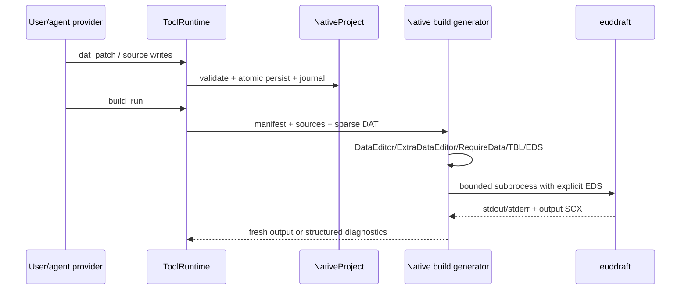

# Architecture

## Built-in browser (2026-10-18)

The app owns one process-wide "브라우저" window (`browser.rs`, `browser/`, Windows only). It is
created on the first browser tool call, without taking focus, and is not bound to a project: a
chrome webview (`browser`, `panel/browser.html`) draws the tab strip, address bar, session badges
and downloads, and every tab is its own child webview (`browser-tab-<n>`, `Window::add_child`,
Tauri's `unstable` feature) laid over the rest of the window. Inactive tabs stay at the active
tab's rect behind it, because a hidden or zero-sized WebView2 reports `visibilityState=hidden`
and never answers `Page.captureScreenshot`. Every tab uses one separate WebView2 user data folder
(`LocalAppData/eud-agent/browser/profile`, wry's own `--disable-features` arguments restated), so
sign-ins are shared by every tab, kept across runs, and never shared with the app windows. A tab
needs a WebView2 runtime with `ICoreWebView2_18`: the popup and external-scheme guards
(`cdp::install_page_guards`) are installed before anything loads, and a tab whose guards fail is
not created. A popup (`on_new_window`) never becomes a window: it opens as a new tab of the
opener's session only when a person's gesture (`IsUserInitiated`) or a running agent interaction
opened it, at most three per session in 10 s, and while the session has fewer than ten tabs
(`PopupGate`; `MAX_TABS_PER_SESSION` also refuses `browser_open`); any other popup is dropped. A
popup is the agent's only when the opener was `Interacting` (not merely read): it is then checked
with `validate_agent_url`, runs under the opener's interaction context (including one still in
its grace), arms script interception before it loads, and leaves its own grace. Tab webviews are
in no capability; only the chrome is (`capabilities/browser.json`, `core:event:default`), and its
commands (`browser_state`, `browser_activate`, `browser_tab_close`, `browser_user_navigate`,
`browser_chrome_expand`) refuse any caller but the `browser` webview. A remote page sees the IPC
object but every call is refused by the ACL. Chrome state (`browser-state-changed`) is emitted at
most once per 150 ms (`EMIT_INTERVAL`, trailing edge) on an async task, never on the UI thread
page events arrive on. The session titles it shows come from a cache; a cache older than 2 s
(`TITLES_TTL`) is refreshed from the session list on a blocking worker, never on the calling
thread (`browser_state` is answered on the UI thread), which then emits the state again.

The agent drives a tab through the DevTools Protocol called in-process (`cdp.rs`:
`CallDevToolsProtocolMethod`/`CallDevToolsProtocolMethodForSession` and
`GetDevToolsProtocolEventReceiver` on the tab's `ICoreWebView2`, bridged to the UI thread with a
oneshot per call); no debugging port and no `WEBVIEW2_ADDITIONAL_BROWSER_ARGUMENTS` exist.
`TabRegistry` keeps `{tabId, sessionId, projectId, label, url, title}`: a session sees and uses
only its own tabs (another session's id is "탭을 찾을 수 없습니다"), a tab the user closed answers
"사용자가 탭을 닫았습니다", deleting a session closes its tabs and forgets its
downloads, a research worker's tabs close when its turn ends (settled, failed or cancelled), and a
project close (`ProjectRegistry::subscribe_closed`) closes that project's tabs. The window
closes with its last tab, whoever closed it (the user's ×, `browser_close`, a session delete, a
worker's end, a project close), and the next `browser_open` makes it again. A tab loads http(s), `about:`, `data:` and `blob:` documents only;
`tauri:`, `ipc:`, `asset:`, `file:`, external protocol handlers, `*.localhost` and, in a debug
build, the `build.devUrl` origin that serves the app's own pages never load, in a tab or an iframe
(`page_navigation_allowed`, also applied to every paused request; `LaunchingExternalUriScheme` is
cancelled, so no OS handler starts).

An agent load never reaches this computer or the local network, checked at three stages. (1) URL:
an agent tool opens only public http(s) hosts (`validate_agent_url`): loopback, private,
link-local, CGNAT, broadcast and unspecified addresses (IPv4-mapped IPv6 included), single-label
names, `.localhost`/`.local`/`.lan`/`.internal`/`.home.arpa`/`.localdomain`/`.ts.net` names and
wildcard-DNS domains that spell or point at loopback (`WILDCARD_LOOPBACK_DOMAINS`: `nip.io`,
`sslip.io`, `xip.io`, `localtest.me`, `lvh.me`, `localho.st`, `vcap.me`, `traefik.me`) are
refused. (2) Every hop: each Document request an agent call drives (a redirect pauses again)
repeats that host check (`fetch_decision` → `Internal`) and then resolves the name
(`resolves_to_local`, `tokio::net::lookup_host`, 2 s `LOOKUP_WAIT`; a slow or failed lookup falls
through to stage 3). A refused main-frame load marks the tab `internal`, and every later read of
it refuses until the next main-frame load starts. (3) Response: `Network.enable` (no buffering)
runs in the page and every guarded frame, and `Network.responseReceived` for a Document whose
`remoteIPAddress` is local navigates the tab to `about:blank` and marks it `internal` when an agent
call drove that request (tracked by DevTools session + network id). Every locally answered page,
the user's too, is remembered (`local_pages`, 64), and the agent's back/forward refuses a history
entry that is a local host or one of those pages (`require_public_history_entry`), since the
back/forward cache restores it without a request. A navigation the user starts from the chrome
(`browser_user_navigate`: address bar, back, forward, reload) is the user's within an
interaction's grace (`UserNavigation`): an address navigation is the document request whose
network id is the loader `Page.navigate` reported; a reload or back/forward (no loader reported)
is the first main-frame GET document request, within 5 s (`USER_NAVIGATION_WAIT`, a backstop).
That request and its redirect hops (same `networkId`) are decided as `Driver::User`, so the user
may still open their router, NAS or dev server. The match ends when the main frame commits
(`Page.frameNavigated` with that loader, or any commit while unmatched, or a same-document
move) and when starting the navigation fails. While any agent call runs on the tab, or an agent
interaction's 3 s grace has not ended (`AgentCalls::acting` is not `Driver::User`), no request is
the user's (`UserNavigation::claims_while`): every document request is checked as the agent's, so
a navigation a page script starts after an agent click is never taken for the user's pending
reload. By design, a page the USER opened on an internal address (their router, NAS, dev
server) is the user's own navigation: it stays loaded and the agent may read it with
`browser_snapshot`/`browser_screenshot` (the tab is not marked `internal`), because the user
chose to open it in the agent's browser; only the agent's own loads, history moves and fetches
are kept off local addresses. `browser_download`'s own page fetch
passes the DNS check first, and its response address is checked too (`FetchWatch`): while a page
fetch is watched, `Network.responseReceived` for `Fetch` responses records the `remoteIPAddress`
of that URL's response, and a local address (DNS rebinding after the check) drops the fetched
blob and refuses with the internal-address refusal; an address that does not arrive within 3 s
(`FETCH_ADDRESS_WAIT`) also refuses (fail closed).

Thirteen tools (`tools.rs` `BROWSER_TOOLS`, registered only `cfg!(windows)`), all read tools
needing no write registration, run on the async browser branch of the tool gate
(`SessionToolRuntime::browser_for_run`, an injected executor like `ask`), and stay within the 240 s
tool bound (150 s; 230 s for an action that may wait for a confirmation). Reads
(`BROWSER_READ_TOOLS`): `browser_open`, `browser_navigate` (url, back, forward, reload; 30 s load
wait), `browser_snapshot` (the accessibility tree as `[ref] role "name"` lines, refs `e1..` that
expire on navigation, 36 KiB pages with `offset`, marked untrusted; walked iteratively on an
explicit stack, never recursively, and cut below 256 levels with one "… omitted" line),
`browser_screenshot` (viewport or full page, at most 5 MiB and 7900 px a side), `browser_tabs`,
`browser_close`, `browser_wait` (text or ms, ≤ 30 s). Interactions: `browser_click`,
`browser_type`, `browser_press`. Downloads: `browser_download`, `browser_downloads`,
`browser_save`. The main EPS session gets all thirteen; a research worker gets the seven reads
(`WorkerProfile::permits`); map_research and implementation workers, Map sessions
(`map_tool_registry`) and the remote dispatch allowlist get none. A phone that runs an EPS turn
reaches the tools through that turn, never the window. `data/prompts/browser.md`
(`[built-in browser]`) is appended to the static baseline of a session offered browser tools, and
with a `[browser: read only]` note to a research worker's baseline; it is hashed with the baseline,
so it reaches no session without the tools.

`browser/policy.rs` holds the rules the app enforces whatever the model was told. The agent never
types into a credential field (`type=password`, `current-password`/`new-password`/
`one-time-code`/`cc-*` autocomplete, password/카드번호-like names): the user enters it in the
window. Element facts are read in an isolated world of the main frame (`Page.createIsolatedWorld`
`eud-agent-facts`, made once per navigation), where page script cannot replace the DOM methods
they call; when the world cannot be made they fall back to the page's own world. A click (or a key
press that amounts to one) on a control whose accessible name, labels or text match
`SENSITIVE_TERMS` (결제, 구매, 구독, 탈퇴, 삭제, 비밀번호 변경, pay, checkout, delete account, ...;
"내역/조회/history" labels excepted) waits for the user. Enter or Space (`browser_press`, and
`browser_type` with `submit`) is checked as a click (`key_activation`): on the focused control
itself, or for Enter in a text input on the form's default button; typing keys and Space in a text
field are not activations. The focused element is followed into open shadow roots and same-origin
frames (`FOCUSED_JS`); when focus sits on an iframe, frame, object or embed (a cross-origin
document), or cannot be read at all, the key is refused (`KEY_TARGET_UNKNOWN`) and the model is
told to `browser_click` a snapshot ref instead. A click presses the centre of the element's box
only when `DOM.getNodeForLocation` there hits that element, something inside it or one of its
labels; an overlay drawn over it refuses the click.

Every tab pauses requests (`Fetch` domain) in its page target and in every child target. Document
requests are always paused; XHR, Fetch and Ping (`sendBeacon`, `<a ping>`) are added
(`SCRIPT_PATTERNS`) only while an agent interaction (click, type, press, download) runs and for its
3 s grace (`AGENT_GRACE`), where they are checked only against the app's own origins, and switched back afterwards (`arm_scripts`/`schedule_disarm`, serialized with child
guarding under one `arming` lock), so the user's and a reading agent's page traffic never round
trips through the app. An `Interaction` guard holds the call's agent scope and schedules the
switch back when dropped, so an interrupted call (a timeout, a dropped future, a failed arm) never
leaves the tab's script requests paused. Arming fails closed: when the patterns cannot be switched
on in the page, or in a child target that is still attached, the interacting call is refused
before it acts. `Network.setBypassServiceWorker` keeps a service worker from answering the
page's requests where the page's Fetch would not see them. `Target.setAutoAttach` (flatten,
waiting for the debugger) attaches every child target, and `guard_frame_target` sets it up through
`CallDevToolsProtocolMethodForSession` before `Runtime.runIfWaitingForDebugger`: an iframe or page
gets `Network.enable`, bypassed service workers, `Fetch.enable` with the tab's current patterns and
its own auto-attach; a dedicated, shared or service worker gets `Fetch.enable` (and auto-attach
where it can). A target whose required step fails stays paused before its first instruction (fail
closed). The one exception is a dedicated worker whose `Fetch.enable` answers -32601 (no Fetch
domain): it is resumed, because its requests pause in the owning page or frame (verified live).
Worklets make no requests of their own and resume at once.

Submissions and data-sending requests are never held for the user (user decision 2026-11-11:
pages send analytics and CDN traffic all the time, and a card per domain only got in the way): a
document POST or a POST/PUT/PATCH/DELETE script request continues at once, whoever caused it and
whatever its domain. Only a sensitive click (above) is confirmed. A confirmation is a one-question
ask card (`browser_confirm`, header "브라우저 확인", 허용/거부, ask event `kind: "browser_confirm"`, so
the desktop and phone cards say that no answer is a refusal and offer no free-text answer) on the
session, at most 200 s (`CONFIRM_WAIT`); only 허용 allows, and no answer, a cancel or no one to ask
refuses. A session shows one confirmation card at a time (`SessionToolRuntime::confirm_with_user`,
shared with agent-instruction writes): a second waits for the shown one to settle, within its own
wait, and is then asked. A confirmation that never reached the user (its wait spent queued, the
model's own `ask` pending, a worker session, no time left, or more than two open or waiting,
`MAX_OPEN_CONFIRMATIONS`) is `ConfirmAnswer::Unasked`: refused, but the tool says the user could
not be asked (`CLICK_UNASKED`), never that the user refused; a refusal returns a "do not retry"
error (`CLICK_DENIED`). While a card waits, another tool call of the session is refused with a
message naming the 브라우저 확인 card. The chrome shows the tab as "에이전트 조작 중"
during a call and "확인 대기" while a confirmation is pending; the mark is held by a
`ConfirmationSlot` guard, so it clears however the confirmation ends (also when its call is
cancelled mid-wait). Clicks and typing are refused on a
tab that is not an ordinary http(s) page.

The chrome draws Chrome-style tabs: at most 240 px, shrinking to 100 px before the strip scrolls,
the title cut with an ellipsis and the close button at the right. A tab's one icon slot shows, in
order, 확인 대기, the agent spinner, its newest download, or a page globe; its session is a coloured
stripe on top (`sessionColor`, the theme's chart colours by session id) and its accessible name and
tooltip, and the active tab's session is named beside the address bar.

Every download of every tab, the agent's or the user's, lands in its own folder under
`LocalAppData/eud-agent/browser/downloads/<uuid>/` (`downloads.rs`); one that would exceed 64 MiB
is cancelled, and folders older than a day are removed at start. A session lists only its own
tabs' downloads. `browser_download` clicks a ref, fetches a URL with the page's cookies, or waits
for a download the page already started, within `timeoutMs` (default 60 s, ≤ 120 s). The page
fetch (`redirect: "manual"`, read out of the page in 2 MiB chunks after the Content-Length, the
blob size the page reports and every chunk's length are checked against 64 MiB, and the file is
created and written on blocking workers) follows no
redirect, because no hop of it is checked; a redirecting, cross-origin or otherwise unfetchable
URL is instead loaded by navigating the tab, hop by hop under the request policy, and read from
where it ended, and the result says the tab moved. Audio is bound to the request as an audioRef
(`register_audio_bindings`), so `audio_ffmpeg` and `map_sound_import` use it without a project
copy; a PNG/JPEG/GIF/WebP up to 5 MiB returns as an image. `browser_save` copies a completed
download into the project (`save_target`): root-confined through `fs_tools::resolve`, never
`.git`, `.claude`, `.codex`, an agent-instruction path (`fs_tools::is_agent_instruction_path`: under
a top-level `.claude`/`.codex`/`.gemini`/`.cursor`/`.github`/`.agents`/`.clinerules`, the
editor files that run or steer tools (`.vscode/{settings,tasks,launch,extensions,mcp}.json`,
`.idea/workspace.xml`, `.idea/watcherTasks.xml`, `.idea/startup.xml`, `.idea/runConfigurations/**`), or `CLAUDE.md`,
`CLAUDE.local.md`, `AGENTS.md`, `AGENTS.override.md`, `GEMINI.md`, `SKILL.md`, `.mcp.json`,
`.cursorrules`, `.windsurfrules`, `.clinerules` at any depth, any case), the whole top-level
`.vscode`/`.idea`/`.github` (a download destination never needs editor state, so `browser_save`
keeps refusing those folders entirely), `.eud-agent`, `src/`, `dat/`, `maps/`, `references/`, `build/`, `compat/` or the
root manifest (`project.eap`, any root `*.eap`, legacy `project.json`/`*.eudproj`); only `ogg wav mp3 flac png jpg
jpeg gif webp bmp txt md json csv` matching the bytes; an existing file only with `overwrite`.
The written path is claimed by the request and committed with its turn. The chrome's download
indicator opens a list that expands the chrome webview over the tab area while open
(`browser_chrome_expand`).

Every project path, on every platform (`native_project::normalize_relative_with`, behind
`fs_*`, `browser_save` and the manifest), refuses a component that ends in a dot or a space,
contains `:<>"|?*` or a control character, or whose stem is a device name (`CON`, `PRN`, `AUX`,
`NUL`, `CONIN$`, `CONOUT$`, `COM0`-`COM9`, `LPT0`-`LPT9`, superscript digits included) whatever its
extensions, because Windows would open a different file than the one checked. The refusal names
the path and the rename ("파일·폴더 이름을 바꾸세요", with a suggested name), so a project brought from
macOS with `src/aux.eps` opens with that recovery instead of an opaque error. A stored `outputMap`
is the one exception at open: one written before these rules (an E2 title "Zerg: Rush") still
opens as long as it stays inside the root, and the build (`output_map_path`) refuses it naming the
rename (`settings_set SaveMapName`); a new default output map keeps the title the way
`release::file_title` does (`default_output_map("Zerg: Rush")` is `build/[EUD]Zerg Rush.scx`).
`fs_tools::resolve` canonicalizes the root first (any spelling of it compares) and then the
deepest existing ancestor and appends the rest, so a write policy (`.claude`, `maps/`, ...) is
decided on the folder on disk (its case, an 8.3 short name), and an `fs_write`/`fs_edit` claim
records that resolved path, the one the write lands on and git reports.

Agent-instruction files (2026-10-24 decision) are written only with the user's consent. An
`fs_write`/`fs_edit` of the main EPS session to an agent-instruction path the write boundary
otherwise allows (`instruction_write_needs_confirmation`) runs on the async branch of the tool
gate: `confirm_instruction_write` shows a one-question card (`instruction_write`, header "지시 파일
수정 확인", ask event `kind: "instruction_write"`, the path and whether it creates, overwrites or
edits, and a `preview` of what would be written, within 2000 bytes: an `fs_write`'s size and
the first and last 700 bytes of its content, or every edit's count and sizes with the first and
the last edit's old/new text always shown (80 bytes from each end) and the ones between while they
fit; blank runs at either end are collapsed into a note of how much they held, and control,
bidirectional and invisible characters (every general-category `Cf` character, tag characters
U+E0000–E007F included, every `Default_Ignorable_Code_Point` such as variation selectors, U+00AD,
U+034F and the Hangul fillers, and U+2028/U+2029, from the `regex` crate's Unicode tables) are
written out as `\u{XXXX}`, in the path too; 허용/거부, at most
200 s; desktop and phone render it like a browser confirmation, no free text, expiry is a refusal)
through the same one-card-at-a-time queue. 허용 records a one-shot approval bound to that request,
tool, resolved path and the SHA-256 of the call's exact arguments; `execute_scoped` runs only the
call that matches it (another call leaves it in place), and the allowed write passes the pending-
ask refusal, since it completes the confirmation itself. The allowed call keeps the session's card
slot until it ran, so a queued card is shown only after the write the user allowed. Only the
wait for the answer ends when the run's tool gate closes (a cancel); once allowed, the write runs
to completion holding its gate admission and that slot, so a drain counts it and its completion is
recorded. Without the
approval the write refuses. 거부 or no answer returns a "do not retry" error; a card that could not
be shown says so. Workers (every profile) and Map sessions are refused outright with a message that
the parent or the user must make the change. Ordinary `.md`/`.txt` documents stay free for every
role.

`.claude/` is not asked at all (user decision 2026-10-24): every write under it, documents
included, is refused by the write boundary for every role, because Claude Code's
`validate_workspace_boundary` refuses every turn once the project holds a `.claude/` folder; the
refusal says so and tells the model to have the user remove or change it. Provider permission
settings (a root `.mcp.json`, non-document `.codex/` entries) keep their plain refusal too.

A provider's own file tools never reach an instruction file: Claude Code runs with
`--disallowedTools` `Edit(...)` rules for every path the predicate names
(`fs_tools::agent_instruction_globs`: `<folder>/**` per folder, the editor files by path,
`**/<name>` per file name in its CLI spelling and in lower case; `Edit` covers `Write`), reading
stays open. Codex's write profile (`workspace_write_profile`, built when the app-server starts in
the project root) keeps the top-level instruction folders, the root instruction files and the
guarded editor files inside a root `.vscode`/`.idea` that exist at that moment
(`existing_instruction_entries`) read-only, in their on-disk spelling, so a patch to one asks for
approval; one that does not exist gets no entry, because Codex's Windows sandbox materializes a
missing explicit read-only path as an empty folder of that name (an `AGENTS.md` folder, or a
`.claude` folder that stops every Claude turn). The adapter restarts the app-server before a turn
whenever that set changed since it started (`client_reusable`), so a deleted read-marked path is
never materialized and a new one is not left writable, and the turn-end sweep below deletes an
instruction file created during a turn. Every app-server runs with `features.unified_exec=false`:
native commands run in the classic shell tool to completion inside their turn, so no background
terminal outlives the turn and writes between turns. The approval handler declines `item/fileChange/requestApproval` (paths from
that item's `item/started`) and `applyPatchApproval` (its `fileChanges`) when any path it touches
could be an instruction file or when its paths cannot be determined. `touches_agent_instructions`
judges a path relative to the app-server's cwd (the project root, canonical or as given,
case-insensitive on Windows): a relative path is root-relative, an absolute path outside the root
is declined, and only a client without a known root falls back to "some tail of the path is one".
Codex's profile keys under `:workspace_roots` take `read`/`write` only for exact paths (a trailing
`/**` is the same subtree); a glob such as `**/AGENTS.md` is accepted only for `deny`, which would
also hide the file from reading, so nested instruction files cannot be made read-only there. The model then uses `fs_write`/`fs_edit`, which shows the
card.

Whatever still reaches an instruction file without the card is put back when the turn ends
(user decision 2026-10-24, `instruction_guard.rs`). Each command that runs a foreground turn
(`chat_with_request_id` for EPS main, worker, Map and team sessions, `plan_feedback`,
`continue_pending_write`, `autonomous_resume`) captures an `InstructionGuard` first: a scan of the
real project tree for every instruction path (`is_agent_instruction_path`, plus the instruction
folders themselves), recording files with their bytes (≤ 1 MiB each, 16 MiB per baseline; larger
ones by SHA-256 only), folders, and links by target; it skips `.git` folders and the guard's own
files (the backup folder below and `.<name>.<uuid>.eud-restore` temporaries), never descends into
or follows a symlink or junction, and stops at 50,000 entries, which marks the baseline
incomplete. One mechanism serves every project, with or without git. Only the outermost guarded
command of an engine captures, always afresh; its `InstructionGuardScope` ends the baseline on
every exit, and when it is dropped without its normal end (a panic, a dropped command future) the
last one out still sweeps on a blocking thread, so a stale baseline is never reused. That sweep
counts as pending (`instruction_sweeps`) until it is done; the engine's next guarded command waits
for it, at most 30 s, before it takes its baseline or makes the external-edit commit, then tells
the user its report as a `GitTurnEvent` warning and queues the model's `[instruction files
reverted]` note (`orphan_instruction_reports`). Each `InstructionGuard` registers with the
coordinator (`open_instruction_guard`, which hands out its `since` in the same step) and
unregisters when it drops, after its last sweep.

Every `commit_boundary` (each autonomous iteration's included) and every command exit sweeps. The
tree is scanned first, outside any lock (`Snapshot::current`); then, inside the `git_scope`
transaction, every path the scan shows changed, or that an incomplete scan did not reach, is read
again directly (`probe`, through plain folders only) before anything is restored or deleted, so
an incomplete end scan never rewrites a baseline path it did not see, and a path that cannot be
examined is reported unchecked, never created. A sweep's target for a path is the newest record
of the `git_scope` after its baseline in `ProjectWriteCoordinator`'s settled store — an allowed
`fs_write`/`fs_edit` (`record_instruction_write`, inside the transaction the write runs in), what
any session's sweep restored (a file, a recreated folder, or a tombstone for a deletion,
`record_instruction_settled`), or what a history revert (`git_revert`, `worker_revert`) left
(`settle_commits`, inside that revert's transaction) — otherwise its turn-start state. So when
two sessions' turns overlap and one injected a file the other's baseline then captured, the first
sweep's restore becomes the settled content and the second sweep leaves it. The sweep restores a
file through a same-folder temporary file and a rename, deletes a file or link the turn created (a
link as a link), removes created instruction folders deepest first and recreates deleted ones (a
folder someone else recreated meanwhile is not reported). Before it overwrites or deletes
anything it copies the replaced bytes (a link as `<path>.link` with its target; nothing followed;
≤ 16 MiB) to `.eud-agent/state/instruction-reverted/<millis>-<id>/<relative path>`, named in the
warning; when that copy fails, nothing is overwritten or deleted and the path is reported. The
folders on the way are re-verified (plain folders, still under the root) right before and right
after each rename or removal, and a failed post-check is reported. Because the scan reads the tree
as it is, a write through a case variant (`Agents.md`), an 8.3 name (`CLAUDE~1.MD`) or a nested
path lands on the one entry it reached and is caught.

Reverted paths, paths it could not restore (a folder in a file's place, a link, a file too large
to keep, a failed backup, an unreadable entry) and paths it could not judge are excluded from the
turn commit (`commit_owned_paths_with` `excluded`, which also excludes everything inside an
excluded folder); a failure is reported once per turn. A path left in place is held per
`git_scope` with its state then (`hold_instruction_paths`): while it stays exactly so it is kept
out of every later turn commit and out of the turn-start external-edit commit too (warned "승인 없이
바뀐 채 남아 있는 지시 파일을 이번 커밋에서도 뺐습니다"), and released once anything changes it.
`git::dirty_paths` never lists the guard's own files. The user sees the `GitTurnEvent` warning
("승인 없이 바뀐 지시 파일을 되돌렸습니다: …", at most 20 paths named), and the next foreground run
appends a bounded `[instruction files reverted]` note telling the model to use
`fs_write`/`fs_edit`. A hand edit the user makes to an instruction file while a turn runs is
reverted too (accepted by the user); one made between turns is the user's and the next baseline
takes it, since no native command outlives its turn (`features.unified_exec=false`).

`.idea/workspace.xml` is watch-only (`fs_tools::is_watch_only_instruction_path`): an open JetBrains
IDE rewrites it constantly, so putting it back would fight the IDE every turn. It keeps the card for
`fs_write`/`fs_edit` and the native-CLI blocks, but a sweep never restores or deletes it: a change
nothing settled is listed as `watched`, excluded from the turn commit and held with the state
`watch`, which `held_paths` keeps while the file differs from HEAD (whatever the IDE writes
meanwhile) and releases once it is committed or reverted outside the app, or settled by an allowed
write (`record_approved`) or a history revert. Only a change to a component that can make the IDE
run something (`EXECUTABLE_IDE_COMPONENTS`: run configurations, startup tasks, file watchers,
external tools, Gradle/Maven tasks bound to a sync) is told: `executable_components` parses both
sides with `quick-xml` into a canonical form per `<component>` child of the root, and a component
that is new or differs (or content that cannot be parsed or was not kept) puts the file in
`watched_risky`, copies its turn-start bytes into the sweep's backup folder, warns once per turn
("IDE 설정 파일의 실행 구성(…)이 승인 없이 바뀌어 커밋에서 뺐습니다. …: <paths>", naming that folder) and
names it in the model note. Layout and other IDE bookkeeping stays quiet, in the sweep and in
`held_warning`. A watch-only file git does not report dirty (gitignored, as JetBrains projects usually ignore
`workspace.xml`, or equal to HEAD) is neither excluded nor held, since no commit would take it; a
run-capable component that changed against the turn baseline is still backed up and told once per
turn (`watched_untracked`: "…이 승인 없이 바뀌었습니다. git이 커밋하지 않는 파일이라 그대로
두었습니다. …"), with the same model note, because the risk is the IDE running it. Other rewrites of
it stay silent. `.idea/startup.xml` (the shared Startup Tasks list) is not rewritten by the IDE on its
own, so it is an ordinary guarded file: reverted like `AGENTS.md`.

Besides what its own sweep excluded or holds, every turn commit leaves out each instruction path
that differs from HEAD with nothing settled for it after the turn's `since`, or settled on other
content than it now has (`unsettled_paths`): the turn's own unapproved changes were put back and its
allowed writes recorded, so such a path is another session's unapproved change (one this turn's
baseline captured before that session's sweep ran) or a sweep still due. The turn-start
external-edit commit leaves them out only while another guard of the `git_scope` is registered (a
running turn of another session, or a dropped command's sweep still pending); with none they are the
user's between-turn edits and are recorded. The settled store drops every record at or below the
oldest registered guard's `since` and the whole scope when its last guard ends, so it stays bounded
without losing a tombstone a running guard still reads; `release_project` (the project close beside
`ProjectRegistry::close`) clears the project's settled records, held paths and load marker, unless a
guard of the scope is still registered: then the scope is only marked closing, a late sweep still
sees what the project settled on, and the last guard's `close_instruction_guard` clears it. Such a
sweep's report has no window: the engine checks `instruction_scope_closing` before the guard ends and
writes the report to `.eud-agent/state/instruction-reports.json` instead (also when the engine is
gone), and the project's next guarded command (`begin_instruction_guard`) takes the file and tells
the user and the model. `end_instruction_guard` hands the baseline to the sweep's blocking thread
(`spawn_final_sweep`), so a dropped command future still ends its guard and its report reaches the
next command through the orphan reports. Held
paths persist in `.eud-agent/state/instruction-held.json` (sorted UTF-8 JSON without BOM, temporary
file + rename, removed when empty, a guard-own path no commit takes) and are read back the first
time a scope asks after a restart or reopen, so they stay held and the first turn's commit warning
names them again. A sweep that makes a backup prunes `.eud-agent/state/instruction-reverted/` to the
newest 20 `<millis>-<8 hex>` folders at most 14 days old, always keeping the folder it just made,
keeping a folder dated up to a day in the future without counting it, and touching only plain
folders named so (links are neither followed nor removed).

Settings → 브라우저 explains the shared window and sign-ins and offers 로그인 데이터 초기화
(`browser_profile_reset`, main windows only, not in the remote allowlist) behind a confirmation
dialog: holding the window-creation lock, it refuses while the window or any tab exists
("브라우저 창을 닫은 뒤 다시 시도하세요"), otherwise forgets every download record and deletes
`browser/profile` and `browser/downloads`. It refuses a folder not named so and a link or junction
in place of either folder or of `browser`; links inside are removed as links, never followed. Off
Windows the section only says the browser is Windows-only and agents get no browser tools.

Off Windows nothing is registered and the service answers "이 플랫폼에서는 브라우저를 쓸 수
없습니다". Residual risks: the policy decides on what a page says about itself (a control named
innocuously is clicked without asking); requests are attributed by time, not cause, so the
user's own navigations on a tab while an agent call or its grace runs there are checked as the
agent's; the response-address check runs after the agent's GET was already sent, and only
the final response's address is checked, so an intermediate redirect hop answered from a local
address is not; a proxy on loopback or the LAN (every `remoteIPAddress` is the proxy's) or
split-horizon DNS that answers public names with private addresses refuses every agent load;
the sensitive-term list is heuristic; an agent action can send any data a page asks it to send
(submissions are never held, user decision 2026-11-11), so a page can make the agent carry data
out in a form or request; WebSocket and EventSource traffic and subresource GETs are never
paused; an iframe restored from the back/forward cache loads without a request; shared-worker
interception is not verified live; a child target whose script patterns fail to switch on during
`arm_scripts` refuses the call rather than act; focus can move between the key-press check and
the key press; a research worker reads with the signed-in profile and its reads are never
confirmed, so a page can make it carry data out in the GET URLs it opens (an accepted risk: the
user chose on 2026-10-24 to keep sharing the signed-in profile with research workers); a page
fetch's response address is matched by URL, so two concurrent fetches of the same URL share one
record; native provider writes that still reach an instruction file without the card (an `Edit`
in another case or through an 8.3 name, a Codex patch to a nested file, either CLI's shell
writes, a root instruction file created after the Codex app-server started) are put back only at
the end of the turn, so a native CLI can read what it wrote, and act on it, within that same turn;
a process a native shell command detaches on purpose (`Start-Process`, `start`) lives in the
app-server's job until the app-server exits and can still write between turns, where it counts as
the user's edit; a change landing between a sweep's scan and its transaction is caught only by a
later sweep, and one after the last sweep of a turn becomes the next baseline;
an instruction file reached through a folder a sweep cannot pass (a link or junction) is reported,
never restored, and the parent re-check around a rename is path-based, so a swap inside that
window is detected afterwards, not prevented; a change landing between a sweep and its commit outside any transaction (another
session's shell write) is held back only when it is an instruction path that differs from HEAD, so
an ordinary file written that way can still be committed; a user's between-turn edit of an
instruction file made while another session's turn runs stays uncommitted until a turn starts with
no other turn running; a dropped command's sweep stuck behind a transaction longer than 30 s lets
the next command start first (its baseline may then take the bytes that sweep restores, and the
sweep's settled record wins); an allowed `fs_edit` applied to a file a native
write changed earlier in the turn keeps that change, since the card shows the edit, not the whole
file; a project larger than the scan bound is only partly checked (reported); a project
whose own path holds an instruction folder (`C:\Users\me\.vscode\proj`) is judged relative to its
root, and a native patch outside the root is declined (fail closed; `fs_write` still works);
Chromium may open a TCP preconnection to a link's host when the pointer hovers it (the agent's
`browser_click` moves the pointer), before any request is paused, so a local address can see a
bare TCP connection with no HTTP request from an agent hover; a site's bot checks and captchas are
handed to the user, never bypassed.

## Mid-turn steering (2026-10-17)

Enter while a turn runs steers that turn; the panel queue is gone. Each session's
`SessionToolRuntime` owns one `SteerInbox` (`steer.rs`), shared like the cancellation watch
and never behind the engine mutex, so `chat_steer` / `map_agent_chat_steer` (each with its
`*_inner`, in the remote allowlist and the ledger's remembered set) are answered while the
turn holds the engine. The inbox opens when a chat command is admitted (before context
assembly, `chat_with_request_id`) and for every foreground run (`run_foreground`), through a
`SteerTurn` guard: only the guard that opened a closed inbox closes it, and a dropped turn
future closes it too. Each opening advances the inbox generation; a steer is resolved for the
generation it saw and `push_for` refuses it once another turn opened. Its refs bind to the
request that generation runs: the turn binds its request id when it begins it
(`bind_request`, right after `begin_request` and at every run), and a steer sent while the turn
still assembles its context waits for that binding (`request_for`), so refs never bind to the
previous request. After the close a push still joins steers the turn left over (so it follows
them instead of overtaking them); they stay in the closed inbox until the dispatcher's follow-up
turn opens the inbox and takes them in one step (`begin_follow_up`), so a steer sent before it
starts joins them and one sent after lands in that turn. With nothing left over it answers
`no_turn`, and
the panel sends the message as an ordinary turn once it saw the turn end, or puts it back in
the composer when that turn was cancelled or ended in a plan review. A steer is resolved like a
chat message (`engine/steer.rs`): text files inline, images as the run's images (an image the
provider cannot take refuses that steer alone), audio bound to the running request, Map images
as request image refs, EPS mentions resolved, Map mention snapshots attached as reference only
(they do not change the running request's authority); the model receives
`[user message during this turn]\n<text>`, and every baseline (EPS, worker, Map) says such a
block is the user's own instruction and takes precedence over the work in progress.

The model receives a steer at its next tool boundary; nothing is interrupted.
- Direct providers (OpenCode Go/Zen, Ollama, Antigravity): the runtime appends each steer as a
  `User` block of the running request in the batch's own resumable checkpoint
  (`mark_batch_resumable_with_messages`): after every result, with the batch boundary and its
  provider continuation kept, so the next step, an iteration boundary right after, or a restart
  resumes from it. A steer whose images cannot be read goes back alone (`returned`). The
  Anthropic Messages and Gemini history builders put it into the tool-result user content after
  the results instead of a second consecutive user message.
- Codex: `turn/steer {threadId, expectedTurnId, input, clientUserMessageId}` against the active
  turn id, one request at a time; a cancel while one is on its way interrupts at once and puts
  it back. A refused steer (review/compaction turn, a turn that already ended) goes back to the
  inbox and steering stops for that turn. An accepted steer is announced on the app-server event
  stream (`SteerAccepted`, tagged with the accepting turn id), after the events sent before it.
  The client also keeps every acceptance with its turn id; at turn end the adapter announces the
  ones whose event landed after `turn/completed` (which it stops reading at) for that turn, and
  drops other turns' entries, so an acceptance is never left "전달 대기" or shown inside a later
  turn (a stale event in the stream is ignored for not naming the active turn). Residual risk:
  a steer Codex accepts in the instant its turn completes is shown as applied, but the
  app-server does not tell whether the model saw it.
- Claude Code: stdin stays open for the turn on a writer task (the read loop never waits on the
  pipe, so a large steer cannot deadlock it or delay a cancel) and the CLI runs with
  `--replay-user-messages`; a steer is one `{"type":"user","uuid":<steerId>,"priority":"next",...}`
  line, applied when the CLI echoes that uuid (`isReplay`). On `result` stdin closes so the CLI
  exits; a steer written but not echoed by then would start a second turn in the same process,
  so the process is ended at the result, everything it still prints is discarded, the turn still
  completes, and the steer stays queued (verified live: the killed process leaves it out of the
  session file, so the next turn does not duplicate it). Sonnet follows a steer under the
  baseline line; Haiku may still treat it as tool output.
- A steer waiting when a soft iteration boundary continues the request rides the continuation
  run's text.

Native providers announce a delivered steer through the adapter event channel
(`AdapterEventKind::SteerApplied`) and direct runs after their batch, so `steer {kind:
"applied", steers}` follows every tool event before it. The panel then moves what the turn
streamed so far into the log and shows the message as an ordinary user row there (persisted
with the panel log); while a tool of the turn still runs (a native provider can take a steer
mid-tool) the row waits for that tool's result, or the turn's end: every ending path (answer,
error, failed request, cancel) places it, and a new request starts with none parked, on the
desktop, in the Map window and on the phone. A steered row has no
`clientTurnId`; editing it ("수정") rewinds like any message, to the transcript before it,
which keeps the part of the turn that ran before the steer. Steers a turn never received stay in
the closed inbox: after a cancelled turn, in a worker session (a turn there would be one the
parent never sees, reverts or cancels) and beside a live autonomous run they go back to the
composer (`returned`); otherwise the EPS command's exit starts the next ordinary turn with them
through the team dispatcher (`turn`, with its `clientTurnId`), and the Map window's
`map_agent_chat` runs one more request on the new candidate revision (steers carrying Map
mentions return to the composer instead, since their snapshots name the replaced revision). A
team Map run hands unreceived steers back to the Map window's composer. While a turn runs the
composer offers only text, attachments and mentions: 인터뷰, skill ON/OFF, model and 사진 배치
are off, and a pending question is answered on its card. Main split panes, the Map window and
the phone (EPS and Map) share this flow; the phone resends a steer whose answer was lost under
the same request id (the ledger answers it once) and reloads the conversation when it gives up,
instead of handing the message back.

## Remote access over Tailscale (2026-10-17)

A phone browser uses the app through `tailscale serve`. `remote/server.rs` is an axum
server bound to `127.0.0.1:<port>` only (default 47821, off by default, `Config.remote`);
`tailscale serve` publishes it as `https://<pc>.<tailnet>.ts.net`. Everything lives under
`/remote`: the embedded `remote.html` page with its PWA files (`remote.webmanifest`, icons,
the network-only `sw.js` registered by the remote page only, scope `/remote/`), and
`/remote/api/*`. Pairing (`auth.rs`) trades an 8-character single-use code (5 minutes,
5 wrong guesses) for a 32-byte device token stored as SHA-256 and sent as an HttpOnly
Secure SameSite=Strict cookie or Bearer; every API path but `pair` needs it, inside the
tailnet too; a token unused for 30 days expires (the phone is told to pair again, Settings
shows 만료됨). Host must be loopback or `*.ts.net`, and a write's Origin must match. Through
`tailscale serve` a device is bound to the `Tailscale-User-Login` that paired it (serve sets
it for tailnet users and strips a client's). Only a request from the PC itself stays
token-only: a loopback Host with none of serve's forwarding headers (`X-Forwarded-*`,
`Tailscale-*`), since serve forwards the client's Host unchanged. A request
serve marks as Funnel (`Tailscale-Funnel-Request`) is refused, and while `tailscale serve
status` shows `AllowFunnel` for the port only the PC's own requests are served. Answers carry the
remote CSP, `X-Frame-Options: DENY`, and `no-store` on the API; only the remote page, its PWA
files and `assets/*` are served. The listener binds with `SO_EXCLUSIVEADDRUSE` on Windows.
Settings → 원격 접속 shows status, the serve command, a Funnel warning, the pairing QR and
device revoke; a pairing or a locked code is announced (`remote_pairing`) as a desktop toast
("새 기기가 연결되었습니다: <name>", with 해제). On Windows it also installs Tailscale
(`remote_tailscale_install`, `remote/tailscale_install.rs`): one pinned official MSI from
pkgs.tailscale.com (version, exact size and SHA-256 per amd64/arm64, picked by the machine's
native architecture) is downloaded into LocalAppData `tailscale/`, opened read-share-only so it
cannot change or be removed (nor any directory above it renamed), hashed through that handle,
and installed with an unelevated `%SystemRoot%\System32\msiexec.exe /i <path> /passive
/norestart` on the path the handle resolves to (`GetFinalPathNameByHandleW`, junctions
resolved) while the handle is held. The package is per-machine (`ALLUSERS=1`), so Windows
Installer raises the UAC prompt itself and names the signer, Tailscale Inc. Progress goes out
once per percent as `remote_tailscale_install`; the command then waits up to 20 s for the
service to answer, and the MSI is removed after a successful install. Tailscale updates itself
afterwards. `remote_tailscale_login` runs a bare `tailscale up` (not `tailscale
login`, which switches to a new empty profile) and returns the sign-in URL it prints; the
command keeps waiting in the background for 10 minutes while the panel opens the URL and polls
status until Tailscale runs. Where the app cannot install (macOS), Settings links to
tailscale.com/download. `remote_tailscale_serve` (`tailscale::serve`) streams `tailscale serve`
the same way: when the tailnet has not enabled Serve/HTTPS, Tailscale prints the page that does
(`https://login.tailscale.com/f/serve?...`, recognized by `serve_enable_url`, which takes only a
`login.tailscale.com` host, never the node's own `https://<name>.ts.net/` line, and after an
exit only from a successful one) and waits; the command returns `{url, status}`,
leaves that `tailscale serve` waiting up to 10 minutes in its own pending slot, and the panel
opens the page and polls status until `serveConfigured`. None of the three commands is in the
remote allowlist. `tailscale status --json` also gives the signed-in account
(`User[Self.UserID].LoginName`, `loginName`).

The main window's header has an always-visible "폰 연결" button that opens `PhoneConnectDialog`,
a one-click flow over the same Settings actions: when remote access is enabled, listening,
Tailscale running, serve configured and the MagicDNS name known, it goes straight to the QR;
otherwise "원격 접속 켜기" runs, showing the current step (1/4 install with download progress,
2/4 sign-in, 3/4 `remote_settings_save(true)`, 4/4 serve, with the HTTPS page opened when serve
returns one) and stops on an error with 다시 시도, which re-reads the status and resumes. The QR
view shows the code, the PC's MagicDNS name and a countdown to the rotation, requests a new code
15 s before expiry (the replaced code is remembered until its own expiry and answers "scan the
new QR" without counting as a wrong guess, `PairError::Replaced`), warns about
Funnel, and turns into "연결됨: <name>" when a device pairs (the `remote_pairing` event or a new
entry in the device list). Closing the dialog stops every run, poll and timer. The pairing QR
(`pairing_url`, here and in Settings) opens the public landing page
`https://raravel.github.io/eud-agent/connect/#host=<dnsName>&pair=<code>[&login=<account>]`
(`docs/connect/index.html`, `CONNECT_PAGE_URL`): a static page whose data lives only in the
fragment, which browsers never send; it accepts only a `*.ts.net` host and an 8-character code
from the pairing alphabet, shows the PC address above the button with a request to compare it
with the dialog's, shows the account as text, and links "PC 열기" to
`https://<host>/remote/#pair=<code>`. It never fetches or probes the PC (Chrome's Local Network
Access would prompt for that); below the button it explains installing and signing in to
Tailscale on the phone. The phone page pairs with a valid `#pair=` code automatically, once,
under a device name taken from the user agent (Android 휴대폰, iPhone, iPad, 휴대폰); a browser
already paired only drops the code from the address, and the code leaves the address before the
attempt, so a failed one leaves the form with the error and a refresh never retries it.

A paired client opens one event socket (`/remote/api/events`) whose connection id names a
virtual `remote-<device>-<conn>` label. Attaching binds that label in `ProjectRegistry`,
so commands resolve the project as a window's do; `emit_project` skips remote labels in its
window fanout and publishes once into `RemoteHub`, and the socket forwards the attached
project's events (a lagged socket gets `resync`). `POST /remote/api/invoke/<cmd>` runs only
the `dispatch.rs` allowlist, each entry calling the same `*_inner` function as its Tauri
command; `map_agent_render` answers octet-stream. A dispatched command runs on its own task,
so a turn outlives a phone that stopped waiting, as a desktop invoke does. Every remote invoke
carries an `x-eud-request-id`; Chromium resends a POST whose kept-alive connection closed
before the answer, and the phone resends a lost long turn itself. The request ledger, keyed by
device + command + id, joins the running command or returns its answer instead of starting a
second turn: running commands are never evicted, state-changing and long commands keep their
answer 10 minutes after they finished (64 per device, 512 overall, 8 MiB), read-only ones are
forgotten once finished, and a ledger full of running commands refuses a new one. Each
listener start makes a new stop signal: turning remote access off closes every event socket,
removing a device (`RemoteAuth::revoke`, also logout) closes that device's sockets at once,
and a project closed on the desktop (`ProjectRegistry::close`) is announced as `detached` at
once; a closing socket unbinds its label. Socket messages are capped at 64 KiB and two
attachment uploads stage at a time. `session_activity` goes only to sockets attached to that
session's project. Session and Map
commands are admitted only for sessions of the attached project. Map commands take a
`MapCaller` (the project's `map-agent-*` window or an attached connection); a phone never
consumes the desktop window's pending open/properties request.

A project is shown by at most one desktop window plus any number of remote observers. A
phone opens only a recent project (through the desktop's validation and activation path)
or attaches to an open one, and closes one through the same close gate (refused while busy
unless forced; the refusal names its kind, `busy`/`building`/`companions`/`switching`). A
desktop open of a project only remote clients hold attaches to it. A window that closes or
switches away while a remote client is attached only leaves the project; its work keeps
running, including a turn its Map window was running (the Map window closes with it). The
check and the leave are one step (`leave_if_observed`): an observer that detached meanwhile
means the project closes, and only through `close_admitted`, so a busy project still asks.
A dropped socket leaves its project open for reattach.
With remote access on, closing the last window keeps the process alive behind a tray icon.

The remote panel (`remote-main.tsx`, `panel/src/remote/`) shares `lib/transport.ts` with
the desktop: Tauri when its runtime exists, otherwise HTTP + the one socket with backoff
reconnect, re-attach and `remote_resync`. `chat`, `plan_feedback`, `plan_approve`,
`ask_response` and `map_agent_chat` hold their request for the whole turn; `tailscale
serve`'s proxy sets no response-header or server read/write timeout (its transport sets
only idle/TLS/expect-continue timeouts), so the realistic loss is the phone itself (screen
lock, network change). A request that broke after it was sent, or a 502/503/504 gateway
answer, is `CONNECTION_LOST_MESSAGE`; for those five commands the page shows "연결이 끊겨
결과를 다시 불러옵니다", waits for the socket and sends the same request again with the same
request id (at most 5 times), so the PC joins the running turn or answers with its result and
a request that never reached it runs now. It then flushes its log and reloads the session
(`session_load`, or the Map session load with its run snapshot); when it gives up it only
reloads. After a reconnect, commands wait until the socket re-attached its project.
Events the socket missed while down are not replayed.

The panel log (`session_update_log`) is the visible conversation and the transcript a reset
or rewound conversation continues from; each client builds it from events plus its own rows
and the app keeps the last write. The phone saves an EPS or Map log only after it took part
in that conversation (send, answer, approve, cancel, reset, rewind) or while no PC window
shows the project, and never just for opening it; a PC main window saves every conversation
of its project, shown in a pane or not. A pending save is flushed before a resync replaces
the store, a streaming turn is saved at least every 3 s, and any save of a conversation
loaded before the latest reconnect, queued or already on its way, is checked against the
saved log right before it is sent and dropped when the saved `logSeq` is newer. A conversation messaged from
both a PC pane and the phone at once can still lose the other device's message rows. Map
run rows converge because both sides adopt each other's runs from the run transcript. A new phone conversation shows the PC's default provider/model
(`provider_status_list`, `provider_settings` without the endpoint); a choice applies to the
created session through `session_model_settings_save`, never to the PC's defaults.

## Release skill (2026-10-12)

`skills/release` (`# 배포`) is an explicit-selection skill. `release_history` (EPS read)
returns the newest `release/vMAJOR.MINOR` git tag, the default next version, the project
commits after it (all history without one; at most 200, bounded to 40 KiB double-escaped),
the source map's scenario title and the stored titles. `release_prepare {version?, title?}`
(EPS canonical write, journaled as `SettingsSet` entries) resolves the version (one minor
up by default; a given one must be newer), sets `outputMap` to
`build/[EUD]{title}{version}.<ext>` and `settings.outputTitle` to `{title} {version}` in one
manifest write, stores a user-named title as `settings.releaseTitle`, and records a pending
release on the session runtime for that request. Both keys are optional and absent from
untitled manifests; `settings_get`/`settings_set` expose them as `OutputTitle`/`ReleaseTitle`.
With `outputTitle` set every build writes the generated `OutputTitle.py` (EDS right after
`ChkSectionGuard.py`), which points the OUTPUT map's SPRP scenario-name id at
`GetStringIndex(title)` and keeps the description id; the source map is untouched. At the
request's commit boundary `release.rs` tags the turn commit `release/<version>` (lightweight,
inside the `git_scope` transaction) only when the request's latest `build_run` succeeded for
the current revision; otherwise the git event warns why there is no tag and the release stays
pending for a later boundary of the same request. Workers are never offered either tool.

## Central summons and closed enemy loops

The luck-defense skill defaults to direct summoning inside the central defender board;
separate gameplay functions do not require an external management platform or access corridor.
Its map brief and acceptance checks preserve a closed enemy loop, including the final-to-first
waypoint segment, and verify ground separation independently. Older cut/open route briefs
must be corrected before reuse. The Map Agent baseline also preserves requested route topology
and distinguishes candidate validity from gameplay geometry checks. Both instructions are
embedded in the application binary, so source changes require an application rebuild.

## Project work checkpoints and worker batches (2026-10-01)

`work_checkpoint.rs` exports bounded progress from the session task projection and worker
records into `.eud-agent/state/tasks/<session-id>.json`. Derived `plan.md` and `evidence.json`
live in `.eud-agent/workspace/tasks/<session-id>/`. Session events retain provenance and
rewind authority; project checkpoints are advisory recovery material, not authorization
or proof of completed gameplay. Native project revisions invalidate older evidence, and
workspace identity checks keep records out of other projects. Plans and same-revision build
observations survive turns without new evidence. Resume refreshes current worker statuses
from the session store, including interruption after restart. Fresh sessions can discover
up to three recent checkpoints; existing sessions read their own. The bounded resume note
uses the existing project-map hash cursor, so unchanged details are not resent.

Successful worker settlements wake the parent only after the active workers started by
the same request have finished. Failures wake early for recovery; unrelated request batches
remain independent. Worker turns and automatic settlement continuations do not run the
semantic task compiler. Cancellation still appends a deterministic task event. Cleanup
failure warns independently and never discards a valid compiler result. Generated task
files are excluded from automatic Git commits, including existing repositories without
the new ignore entry. No post-turn model-driven document generator is restored.

## Skill registry (2026-10-03)

Skills live in `skills/<id>/SKILL.md` and are compiled in through the static
`SKILL_SOURCES` list in `src-tauri/src/skills.rs`; adding a skill is one folder
plus one line. The registry parses frontmatter `name`/`description` and the
first `# ` heading as the Korean title, and `skill_list` returns
`{id, title, description}` to the panel as the single source of truth.

`SkillSelectionChanged { skill, enabled }` records one skill's explicit ON/OFF
per client turn; events persisted before the registry have no `skill` and mean
`luck-defense`. Several skills can be ON. Every main EPS turn assembles one
`[active skill]` section with a `[skill: <id>]` block per active skill in
registry order, so its hash-based resend covers the combination. Luck-defense
keeps the scoped routing below; every other skill is active only by explicit ON
and contributes its whole body (no keyword or build-warning activation).
Workers keep only the luck-defense marker guidance.

## Scoped luck-defense workflow authority (2026-10-02)

Scoped workflow state is event-sourced in the existing task projection. A manual
`SkillSelectionChanged` event for `luck-defense` records explicit ON or OFF, while
`WorkflowProgressReplaced` records the backend-validated mode, phase, action,
bounded prerequisites and pending playtests. The backend stamps completed
evidence and provenance; callers do not provide evidence identifiers or hashes.
Session events and revision/CAS checks remain authoritative. Checkpoints mirror
the projection for recovery and remain advisory: they are never permission,
proof of a build, or proof of gameplay.

The manual `ChatRequest.skillSelections` entry is tri-state per skill id. ON
sends `true`; an explicit OFF sends `false`; an untouched or already-settled OFF
omits the id. A
visible persisted ON is sent as `true` on a fresh manual request. Retry
and edit preserve the captured directive and `clientTurnId`, with the
captured retry directive taking precedence over a later UI callback. A message
sent while a turn runs steers it and carries no selection. Synthetic
continuations send no selection field and preserve the durable branch value.

Prompt routing is scoped by the durable mode. An enabled unclassified branch
receives the compact router and must record progress before scoped mutation.
`new_build` and `continue_existing` retain the final acceptance contract and
their mode guidance; `local_edit` receives shared safety, local scope and the
pending acceptance inventory. A legacy marker or natural-language activation
can enable the router only when no explicit selection exists; explicit OFF
suppresses both.

New-build guidance orders the playable core loop as summon → movement/combat →
reward/defeat, then `core_loop → economy_multiplayer → advanced_features →
final_polish`. The final acceptance requirements remain recorded throughout;
phase order is guidance for feedback and does not prove a build or playtest.

An EPS-to-Map handoff seeds one parent provenance record. Map-local progress
keeps that inheritance origin. During `map_chat`, updates stage under the
session/request/client-turn/expected-revision key. A successful candidate
commit publishes the staged event, binds the exact committed candidate
revision and hash, and writes the checkpoint. A successful text-only turn may
publish advisory progress without completed evidence. Error or cancellation
discards staged progress while retaining prior committed progress and skill
events; the candidate and Apply path remain Map mutation authority.

Accepted Map updates form one ordered batch of at most eight against the
durable original CAS base. The application-owned intent is durable before
candidate commit, the receipt binds the exact committed candidate, and
publication never rebases onto a newer revision. Recovery is idempotent and
does not repeat candidate mutation. A checkpoint write failure after
authoritative publication is advisory.

Task-state and full `SessionRecord` schema 1 are readable with defaults and the
next ordinary save emits schema 2; checkpoint schema 1 follows the same
read/schema-2-write rule. Future schema versions are rejected. Revision
changes mark prior evidence stale. Worker units verify their owned units, the
parent validates the integrated current revision, investigators own assigned
result documents, and the parent owns shared accepted specifications.

## Worker context delivery (2026-10-01)

`engine/context.rs` assembles role-aware EPS contexts across cold starts, continuation and
recovery. Worker baselines retain the domain safety contract while limiting tools and guidance
to the role. `worker/delivery.rs` selects bounded active/new reports; only selected settlements
are acknowledged after a successful uncancelled turn. Continuing contexts omit reported results,
and full context recovery restores recent results. A sole hydrated first goal is not replayed
beside the current goal. Detailed verification and measured prompt sizes are in `verify.md`.

## Post-turn harness removal (2026-10-01)

The post-turn in-game verification harness is removed. A completed EPS turn records its
commit, accepted journal entries, workspace revisions and DAT ledger, then releases its
write registration. It schedules no document/memory generator or runtime-confirmation job.
There is no harness status card, job IPC, snapshot recovery, retry, dismissal, or harness
condition in project close/switch and session deletion. Existing documents, memory, approvals,
legacy import sources and historical task-state audit records remain readable and are preserved.
Documentation uses ordinary document tools and the memory editor; the task-state compiler remains.
Earlier harness runtime descriptions below and in implementation plans are historical.

## System boundary

`eud-agent` is a standalone Tauri 2 application for native EUD map authoring. It owns project state, epScript files, sparse DAT edits, build generation, review/rollback, map tooling, RAG, and six-provider agent orchestration.

Windows is the verified platform and the one the acceptance evidence in [verify.md](verify.md) is bound to. The release also publishes an Apple Silicon macOS build, which compiles and runs but carries no acceptance evidence, is not signed with an Apple developer identity, has no updater entry yet (the macOS `.app.tar.gz` updater artifact is not being produced), and loses the Windows-only surfaces (the share-lock probe, SCMDraft 2 launching, background Map window placement) to their documented fallbacks. Intel macOS is not a build target: `ort` publishes no prebuilt ONNX Runtime for `x86_64-apple-darwin`, so the RAG dependency cannot link there without building ONNX Runtime from source or changing backends.

EUD Editor 3 is not a runtime dependency. Its open-source data definitions are used only as a versioned compatibility contract for DAT generation and `.e3s` import/export.

```mermaid
graph TD
    Panel[React panel] -->|typed invoke/listen| IPC[Tauri IPC]
    IPC --> Engine[Rust agent engine]
    Engine --> Tools[SessionToolRuntime]
    Tools --> Native[NativeProjectManager]
    Native --> Manifest[project.eap]
    Native --> Sources[src/**/*.{eps,py} + src/**/*.py]
    Native --> Dat[dat/*.json]
    Tools --> Map[Map Agent / isom / CHK]
    Tools --> Journal[semantic journal]
    Engine --> Runtime[ProviderRuntime]
    Runtime --> Providers[Six providers, five transport adapters]
    Runtime --> Gate[Run-scoped tool gate]
    Gate --> Tools
    Engine --> Jobs[Isolated StructuredJobExecutor]
    Jobs --> Providers
    Engine --> Rag[in-process fastembed RAG]
    Native --> Build[deterministic EDS + plugins]
    Build --> Euddraft[euddraft subprocess]
    Euddraft --> Output[output SCX]
    Native --> Compat[independent NRBF E3S compatibility]
```

## Canonical project

The authority is one schema-v2 manifest, a confined EPS/Python tree, and five sparse JSON documents. Generated EDS/Python/binary files and E3S are outputs, never canonical state.

```text
project.eap
src/**/*.eps
dat/{standard,xdat,tbl,requirements,buttons}.json
maps/<source>.scx
build/
references/<name>.scx       # verified copies of maps opened in the Map Importer, never canonical
compat/editor-project.e3s   # only after E3S import
```

`NativeProject` validates paths before filesystem access, writes JSON atomically, hashes complete state for revisions, and updates MainFile when a source moves. Project open requires the source map and MainFile to exist.

### E2 project import boundary

E2 import is a separate compatibility boundary under `src-tauri/src/e2_import/`; it is not part of the NRBF E3S reader. The accepted dialect is exactly EUD Editor 2 `0.17.9.7`. The semantic authority is the verified `armoha/EUDEditor` v0.17.9.7 source and release archive (tag commit `2baf971ee493c772c609a938e0daffba3c40792c`, archive SHA-256 `7e986a6511749f088d485e67c5c3d17817e5de953bce8aa363ee7c28323fc66a`); the older `Buizz/EUDEditor` checkout `8582ec5f240d1482f69ef3f8fadd400e6fe2de86` is historical comparison material only because it represents the older 0.17.8.2 behavior. `.research/` is a development oracle and is never a runtime dependency or shipped archive.

The parser produces `E2Document`/`E2ImportIr` with project settings, feature activation, recursive trigger nodes, resource references, and raw sections. It enforces bounded text, section, line, value, trigger, DAT, resource, path, and candidate limits before allocation or copying. `E2FeatureState.activation` is derived from the exact `UsedSetting0..8`/`SCDBUse`/enabled-node flags: payload in a disabled section is inert provenance. The compiler projects enabled DAT deltas, FireGraft/XDAT/TBL/requirements/buttons, BIN, both custom-tile modes, sound/BGM, plugins, file-manager non-GRP files, and GUI/lifecycle triggers into editable EPS/Python/native DAT authorities. The catalog is independently typed at 110 actions and 44 conditions; mode 13 uses `EUDLoopUnit2()` and player loops use `EUDLoopPlayerUnit(...)`. The narrow seven-function custom-text helper is MIT-attributed in `src-tauri/src/e2_import/LICENSE.EUD-Editor-2-customText`; enabled `ChatWrite` returns `active_chatwrite_unverified` until a tested helper semantic exists.

An imported manifest keeps `schemaVersion: 2` and adds optional `e2Import`. Each active `ProjectResource` owns a normalized project-relative path, kind, byte size, SHA-256, source provenance, and a deterministic consumer/build destination. The input map is copied to `maps/source.<scx|scm>`; other bytes are owned below `resources/e2/{audio,bin,tiles,plugins,files}`. `NativeProject::resource_snapshot`, `validate_resources`, and `revision` include resource metadata and bytes, so reopening after relocation remains independent of the legacy folder and a changed owned byte changes the revision. Old schema-v2 manifests with no `e2Import` remain valid and serialize without the extension.

Map/resource resolution reads an existing stored path first, then the E2P package's `Map`/`Resource`/`Sound` roots or the E2S source sibling with the requested basename. A missing or ambiguous candidate produces an explicit `E2RelinkNeed`; the output map identity is excluded from all input candidates, and a relink request is bound to the preflight fingerprint. Resource reads reject absolute, parent/NUL, canonical-escape, symlink/reparse, missing, size, hash, extension, and case-collision violations.

The import transaction is read-only through preflight, then compiles and materializes in a confined sibling stage. It reopens and validates the staged project, publishes into an empty destination with create-new/no-replace writes and a receipt, reopens the published project, and activates it once. Rollback removes only receipt-owned paths whose bytes remain unchanged and preserves concurrent arrivals; cleanup errors are appended to the primary failure. `setup_status` is read-only after completion and the panel performs the guarded UI-only transition, so E2 completion does not issue a second `project_open`.

Native E2 audio is injected before euddraft freezes the candidate map: generated `E2MpqAssets.py` opens only owned bytes and calls `MPQAddFile("M<n>_<k>.ogg", bytes, False)`. Fresh output MPQ entries are reopened read-only and checked for exact bytes, size, and SHA-256 before build success or deployment. The helper `PythonPath.py` is a dependency path only; it is not an EDS entrypoint. Active SCDB and effective GRP replacement/injection/use fail with typed diagnostics; false-gated payload and true-but-empty/no-op GRP remain inert provenance. There is no E2 reverse export or game-equivalence claim.

The manifest itself uses `.eap` (EUD Agent Project); there is no separate launcher descriptor. New projects use `project.eap`, and a renamed sole `.eap` remains the persistence target. Only explicit opens migrate legacy `project.json`/`.eudproj` state after validation; passive status probes never migrate. Multiple `.eap` files or mixed old/new authorities fail closed. Historical map identities retain the root/legacy-filename hash so migration does not orphan existing map state.

## Runtime ownership

- `AppManaged`: shared data-directory state for Tauri commands.
- `ProjectRegistry`: the runtime authority over open projects, keyed by `ProjectId` (the hash of
  `NativeProject::root()`, so every spelling of one folder is one project). Any number of projects
  are open at once; `can_open_additional` is the one place that could limit that again. It also
  holds the window bindings (`label -> ProjectId`): a command resolves its project from the
  calling window's binding, never from `config.project_path`, which only remembers the last
  opened project for the launcher. Each project's windows share one label suffix (its first 12
  hex digits, or the whole id when an open project already has them), fixed while it is open:
  `main` (the launcher, bound once it opens a project) or `main-<suffix>`, `map-agent-<suffix>`,
  `map-import-<suffix>`.
- `ProjectHandle`: one open project — its id, canonical root, the root-bound
  `NativeProjectManager` every tool, build and prompt section of that project uses, its Map
  context, and the runtime state it owns (session engines, running harness jobs, review recovery,
  the Map window's pending open request) behind a close gate: admitted work holds the gate for
  reading, a close takes it for writing, and a closed handle refuses everything.
- `NativeProjectManager`: one project's open/status/list/source/DAT/build facade, bound to its root.
- `ToolServices`: immutable process services; `SessionToolRuntime` owns request evidence, iteration
  progress, attachment bindings, and write registration.
- `ProjectWriteCoordinator`: serializes shared project transactions across sessions without
  treating generated build outputs as canonical mutations, and keeps each in-flight request's
  in-memory path claims (`claim`/`unclaim`/`claimed_by_others`/`claimed_in_flight`) that turn
  commits are split by.
- `JournalStore`: durable semantic before/after records and reverse-order rollback through the native runtime.
- `WorkspaceManager`: durable project-local agent documents and trusted turn baselines; the provider CLI cwd is the native project root, so there is no session mirror.
- `MapSafe`: native build marker, Windows no-share probe, backup, isom mutation, verification, rollback.
- `isom::game_asset`: one verbatim read of an installed StarCraft asset out of CASC/MPQ, uninterpreted
  by the native shim. `iscript_info` builds on it in Rust: it parses `scripts\iscript.bin` for the
  animation slots an existing iscript declares (slots `0..=type` padded to an even array length, so
  most overlay scripts carry only Init and Death) and `arr\images.tbl` for the GRP name of each image
  whose effective `Iscript ID` selects that script. The parse is strict — bad magic, a truncated
  header, an out-of-range slot offset, or two headers whose slot arrays overlap are errors, never a
  silently shortened slot list.
- `isom::map_asset`: one verbatim read of a named extra asset out of a map's MPQ (the bytes
  `map_digest` hashes; reserved `scenario.chk`/listfile entries refused, size-capped natively).
  `isom::map_sound_add_batch` registers up to 128 managed OGG sounds in one load/mutate/save of a
  copied map with one reopen verification; `MapSafe::write_sound_batch` wraps it in one backup and
  one post-verify, and `map_sound_import({audioRefs})` records one journal entry per new sound, all
  sharing that backup. `isom::map_sound_remove` takes WAV slots out the same way (slot, game string,
  and the MPQ asset the string names, managed or not) and refuses a string any other CHK user —
  trigger, briefing, location, unit, force, switch, scenario text, another slot — still references,
  so it never rewrites another section; `MapSafe::remove_sounds` wraps it in one backup and one
  post-verify, and `map_sound_remove({mpqPaths})` records one `MapSoundRemoved` journal entry per
  sound.
- `audio_ffmpeg` (EPS only): the model writes FFmpeg arguments, the app owns every file.
  `audio::ffmpeg` validates inputs (`{audioRef}` or WAV-registered `{mpqPath}` read through
  `isom::map_asset`), the `-i {inN}` / last-argument `{out}/<name>` placeholder contract, and an
  option/value/filter allowlist before anything runs; `AudioService::run_ffmpeg` runs the pinned
  FFmpeg (one job at a time) with `-nostdin -hide_banner -v error`, `-protocol_whitelist file` and
  an audio `-format_whitelist` per input, cwd in a fresh request-temp directory, a per-poll guard on
  output entries/bytes and resident memory, OS memory/file-size/CPU limits and the managed process
  bounds, then probes and binds
  every output as a new request audioRef that `map_sound_import`/`map_sound_edit` accept unchanged.
- `audio_from_project` (EPS only): binds 1..=64 audio files already in the project root (≤ 64 MiB
  each, 512 MiB per call) as request audioRefs, so a sound the user keeps in e.g. `sounds/` needs no
  attachment. Each path goes through the `fs_tools` root confinement, must be a regular file whose
  bytes `detect_audio` recognizes, and is copied into the request temp before FFprobe binds it, so
  the binding's checksum holds even if the project file changes before import. Like `audio_ffmpeg`
  it writes only request temp: no write lane, project transaction, or write budget.
- `CandidateStore`: per-session baseline snapshot, operation-manifest revisions, and the current
  candidate map. The saved source is the authority a session follows: `follow_source` runs at every
  open/state/request/apply boundary and, when the source hash moved, replays the session's revisions
  onto the new source with fresh verification, or marks `sourceDiverged` (candidate wins on Apply)
  when the new source rejects a revision on the visible chain. The Map panel polls the source mtime
  and reopens the session on change instead of asking for a new work item. The selection palette
  (saved target/protect/reference/anchor areas) is authoring state in the project's
  `.eud-agent/map/selection-palette.json`, committed with the map; an AppData palette moves there
  once and is kept as `selection-palette.migrated.json`. Both agents (EPS and Map) read it with
  `map_selection_list`/`map_selection_read` and save or delete areas in it with
  `map_selection_write` (tile rectangles unioned, minus `exclude`), which writes the palette
  directly through `CandidateStore::palette_save`/`palette_delete` without a Map session; every
  session rebinds the palette on its next load, and the `map-selection-palette-changed` broadcast
  makes an open Map window take the new selections (`map_agent_candidate_state`) without touching
  its candidate or a running turn. `team-` selections belong to `map_task_request` and are refused.
- `engine::prompts::MAP_LOCATION_GUIDE` embeds `data/prompts/map_locations.md` in both the EPS
  static baseline and Map Agent system prompt. The policy applies to every skill: ordinary areas
  stay saved selections, runtime gameplay binds their verified coordinates/masks into EPS/Python,
  and location-consuming APIs prefer a project-owned pool sized by peak simultaneous use.
  Dedicated locations are reserved for explicit requests or required persistent semantics. This is
  shared authoring guidance, not a native runtime allocator or an automatic existing-map migration.
- Map window scenario properties ("맵 속성": title, description, 12 slots, 4 forces) are a
  UI-only request: `MapAgentService::properties_save` diffs the form against the current digest,
  emits `scenario.set`/`player.set`/`force.set` into a session work file, verifies it under a
  properties authority (the only authority allowed to change `SPRP/OWNR/IOWN/SIDE/FORC`), then
  runs the ordinary `MapSafe::apply` + `complete_apply`, so the source map changes immediately
  and the Map window's Undo restores the exact backup. It refuses while a candidate revision or
  request exists. The wizard's title/description/slot/force choices are therefore editable for the
  life of the project. The main window's header carries the same request
  (`map_agent_open_properties`): it focuses or creates the Map window and opens that dialog
  there — through `MAP_OPEN_PROPERTIES_EVENT` when the window already exists, otherwise through
  the bootstrap's `openProperties` — so the save keeps its one session, verification, and Undo
  owner instead of gaining a second.
- The Map window's "이미지 내보내기" draws the view on the canvas (original, candidate, or the
  live draft) as one whole-map PNG at 32 px per tile with terrain, doodads, sprites, units, and
  buildings — the scmscx.com map picture, not the minimap. `map_agent_export_image` returns it for
  the clipboard; `map_agent_export_image_save` asks for a path first, then draws and writes it.
- The Map composer's one-message "사진 배치" toggle (enabled only with an image attached) sends
  `MapChatCommand.imagePlacement`. The engine adds `[image placement requested]` to that turn and
  `SessionToolRuntime` refuses `map_candidate_finalize` until every bound `image-N` has been placed
  on the current draft with `map_image_place` (a `map_draft_reset` forgets earlier placements), so
  the agent converts the photo instead of imitating it with terrain patches. Team requests never
  set it.
- "SCMDraft 2로 열기" is a main-window header action (`project_open_scmdraft`): it launches
  `config.scmdraft_path` on the project's source map, and when the executable is unset or gone
  it returns `unconfigured` so the panel opens 설정 → 컴파일 in place instead of showing a hint.
  The share-lock probe keeps refusing Map writes while SCMDraft holds the file.
- "프로젝트 빌드" is a main-window header action (`project_build_run`) left of "맵 에이전트": it
  runs the ordinary `NativeProjectManager::build` on the user's own request and shows the euddraft
  verdict in the 빌드 결과 dialog — errors and warnings at their innermost project frames, the
  bounded output excerpt, the output map, the StarCraft copy, and `build/euddraft/build.log`. The
  raw streams never cross the boundary, no agent session sees the run, and the project-scoped build
  marker is what keeps it from overlapping an agent's `build_run` (an active build is refused with
  its recovery action). The header's "프로젝트 전환" button sits at the right edge of the same
  action group.

No module reads an Editor heartbeat/status file, starts Editor, installs Lua, polls inbox/outbox, invokes BindingManager, or asks Editor to build.

## Provider execution ownership

`SessionEngineManager` constructs a session-bound `AgentEngine<R: RuntimeExecutor>` with `ProviderRuntime`. A fixed exhaustive factory selects `CodexAdapter`, `ProductionClaudeCodeAdapter`, `AntigravityAdapter`, `OpenCodeGoAdapter`, or `ProductionOllamaAdapter`; there is no legacy driver facade or dynamic plugin registry. OpenCode Go selects only its three declared Responses, Chat Completions, or Anthropic Messages wires from the persisted binding. OpenCode Zen is a separate provider (`opencode-zen`: own API-key secret, `providers.opencode_zen` defaults, status card and transcript state) served by the same `OpenCodeGoAdapter` through an `OpenCodeFlavor` that fixes only its provider id, base URL (`https://opencode.ai/zen/v1` instead of `/zen/go/v1`) and models.dev key (`opencode` instead of `opencode-go`); its catalog is the authenticated live `/models` list joined with that key, keeping only the three supported wires, free and paid models alike. The models.dev document is cached once and parsed per flavor, and continuations carry the flavor's provider id, so the two never share models or reasoning state. The common runtime owns shared run, tool-gate, cancellation, checkpoint, and normalized-event rules; selection never creates provider or wire fallback.

`provider_runtime.rs` defines the request, identity, policy, normalized event and outcome contracts. Its private runtime modules own foreground lifecycle, direct model-step/tool-result iteration, the ordered text/reasoning/tool/signature block stream, deadlines, ASK-aware cancellation, event validation, workspace preparation, compaction, and checkpoint/recovery. The engine retains domain context, task-state provenance, approvals, review, and application-session persistence.

A native adapter publishes its resumable session identity as soon as the CLI reports it, before any output, and the runtime records it as that run's boundary; a run that is cancelled or dies keeps that boundary (receipt state `interrupted`) instead of refusing the conversation — a run the runtime cancels or times out before the CLI reported a session keeps the session it asked to resume, while a CLI that fails on its own before reporting one leaves the conversation unknown — while a session the run did not ask to resume is never adopted and leaves no boundary. The runtime seeds the adapter onto the boundary it records, since a cancelled or timed-out step drops the adapter's future before the adapter settles itself. Each chat turn persists the boundary it reached even when the turn fails.

Adapters preserve native authentication, protocol and session controls without owning application storage writers, UI sinks, workspace services or unrestricted tools. Codex/Claude retain their official CLI internal loops. OpenCode Go retains its catalog-selected Chat Completions, Responses and Anthropic Messages wires; Antigravity retains Cloud Code/thought signatures; Ollama retains the exact saved endpoint/model binding.

For OpenCode Go, ordinary function descriptors on the Responses and Chat Completions wires explicitly use non-strict schemas so optional tool fields remain representable; structured-job result descriptors remain strict. A parsed protocol or incomplete-stream failure remains that error class rather than being overwritten by a synthetic transport-close event. For Codex, native `context_usage` is published only after a nonempty official `turn/started` ID and only when the usage event names that active turn; unmatched prior or stale usage is ignored before it reaches the strict session sink.

`RunPolicy.max_output_bytes` limits serialized normalized output in the common runtime. It is not an HTTP-body ceiling: OpenCode Go, Ollama, and Antigravity enforce their own 16 MiB raw-response limits, while Claude Code independently bounds raw stdout at 32 MiB in total and per JSONL line, and records each native tool's arguments and result as an observation up to 256 KiB, echoed MCP `image` blocks (rendered maps) exempt; a larger one is recorded as `observationOmitted`/`bytes` and never ends the run, because the model has already seen it. Codex keeps its existing common-runtime checks. This separation admits harmless transport framing overhead but still rejects normalized semantic output beyond policy.

Direct batches and native MCP calls share a run-scoped tool gate over `SessionToolRuntime`. Each native endpoint/handler has a unique run URL and UUID identity, belongs to its creating run, and becomes invalid at shutdown. Native notifications are observations, not duplicate execution commands. Completed tools persist their journal/receipt independently of final-answer success; the receipt records each result verbatim up to 64 KiB and otherwise only its identity (an MCP image keeps `mimeType`/`width`/`height` with the PNG replaced by `dataBytes`/`dataSha256`; any other oversized result becomes `receiptOmitted`/`bytes`/`sha256`), so a long Map run of rendered candidates never exceeds the 64 MiB run-receipt bound. Cancellation blocks new admission while already-started operations settle; it never automatically replays or rolls back completed mutations.

Direct transcript generation/pointer validation and native ID/receipt recovery remain distinct. Only confirmed boundaries advance continuation/context state; late events must still match their immutable run/session identity. Unknown native state and corrupt direct state fail closed with review intact; an explicit reset starts fresh rather than silently adopting a receipt. A failed resume never blocks opening the session: the Map bootstrap returns `conversationResumeError`, the window opens with candidate/revision state intact, chat stays refused, and the panel's "대화 초기화" action (`map_agent_conversation_reset`) clears the receipt and starts a fresh native session. The Map window's per-message "수정" action (`map_agent_conversation_rewind`) rewinds the conversation to the rows before that message, anchored by the row's `requestId`, without touching the candidate map. Application metadata acknowledgement retires native recovery receipts. This does not claim crash-atomic external side effects or universal exactly-once execution.

`AgentEngine` also owns the provider-independent autonomous controller. An autonomous run contains
one durable request/journal and any number of soft-bounded foreground iterations. `RunOutcome`
distinguishes write transition from typed action, direct-round, context-pressure, and
provider-continuation boundaries. Direct adapters checkpoint their exact ordered transcript after
completed tool results; Codex and Claude accept only official native continuation receipts. The
engine persists each confirmed boundary, builds a minimal continuation from goal/task/blocker/build
state, and never copies stale project contents into the next prompt.

`SessionToolRuntime` also hosts engine-injected executors, like the ask emitter: `map_task_request`
records a durable `TeamTask` on the EPS session and submits an ordinary Map request through the
manager's team dispatcher, and the worker executor starts and cancels background workers (below). A request whose `revisesTaskId` names a
candidate_ready or applied task continues that task's team session (its conversation, and its
candidate while that is ready); every other request runs in a **fresh** team Map session (new provider
thread, empty transcript, candidate r0 on the saved source map), and the parent's earlier team
sessions are retired with their candidates unless the Map window can still undo their Apply against
the current source. The request's `target`/`protect` tile rectangles become one target selection
(target union, or the whole map, minus protect, carrying the task's layers) created on the team
session's candidate right before the request is prepared, mentioned like a region the user selected,
so `MapRequestAuthority` refuses any change outside it or on another layer, and removed once the
request ends (the revision's manifest keeps its authority). Protect is never a protect selection,
which the project palette would bind to every later request, and it cannot be combined with
`selectionIds`. Revising a ready candidate supersedes its task only until the revision settles: a
revision that produces nothing makes that task ready again. Withdrawals are typed
(`TeamWithdrawal`): a discard or revert ends the ready candidate, an undo also the one apply it
reverted, a deleted session everything it could still deliver. The request waits at most 240
seconds inside the tool call. A Map request that outlives the wait returns `running`; when it later settles, the
dispatcher's `team_continue` starts the EPS session's continuation turn itself (idle sessions only,
announced as `team_task.continuation`), so the handoff completes without a user message. The EPS
session then inspects the team candidate
(`map_task_diff`/`map_task_objects`/`map_task_render`) and applies it with `map_task_apply` through
the Map window's own apply path, revises it with a request that states only the change, or discards
it; the user can do the same in the Map window and undo an apply from either. A team request stopped
from either side settles `cancelled` (the engine reports the cancelled turn as `MapTurnEnd::Cancelled`,
not as a missing candidate) and commits nothing, so it never starts a continuation turn.

Background workers (`worker.rs`, `engine/worker.rs`) are the EPS-to-EPS counterpart. `worker_start
{goal, title}` is admitted only on an EPS session that is not itself a worker (depth 1) and without
a live autonomous run; the store checks the limit of 3 queued/running workers per parent and records
the `WorkerRecord` on the parent's `SessionRecord.workers` under one lock, then returns at once with
`{workerId, sessionId, status: "queued"}`. The child is a fresh EPS session with the parent's
provider binding and an empty conversation (`SessionMeta.worker_parent`); its user message is the
goal alone, and every child turn carries the engine's `[background worker]` section. Worker
sessions are not offered `worker_*`, `ask`, `propose_plan`, or `map_task_*`, and calling one is a
usage error. The team dispatcher runs the child's turn as an ordinary interactive chat and records
the settlement (`settled`/`failed{reason}`/`cancelled`, bounded summary, commits, changed files,
last build verdict) on the parent; a failed turn still keeps what it committed. Each settlement is a
`worker` event on the parent, and `worker_continue` starts one continuation turn on
`WORKER_CONTINUE_TEXT` only while the parent is idle with no live autonomous run, never for a
cancelled worker and never after a cancelled parent turn; every parent command exit re-dispatches
an unreported settlement. The `[workers]` prompt note shows the records, and a settlement counts as
reported only once the turn that showed it succeeded. Cancelling any turn of a parent cancels every
queued/running worker of that parent through the dispatcher without waiting for them, and stopping
a worker session cancels its worker. An autonomous run cannot start while workers are active; a
parent (or a worker session its parent still counts as active) with active workers cannot be
deleted; startup maps queued/running workers to `interrupted`. `worker_status` returns the record
with each commit's detail within 40 KiB double-escaped; `worker_revert` reverts the worker's commits
newest first in the project's git transaction, stops at the first conflict, records `reverted`, and
refuses a second revert.

`SessionToolRuntime` classifies tools on two axes: canonical write-workspace admission and shared
project transaction. `build_run` uses only the latter, so an EPS read foreground builds in place
while still excluding concurrent source/Map/sound operations for the native process lifetime.
Build no-progress uses bounded stable revision/diagnostic history. Search and Python dependency
preparation use input/result identity rather than request-lifetime attempt caps.

An EPS chat turn registers its write request before the turn starts and runs with write access from
its first call, then settles itself (commit, journal, release) without a second foreground turn. The
registration is not exclusive — `ProjectWriteCoordinator` grants it at once and serializes only the
individual project transactions — so a read-first turn bought no concurrency and cost a refused
call, a restarted turn, and a re-read of every target. The automatic first-mutation transition
remains for turns that still start read-only (plan feedback, autonomous continuation). A plan
proposed by a turn that changed nothing returns the registration until approval.

Turn commits are owned-path commits. Each request claims the project files it changes, keyed by
`git_scope` (the open project's name, so EPS and Map sessions and a history revert share one
scope): argument-path writers (`fs_write`/`fs_edit`, `file_*`) claim before dispatch, journaled and
palette writers claim their targets after success, and native observations claim Claude Code
`Edit`/`Write`/`MultiEdit`/`NotebookEdit` `file_path`/`notebook_path` (kept even when arguments
over 256 KiB are recorded as omitted) and Codex `fileChange` paths. Codex shell writes name no path
and stay unattributed. `commit_boundary` commits the dirty paths minus those claimed only by other
in-flight requests through `git::commit_paths`; a path this request and another both claimed is
committed with a `shared-with:` trailer and the `GitTurnEvent` warning "다른 세션과 같은 파일을 함께
변경했습니다"; with no path claimed by another request it commits everything as before. Recorded
paths are unclaimed after the commit, and claims end with the turn or `release`. The turn-start
external-edit commit skips every in-flight claim. A worker's commits use the subject `[작업자]
<title>` and a `parent-session:` trailer. `git::revert` refuses only over staged changes or dirty
paths the reverted commit touched. Every git mutation (turn and external commits, `git_revert`,
`worker_revert`) runs inside `ProjectWriteCoordinator::transaction` for `git_scope`; engine
commits run it on a blocking thread (`run_git_mutation`).

Autonomous lifecycle is durable session state, separate from live read/write activity. ASK, review,
pause, restart pause, safety stop, cancellation, failure, and completion remain explicit. Startup
never resumes. Explicit resume validates project identity/revision, pending review, and the exact
persisted/provider checkpoint; runtime-affecting completion requires a successful build for the
current canonical revision.

Compiler and harness requests use an independent `StructuredJobExecutor` with no main storage, workspace manager, tool authority or UI sink. It receives a fresh binding snapshot and a unique empty compiler input/cwd. Compiler requests use the common 60-second deadline and 8192-token cap; harness requests retain their 300-second deadline. Whole-result validation precedes revision/branch/provenance checks or harness staging/review. No model-name exceptions, prose JSON scraping, timeout inflation, partial-success conversion or automatic provider/model fallback is used.

See [agent core](features/05_agent-core.md), [sessions](features/sessions.md), the
[autonomous loop plan](features/autonomous-agent-loop-plan.md), and the
[runtime acceptance plan](features/provider-runtime-unification-plan.md). Implementation,
deterministic adapter evidence, actual service/UI acceptance, and environment limits have separate
verdicts in [verify.md](verify.md).

Historical checkpoints retain their recorded source/binary bindings: checkpoint 22's Windows draft-cleanup failure and checkpoint 33's compiler-cwd error 32 are not evidence for later source. The checkpoint-23 non-inheritable `rbN` Map reader mechanism, ordinary OpenCode `strict: false` descriptors, active-turn usage filtering, and independent raw/normalized-output bounds remain part of the implemented runtime.

## Request workflow

Every interactive EPS chat request is one ordinary foreground turn that reads the project, changes
it, and builds. No triage, research, planning, critique, or verification stage runs first, and no
mandatory delegated run exists. The foreground actively uses optional `worker_start` role sessions
for broad code/documentation (`research`), map facts (`map_research`), or independent changes
(`implementation`). Investigators get a fresh conversation, read-only native workspace, a closed
tool allowlist with project `.md`/`.txt` document I/O and no native built-in tools; their bounded final summary reaches the parent. Worker
creation opens the existing split panels while preserving focus; at the four-pane cap an unfocused
terminal worker of the same parent can be replaced, preserving its session history. Three workers
form a two-by-two grid with the parent. The agent calls `propose_plan` only when the user asks for a plan or
the work warrants agreement first; plan approval then registers write intent and executes. A
requirements interview is part of the same turn, not a stage: the static `[clarify]` section scores
seven EUD axes (목적, 범위, 규칙·흐름, 플레이어·맵, 기존 프로젝트, 완료, 제약), asks about axes above
0.2 with at most three `ask` calls, writes the confirmed spec to `.eud-agent/workspace/specs/` and
`specs/index.md` (which `[project map]` shows on later turns), and continues into the work. The
agent decides when a request needs it; the composer's one-message "인터뷰" toggle sends
`ChatRequest.clarify`, which the engine delivers as `[clarify requested]` on that turn only (also
on a transcript-replay fresh start), never to a background worker or an autonomous run; the toggle
is disabled while the input is plan feedback. The
`[completion]` section states that a green build means the project compiles, not that the map plays,
and requires every changed turn to name what the user should check in game. A `[project map]`
section (source listing, entrypoints, plugins, DAT override counts, accepted spec index) is
delivered through the context cursor like memory, so an unchanged tree costs nothing per turn.
Parallel work inside one request goes to background workers or the team Map session (above).

## Current verification boundary

Checkpoint41 binds source `078F460095E965AEB7B3E7FE04F8FACF494DD9D23917FD78458F78F8C78C330D` to immutable test executable `0C161936695EEEA3CEA91A2B677FCF3AA5FDC28B607906F77106EA96BE44E84A`. The permanent long-Windows-path Map selector passes, `isom` passes 12 with 7 existing environment ignores, and an unchanged full default-parallel repeat passes `749/0/30`, including main and doc targets. Library check, strict `isom` and all-target/all-feature `eud-agent` Clippy, and full formatter pass. The first full41 run's existing Map finalize/revert Access-denied failure (`748/1/30`) remains a WATCH: the exact diagnostic and unchanged repeat pass do not attribute or causally fix it. Fresh panel36 TypeScript, 58-file/539-test Vitest, and production build remain product-equivalent and pass with the existing chunk advisory. The custom-protocol app build passes on checkpoint41 source and binds app SHA `C8CCB48B0ABBBFC93EB65626BB0668895BF2D0F22FBB979CF9216968F66B8DE2`.

Map admission validates the verbatim registry schema as Draft7, preserving strict malformed and original-Apply refusal. After numeric rendering passed, actual39 exposed a 271-character temporary-draft path failure; the controlled ordinary/extended-path probe isolated that boundary, and source41's shared Windows path correction passes the permanent long-path Map regression. Actual Map41 then completes candidate revision 1, trusted UI Apply, and exact undo to its baseline. Its two preceding `before` conflicts are retained; stale-fork validation did not run.

Actual app33 gives bounded native EPS evidence: read/compiler semantic delta, scoped edit with preflight/build, review reject and accept, and cancellation after `response_started` but before text/tool output all pass. App37 adds native ASK answer, separate ASK cancellation with an 8.08-second idle observation, and normal restart persistence of the 88-byte EPS source/hash and sessions with no active-request replay. Actual39 C18 independently overlaps Map status/analyze with an OpenCode Go/`glm-5.3` `project_status` read; both remain session-bound and complete. The OpenCode foreground answer succeeds, but its persisted compiler warning is `runtime_error` with cause and exact wire unverified. Checkpoint33's C07 error32 remains an unexplained intermittent watch despite later passes and removed temporary diagnostics. SQLite startup has not reproduced, which is not a causal fix. Independent QA41 confirms the post-Undo Map UI at r0 with no candidate and Apply/Undo disabled while retaining its final answer and failed/successful tool history. App41 then closes normally with no owned processes and baseline hashes preserved. Messages structured work still fails, Claude is logged out, Antigravity lacks an OAuth client, and Ollama service verification is policy-blocked before launch: no server, catalog, generation, or configuration change occurred, so model presence and compatibility remain unknown. Gameplay remains required for the harness.

## Build flow



A project-scoped marker is held during build. Success requires a fresh output file whose MPQ block table StarCraft can open (at most 2^18 entries; freeze's decoy table grows with the compressed CHK), and a table from 90% of that limit is a warning. A successful build then copies that output map to `<StarCraft>/Maps/eud-agent/` (the same `resolve_starcraft_path` the Map renderers use) and reports it as `deployedMap`; no resolvable install means no copy, and a failed copy (e.g. the game holding the file) is a warning, not a build failure. Generator inputs are version-matched compatibility assets copied from Tauri resources to LocalAppData.

The runner writes the complete stdout/stderr to `build/euddraft/build.log`. The parser folds every Python traceback and every `warn_with_traceback` stack into one error or warning at its innermost project frame and reads epScript compile errors (`[Error N] Module "m" Line n : text`) as file/line errors; warnings never fail a build. Identical warnings merge with a `count`. The model's `build_run` observation carries `errors` (with `raw`), `warnings` (without stacks), `omittedErrors`/`omittedWarnings`, a bounded `outputExcerpt`, and `logPath`, never the raw streams (euddraft lists every null tile on one line); observation and `build_log_read` pages both stay under 40 KiB measured double-escaped, and `build_log_read` pages the log by line range or query with `nextLine` continuation.

## E3S boundary

The independent NRBF reader/writer parses object graphs as data. Import semantically projects CUI EPS/MainFile/settings/plugins and all supported DAT families; unsupported GUI/RawText or Classic-as-main structures fail explicitly. Export updates the retained graph, copies referenced map assets, embeds an exact native payload, reparses, and writes atomically.

Setup additionally migrates the local harness associated with the original full E3S path. Accepted documents, plan approvals, and memory/wiki are copied into the new project's `.eud-agent`; EPS/Map conversation copies remain in AppData under fresh IDs. Historical quoted keys are recognized. Missing, corrupt, unsafe, ambiguous, and conflicting optional items become stable `importIssues`, not a whole-import failure. Before activation the user must explicitly approve the current omission IDs; a changed issue requires renewed consent. Pending review rolls back healthy copies and clears generated destination contents without changing selection, recency, or originals. Only core import/destination failures or failed cleanup/rollback remain fatal. Conversation copies retain logs/settings without provider connections, pending reviews, context/task state, or map candidates. Jobs and generated mirrors are not migrated; E3S itself carries no harness.

New native projects do not need E3S. Legacy export requires an imported compatibility base; refusal is preferable to synthetic lossy output.

## Panel and setup

The panel is built into `panel/dist` and hosted by Tauri WebView2. Tauri listener registration and native project availability are separate states. Project loss gates authoring but does not disconnect transport.

Every ordinary startup first shows `ProjectLauncher`, even when the saved project and environment are valid. Recents are persisted newest-first by successful open, not by background status probes. An explicit successful open is required before session restoration, native project polling, or project-dependent bootstrap.

Associated `.eap` files contain the canonical manifest directly. The app stays one process: a second launch's arguments reach it through `tauri-plugin-single-instance`. Every open request (startup arguments, a forwarded launch, the header's "새 창에서 열기") is delivered by `project_launch`: a project already open is focused in its window and nothing is queued; otherwise the request waits in the queue of the launcher window while that window has no project and nothing queued, or else in the queue of a new `main-<suffix>` window created for it (never in an existing window that has since switched to another project). A plain second launch (no project path) focuses a main window that has no project and nothing queued, or else opens a new `main-<suffix>` window at the launcher, so another project can be opened beside the ones already open. Requests are delivered one at a time, off the single-instance callback's main thread; each window drains only its own queue, subscribing before it drains, and a window that closes drops what it never took. Busy/failed requests remain visible for explicit retry instead of changing an active project.

Environment setup after project selection:

1. open/create/import a native project from the launcher or a direct file request. "Create"
   starts from an existing SCX/SCM or from the blank-map wizard (`NewMapWizard`): tileset,
   64..256 size, initial ISOM terrain brush, title/description, map format, all 12 CHK player
   slots with type/race (force for P1..P8, like SCMDraft 2's player settings), 4 named forces with
   flags, start locations auto-placed as a packed top-left cluster, and a rendered preview before
   the project opens. Wizard text is encoded by `chk::encode_chk_text`: the new map has a legacy
   `STR ` table, so non-ASCII title/description/force names are CP949 (SCMDraft 2 and the system
   code page read them), with UTF-8 only as the unencodable fallback. The wizard needs the StarCraft install folder
   (`config.starcraft_path`, selectable in place and preferred over the default install folder)
   and generates `maps/<name>.scx` through `isom_map_new`, which saves via a same-directory
   temporary file and atomic promotion and re-opens the result before Rust re-reads the CHK;
2. automatically install the latest official euddraft release when no path is set, or select an existing euddraft folder/entrypoint;
3. verify/download managed RAG/model assets;
4. select and connect at least one supported AI provider.

Both composers' `@` search (the main window and the Map window) follows the textarea while an IME is still composing (a Korean query stays composing until its last syllable commits), and Tab or Enter completes the active option — after the composition commits and the committed query has its results. It lists the map's regions and locations (the main window through `mention_search`, the Map window from its own candidate) and then project-root files ranked from `workspace_list` (audio omitted in the Map window, whose picker takes none); picking a file reads its bytes through `workspace_read_bytes` (confined, regular, canonical-under-root, ≤ 64 MiB) and stages them through the ordinary `attachment_stage` path, so it becomes an attachment with the usual kind/size limits, never a mention. The main window also lists every folder that holds a listed file; picking one adds a `project.path` mention chip (the folder's path, no bytes). The turn resolves it against the current tree (`resolve_project_path`: root-confined, still a folder, fail closed otherwise) into `[resolved mentions]` with its sorted files (at most 200) and `fileCount`, without reading the map, and the model reads or binds what it needs itself (`fs_read`, `audio_from_project`).

The main window's chat tab is a split-pane layout (`paneLayout.ts`): a binary tree of at most 4
panes, each showing one session through `SessionPane.tsx` on the shadcn `resizable` primitive.
Panes split left/right or top/bottom and close (never the last); Alt+Arrow moves focus to the
neighbouring pane, and a sidebar pick focuses the pane already showing that session or else shows it
in the focused pane. The tree and focused
pane persist per project in localStorage (`eud-agent.panes/1:<projectPath>`), and split sizes per
split id. A worker session's pane header carries a "작업자 · <parent>" badge and the worker's
Korean status. The one composer targets the focused pane's session; a question card renders only in
the focused pane, and another pane waiting for an answer or plan review shows "응답 필요". A `worker`
event that creates a worker session opens it in a new pane beside its parent while fewer than 4
panes are open.

Active workers list beneath their parent in independently collapsible sidebar lists. Disclosure
does not change conversation focus; matching search opens its parent group. On a transition out of
queued/running, the worker pane closes and its navigation row disappears, including after project
reload; focus returns to the parent when needed. Restored navigation initially selects a main thread.
Worker and
team Map continuations mark an internal turn in flight without creating user chat bubbles.
Codex investigation workers retain read access and disabled native tools while trusted app MCP
tool calls use `on-request` approval on both fresh and resumed threads.

The project sidebar's "참고 문서" tab runs `rag_search` (`rag_panel.rs`), the same hybrid lexical-then-semantic search `search_docs` gives the model, and lists each hit's tier, match kind, score, and preview; it is read-only and never gates on model warmup. Selecting a hit opens a center "참고 문서" tab through `rag_article`, which joins every `(part i/n)` chunk sharing the hit's link (dropping the indexer's overlaps; an ambiguous part set shows only the hit's chunk) and renders it as escaped markdown with cafe page chrome removed. The original and body links open through the shell plugin.

The sidebar's "DAT 위키" tab is the way into the WHOLE version-matched DAT
catalog, read-only. `dat_wiki.rs` serves it from `DatCatalog`: `dat_wiki_schema`
returns every table (the ten DAT tables, wireframe/statusinfor/ButtonSet,
`stat_txt`, the five requirement tables and the button sets) with its object
names and its field metadata — `.def` order, width, value range, runtime
offset, which catalog the number indexes, and one label per flag bit — and
`dat_wiki_object` returns one object's stock values plus whatever `dat/*.json`
overrides. The sidebar tab searches names across every table and opens the
center "DAT 위키" tab on the hit, where objects sit on the left and the selected
object's properties on the right, laid out the way EUD Editor 3's DAT Editor
lays them out. Nothing in the view writes: an override is created only by
`dat_patch` through the ordinary journal/review path, so no row can go around
the `before == stock` rule the build enforces. Object names come from
`chk::unit_name` (units), each table's own one-based `Label` string id
(weapons/upgrades/techdata/orders) and `arr\images.tbl` out of the installed
StarCraft (images, and sprites/flingy through it); without a resolvable install
those three tables carry a notice and their objects keep bare ids. Requirement
tables reuse the DAT table names, so the wiki gives them `requirements:` ids.

The wiki also draws the pictures EUD Editor 3's DAT Editor draws, and gets them
the same way: out of the installed StarCraft, never from a bundled copy.
`grp.rs` parses GRP sheets, `.wpe` palettes and run-length `.pcx` remap tables
in Rust on top of one verbatim `isom::game_asset` read, exactly as
`iscript_info` parses `iscript.bin`. `dat_wiki_sheet` returns a whole sheet
(`cmdicons`, and the `wirefram`/`grpwire`/`tranwire` wireframes) as ONE grid
PNG plus its frame geometry, so an object list of 228 rows costs one request
and the panel slices frames with `background-position`; `dat_wiki_graphic`
follows `units`/`weapons` → flingy → sprites → images → `unit\**.grp` to one
object's own graphic, reading the project's own values at every step so an
overridden `Graphics` draws what the project runs. That graphic is animated:
`Iscript::animate` plays one slot of the image's `scripts\iscript.bin` script
(Init by default; the panel lists every slot with a body) — `playfram`/`wait`/
`goto`/`call`/turns at a fixed south-east facing (or the unit's own `Unit
Direction`), conditional jumps never taken, overlays not drawn — and returns
the distinct frames as one grid plus a tick timeline and loop start, which the
panel plays at 42 ms per tick. Flingy, sprites and images get list thumbnails
the same way: `dat_wiki_sheet` renders one 32-pixel cell per object from the
first frame its image's Init shows, cropped and fitted, following stock
values like every other list thumbnail. Each picture uses the
palette the engine uses for it: a command icon is a 16-shade ramp coloured
through `game\ticon.pcx`, a wireframe uses `game\twire.pcx` as it stands (its
remap rows are the damage tints), and a unit graphic uses a tileset `.wpe` with
indices 8-15 remapped through `game\tunit.pcx`. A schema whose
`resolve_starcraft_path` fails reports `pictures: false` with the reason, and
the whole view stays text-only rather than showing broken images.

The workspace header returns to the project launcher. Settings retains open/create/import/export and exposes euddraft path, managed version, explicit latest-release checking, and checksum-verified update under Compile. Compile also shows the resolved StarCraft data folder (the same `resolve_starcraft_path` every Map renderer, `map_minimap` included, uses) and picks it through `setup_pick_starcraft_path`. Native switch admission protects active work and invalidates idle workers on a root change; the panel clears project-scoped views and ignores late refresh results from the previous root.

Projects open side by side, each in its own windows (plus any remote observers, see Remote access). Opening a project that another window shows is refused with "이미 다른 창에서 열려 있습니다" and focuses that window; for a native project the launcher's own open, a switch, and a file launch check this before anything is migrated or recorded (a legacy `project.json`/`.eudproj` project has no id until it is converted, so its refusal comes after the conversion). A switch closes only the switching window's project and a window close closes only its own: both take that project's close gate and require every one of its engines idle with no write, harness job or build (a switch also requires its Map and import windows closed). A window close over active work asks first ("창을 닫을까요?"); a confirmed close cancels every turn, pending question and background worker of that project without waiting for them (durable sessions and pending plans remain), and an admitted or confirmed one releases the project's write registrations and claims, removes it from the registry, and closes its Map and import windows. Work on one project, or an open running in another window, never blocks another project's close. The process exits with its last window unless remote access is on, which keeps it behind the tray.

Project-owned events (`status`, `wiki`, `session_loaded`, `harness_job`, session engine events, Map candidate/apply and palette events, `MAP_OPEN_*`) go through `project_events::emit_project` to the windows bound to that project only, with its `projectId` in the payload; an event whose project is not open is dropped, never broadcast. Each panel window also drops an event naming another project. Session-scoped paths without a window (team and worker continuations, notifications, harness jobs) resolve the project from the session's stored `projectId`; a continuation of a closed project does nothing and leaves its settlement unreported until the project opens again. A legacy session without a `projectId` opens only in the window of the one open project whose live name matches; with two same-named projects open it is refused. Lock keys stay namespaced per project: `eps:<id>` for EPS tool transactions, git mutations, claims, memory/wiki saves and harness accepts, `map:<id>` for Map session settlement and the Map window's apply, undo and properties save. The Map window keeps its view state per project in localStorage (`map-agent.layout|surface|window/2:<suffix>`, copied once from the single-project `/1` key, which is kept). Process-wide throughput locks (the RAG embedder, the FFmpeg job, Python preparation) are shared across projects, so one project's job can make another's wait.

## Data locations

- Roaming `%APPDATA%/eud-agent`: config, conversations, journals, runtime jobs, session workspaces/turn baselines, and preserved legacy harness sources.
- Local `%LOCALAPPDATA%/eud-agent`: model/RAG cache, native compatibility assets, audio tools, managed euddraft/uv distributions, content-addressed Python wheels/environments, temporary work.
  The audio tools are the per-platform build pinned in `vendor/ffmpeg/manifest.json` (`eud-managed-ffmpeg/2`): Gyan essentials on Windows, Martin Riedl's signed static release builds on macOS arm64/x86_64 (one ZIP per tool, installed `0755` without quarantine and run once with `-version`). Every archive and member is sha256/size-pinned and published only after both tools verify; a system or Homebrew FFmpeg is never used.
- Project root: canonical authoring state, build outputs, and portable durable harness data under `.eud-agent/workspace`, `.eud-agent/state`, and `.eud-agent/memory` (including the wiki).

The local trusted workspace ID is initialized from the canonical root's SHA-256 identity and then retained across folder moves. It is created only by an explicit project open (or a first EPS turn); a recents or status probe never creates `.eud-agent/state/` in a user folder. Existing native AppData harnesses migrate only from validated project bindings; name-only memory with uncertain ownership is reported and left untouched. `.eud-agent/state/appdata-migration.json` records the one-time cutover, so reopening cannot resurrect deliberately deleted local files. Fresh create/E3S import marks its own cutover without attaching an unrelated same-name native store. Source files are never removed; local data takes precedence.

Every app-written text/JSON file is UTF-8 without BOM. Large/regenerable assets never live in Roaming.

## Verification authority

- Rust full suite for schemas, paths, journal, runtime, map tooling, source snapshots, NRBF, and generators.
- Panel Vitest suite plus TypeScript build.
- Real NRBF fixture: byte-exact parse/write, semantic import/export/import equality, and .NET BinaryFormatter deserialization.
- Real native generator → installed euddraft → fresh output SCX.
- Browser/Tauri surface verification for setup and project settings interactions.

## Direct Python runtime

`project.eap` stores ordered Python entrypoints, exact direct pins, and the deterministic complete wheel lock. Lease-free preparation resolves with managed uv, publishes a verified immutable environment, and runs a real frozen-euddraft probe. A bounded single-use token enters the normal short coordinator/journal/review transaction. Build validates the same lock digest and emits one EDS in bootstrap → plugins → DAT → Python entrypoints → EPS MainFile order, executed once by frozen `euddraft.exe` under a kill-on-close Windows Job Object.
