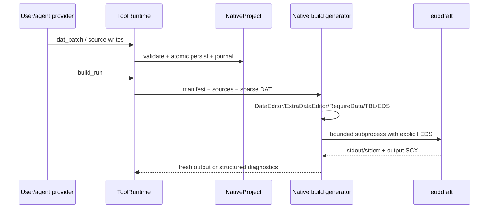

# Architecture

## Central summons and closed enemy loops

The luck-defense skill defaults to direct summoning inside the central defender board;
separate gameplay functions do not require an external management platform or access corridor.
Its map brief and acceptance checks preserve a closed enemy loop, including the final-to-first
waypoint segment, and verify ground separation independently. Older cut/open route briefs
must be corrected before reuse. The Map Agent baseline also preserves requested route topology
and distinguishes candidate validity from gameplay geometry checks. Both instructions are
embedded in the application binary, so source changes require an application rebuild.

## Project work checkpoints and worker batches (2026-10-01)

`work_checkpoint.rs` exports bounded progress from the session task projection and worker
records into `.eud-agent/state/tasks/<session-id>.json`. Derived `plan.md` and `evidence.json`
live in `.eud-agent/workspace/tasks/<session-id>/`. Session events retain provenance and
rewind authority; project checkpoints are advisory recovery material, not authorization
or proof of completed gameplay. Native project revisions invalidate older evidence, and
workspace identity checks keep records out of other projects. Plans and same-revision build
observations survive turns without new evidence. Resume refreshes current worker statuses
from the session store, including interruption after restart. Fresh sessions can discover
up to three recent checkpoints; existing sessions read their own. The bounded resume note
uses the existing project-map hash cursor, so unchanged details are not resent.

Successful worker settlements wake the parent only after the active workers started by
the same request have finished. Failures wake early for recovery; unrelated request batches
remain independent. Worker turns and automatic settlement continuations do not run the
semantic task compiler. Cancellation still appends a deterministic task event. Cleanup
failure warns independently and never discards a valid compiler result. Generated task
files are excluded from automatic Git commits, including existing repositories without
the new ignore entry. No post-turn model-driven document generator is restored.

## Skill registry (2026-10-03)

Skills live in `skills/<id>/SKILL.md` and are compiled in through the static
`SKILL_SOURCES` list in `src-tauri/src/skills.rs`; adding a skill is one folder
plus one line. The registry parses frontmatter `name`/`description` and the
first `# ` heading as the Korean title, and `skill_list` returns
`{id, title, description}` to the panel as the single source of truth.

`SkillSelectionChanged { skill, enabled }` records one skill's explicit ON/OFF
per client turn; events persisted before the registry have no `skill` and mean
`luck-defense`. Several skills can be ON. Every main EPS turn assembles one
`[active skill]` section with a `[skill: <id>]` block per active skill in
registry order, so its hash-based resend covers the combination. Luck-defense
keeps the scoped routing below; every other skill is active only by explicit ON
and contributes its whole body (no keyword or build-warning activation).
Workers keep only the luck-defense marker guidance.

## Scoped luck-defense workflow authority (2026-10-02)

Scoped workflow state is event-sourced in the existing task projection. A manual
`SkillSelectionChanged` event for `luck-defense` records explicit ON or OFF, while
`WorkflowProgressReplaced` records the backend-validated mode, phase, action,
bounded prerequisites and pending playtests. The backend stamps completed
evidence and provenance; callers do not provide evidence identifiers or hashes.
Session events and revision/CAS checks remain authoritative. Checkpoints mirror
the projection for recovery and remain advisory: they are never permission,
proof of a build, or proof of gameplay.

The manual `ChatRequest.skillSelections` entry is tri-state per skill id. ON
sends `true`; an explicit OFF sends `false`; an untouched or already-settled OFF
omits the id. A
visible persisted ON is sent as `true` on a fresh manual request. Queue,
retry and edit preserve the captured directive and `clientTurnId`, with the
captured retry directive taking precedence over a later UI callback. Synthetic
continuations send no selection field and preserve the durable branch value.

Prompt routing is scoped by the durable mode. An enabled unclassified branch
receives the compact router and must record progress before scoped mutation.
`new_build` and `continue_existing` retain the final acceptance contract and
their mode guidance; `local_edit` receives shared safety, local scope and the
pending acceptance inventory. A legacy marker or natural-language activation
can enable the router only when no explicit selection exists; explicit OFF
suppresses both.

New-build guidance orders the playable core loop as summon → movement/combat →
reward/defeat, then `core_loop → economy_multiplayer → advanced_features →
final_polish`. The final acceptance requirements remain recorded throughout;
phase order is guidance for feedback and does not prove a build or playtest.

An EPS-to-Map handoff seeds one parent provenance record. Map-local progress
keeps that inheritance origin. During `map_chat`, updates stage under the
session/request/client-turn/expected-revision key. A successful candidate
commit publishes the staged event, binds the exact committed candidate
revision and hash, and writes the checkpoint. A successful text-only turn may
publish advisory progress without completed evidence. Error or cancellation
discards staged progress while retaining prior committed progress and skill
events; the candidate and Apply path remain Map mutation authority.

Accepted Map updates form one ordered batch of at most eight against the
durable original CAS base. The application-owned intent is durable before
candidate commit, the receipt binds the exact committed candidate, and
publication never rebases onto a newer revision. Recovery is idempotent and
does not repeat candidate mutation. A checkpoint write failure after
authoritative publication is advisory.

Task-state and full `SessionRecord` schema 1 are readable with defaults and the
next ordinary save emits schema 2; checkpoint schema 1 follows the same
read/schema-2-write rule. Future schema versions are rejected. Revision
changes mark prior evidence stale. Worker units verify their owned units, the
parent validates the integrated current revision, investigators own assigned
result documents, and the parent owns shared accepted specifications.

## Worker context delivery (2026-10-01)

`engine/context.rs` assembles role-aware EPS contexts across cold starts, continuation and
recovery. Worker baselines retain the domain safety contract while limiting tools and guidance
to the role. `worker/delivery.rs` selects bounded active/new reports; only selected settlements
are acknowledged after a successful uncancelled turn. Continuing contexts omit reported results,
and full context recovery restores recent results. A sole hydrated first goal is not replayed
beside the current goal. Detailed verification and measured prompt sizes are in `verify.md`.

## Post-turn harness removal (2026-10-01)

The post-turn in-game verification harness is removed. A completed EPS turn records its
commit, accepted journal entries, workspace revisions and DAT ledger, then releases its
write registration. It schedules no document/memory generator or runtime-confirmation job.
There is no harness status card, job IPC, snapshot recovery, retry, dismissal, or harness
condition in project close/switch and session deletion. Existing documents, memory, approvals,
legacy import sources and historical task-state audit records remain readable and are preserved.
Documentation uses ordinary document tools and the memory editor; the task-state compiler remains.
Earlier harness runtime descriptions below and in implementation plans are historical.

## System boundary

`eud-agent` is a standalone Tauri 2 application for native EUD map authoring. It owns project state, epScript files, sparse DAT edits, build generation, review/rollback, map tooling, RAG, and five-provider agent orchestration.

Windows is the verified platform and the one the acceptance evidence in [verify.md](verify.md) is bound to. The release also publishes an Apple Silicon macOS build, which compiles and runs but carries no acceptance evidence, is not signed with an Apple developer identity, has no updater entry yet (the macOS `.app.tar.gz` updater artifact is not being produced), and loses the Windows-only surfaces (the share-lock probe, SCMDraft 2 launching, background Map window placement) to their documented fallbacks. Intel macOS is not a build target: `ort` publishes no prebuilt ONNX Runtime for `x86_64-apple-darwin`, so the RAG dependency cannot link there without building ONNX Runtime from source or changing backends.

EUD Editor 3 is not a runtime dependency. Its open-source data definitions are used only as a versioned compatibility contract for DAT generation and `.e3s` import/export.

```mermaid
graph TD
    Panel[React panel] -->|typed invoke/listen| IPC[Tauri IPC]
    IPC --> Engine[Rust agent engine]
    Engine --> Tools[SessionToolRuntime]
    Tools --> Native[NativeProjectManager]
    Native --> Manifest[project.eap]
    Native --> Sources[src/**/*.{eps,py} + src/**/*.py]
    Native --> Dat[dat/*.json]
    Tools --> Map[Map Agent / isom / CHK]
    Tools --> Journal[semantic journal]
    Engine --> Runtime[ProviderRuntime]
    Runtime --> Providers[Five transport adapters]
    Runtime --> Gate[Run-scoped tool gate]
    Gate --> Tools
    Engine --> Jobs[Isolated StructuredJobExecutor]
    Jobs --> Providers
    Engine --> Rag[in-process fastembed RAG]
    Native --> Build[deterministic EDS + plugins]
    Build --> Euddraft[euddraft subprocess]
    Euddraft --> Output[output SCX]
    Native --> Compat[independent NRBF E3S compatibility]
```

## Canonical project

The authority is one schema-v2 manifest, a confined EPS/Python tree, and five sparse JSON documents. Generated EDS/Python/binary files and E3S are outputs, never canonical state.

```text
project.eap
src/**/*.eps
dat/{standard,xdat,tbl,requirements,buttons}.json
maps/<source>.scx
build/
references/<name>.scx       # verified copies of maps opened in the Map Importer, never canonical
compat/editor-project.e3s   # only after E3S import
```

`NativeProject` validates paths before filesystem access, writes JSON atomically, hashes complete state for revisions, and updates MainFile when a source moves. Project open requires the source map and MainFile to exist.

The manifest itself uses `.eap` (EUD Agent Project); there is no separate launcher descriptor. New projects use `project.eap`, and a renamed sole `.eap` remains the persistence target. Only explicit opens migrate legacy `project.json`/`.eudproj` state after validation; passive status probes never migrate. Multiple `.eap` files or mixed old/new authorities fail closed. Historical map identities retain the root/legacy-filename hash so migration does not orphan existing map state.

## Runtime ownership

- `AppManaged`: shared data-directory state for Tauri commands.
- `ProjectRegistry`: the runtime authority over open projects, keyed by `ProjectId` (the hash of
  `NativeProject::root()`, so every spelling of one folder is one project). Any number of projects
  are open at once; `can_open_additional` is the one place that could limit that again. It also
  holds the window bindings (`label -> ProjectId`): a command resolves its project from the
  calling window's binding, never from `config.project_path`, which only remembers the last
  opened project for the launcher. Each project's windows share one label suffix (its first 12
  hex digits, or the whole id when an open project already has them), fixed while it is open:
  `main` (the launcher, bound once it opens a project) or `main-<suffix>`, `map-agent-<suffix>`,
  `map-import-<suffix>`.
- `ProjectHandle`: one open project — its id, canonical root, the root-bound
  `NativeProjectManager` every tool, build and prompt section of that project uses, its Map
  context, and the runtime state it owns (session engines, running harness jobs, review recovery,
  the Map window's pending open request) behind a close gate: admitted work holds the gate for
  reading, a close takes it for writing, and a closed handle refuses everything.
- `NativeProjectManager`: one project's open/status/list/source/DAT/build facade, bound to its root.
- `ToolServices`: immutable process services; `SessionToolRuntime` owns request evidence, iteration
  progress, attachment bindings, and write registration.
- `ProjectWriteCoordinator`: serializes shared project transactions across sessions without
  treating generated build outputs as canonical mutations, and keeps each in-flight request's
  in-memory path claims (`claim`/`unclaim`/`claimed_by_others`/`claimed_in_flight`) that turn
  commits are split by.
- `JournalStore`: durable semantic before/after records and reverse-order rollback through the native runtime.
- `WorkspaceManager`: durable project-local agent documents and trusted turn baselines; the provider CLI cwd is the native project root, so there is no session mirror.
- `MapSafe`: native build marker, Windows no-share probe, backup, isom mutation, verification, rollback.
- `isom::game_asset`: one verbatim read of an installed StarCraft asset out of CASC/MPQ, uninterpreted
  by the native shim. `iscript_info` builds on it in Rust: it parses `scripts\iscript.bin` for the
  animation slots an existing iscript declares (slots `0..=type` padded to an even array length, so
  most overlay scripts carry only Init and Death) and `arr\images.tbl` for the GRP name of each image
  whose effective `Iscript ID` selects that script. The parse is strict — bad magic, a truncated
  header, an out-of-range slot offset, or two headers whose slot arrays overlap are errors, never a
  silently shortened slot list.
- `isom::map_asset`: one verbatim read of a named extra asset out of a map's MPQ (the bytes
  `map_digest` hashes; reserved `scenario.chk`/listfile entries refused, size-capped natively).
  `isom::map_sound_add_batch` registers up to 128 managed OGG sounds in one load/mutate/save of a
  copied map with one reopen verification; `MapSafe::write_sound_batch` wraps it in one backup and
  one post-verify, and `map_sound_import({audioRefs})` records one journal entry per new sound, all
  sharing that backup. `isom::map_sound_remove` takes WAV slots out the same way (slot, game string,
  and the MPQ asset the string names, managed or not) and refuses a string any other CHK user —
  trigger, briefing, location, unit, force, switch, scenario text, another slot — still references,
  so it never rewrites another section; `MapSafe::remove_sounds` wraps it in one backup and one
  post-verify, and `map_sound_remove({mpqPaths})` records one `MapSoundRemoved` journal entry per
  sound.
- `audio_ffmpeg` (EPS only): the model writes FFmpeg arguments, the app owns every file.
  `audio::ffmpeg` validates inputs (`{audioRef}` or WAV-registered `{mpqPath}` read through
  `isom::map_asset`), the `-i {inN}` / last-argument `{out}/<name>` placeholder contract, and an
  option/value/filter allowlist before anything runs; `AudioService::run_ffmpeg` runs the pinned
  FFmpeg (one job at a time) with `-nostdin -hide_banner -v error`, `-protocol_whitelist file` and
  an audio `-format_whitelist` per input, cwd in a fresh request-temp directory, a per-poll guard on
  output entries/bytes and resident memory, OS memory/file-size/CPU limits and the managed process
  bounds, then probes and binds
  every output as a new request audioRef that `map_sound_import`/`map_sound_edit` accept unchanged.
- `audio_from_project` (EPS only): binds 1..=64 audio files already in the project root (≤ 64 MiB
  each, 512 MiB per call) as request audioRefs, so a sound the user keeps in e.g. `sounds/` needs no
  attachment. Each path goes through the `fs_tools` root confinement, must be a regular file whose
  bytes `detect_audio` recognizes, and is copied into the request temp before FFprobe binds it, so
  the binding's checksum holds even if the project file changes before import. Like `audio_ffmpeg`
  it writes only request temp: no write lane, project transaction, or write budget.
- `CandidateStore`: per-session baseline snapshot, operation-manifest revisions, and the current
  candidate map. The saved source is the authority a session follows: `follow_source` runs at every
  open/state/request/apply boundary and, when the source hash moved, replays the session's revisions
  onto the new source with fresh verification, or marks `sourceDiverged` (candidate wins on Apply)
  when the new source rejects a revision on the visible chain. The Map panel polls the source mtime
  and reopens the session on change instead of asking for a new work item. The selection palette
  (saved target/protect/reference/anchor areas) is authoring state in the project's
  `.eud-agent/map/selection-palette.json`, committed with the map; an AppData palette moves there
  once and is kept as `selection-palette.migrated.json`. Both agents (EPS and Map) read it with
  `map_selection_list`/`map_selection_read` and save or delete areas in it with
  `map_selection_write` (tile rectangles unioned, minus `exclude`), which writes the palette
  directly through `CandidateStore::palette_save`/`palette_delete` without a Map session; every
  session rebinds the palette on its next load, and the `map-selection-palette-changed` broadcast
  makes an open Map window take the new selections (`map_agent_candidate_state`) without touching
  its candidate or a running turn. `team-` selections belong to `map_task_request` and are refused.
- `engine::prompts::MAP_LOCATION_GUIDE` embeds `data/prompts/map_locations.md` in both the EPS
  static baseline and Map Agent system prompt. The policy applies to every skill: ordinary areas
  stay saved selections, runtime gameplay binds their verified coordinates/masks into EPS/Python,
  and location-consuming APIs prefer a project-owned pool sized by peak simultaneous use.
  Dedicated locations are reserved for explicit requests or required persistent semantics. This is
  shared authoring guidance, not a native runtime allocator or an automatic existing-map migration.
- Map window scenario properties ("맵 속성": title, description, 12 slots, 4 forces) are a
  UI-only request: `MapAgentService::properties_save` diffs the form against the current digest,
  emits `scenario.set`/`player.set`/`force.set` into a session work file, verifies it under a
  properties authority (the only authority allowed to change `SPRP/OWNR/IOWN/SIDE/FORC`), then
  runs the ordinary `MapSafe::apply` + `complete_apply`, so the source map changes immediately
  and the Map window's Undo restores the exact backup. It refuses while a candidate revision or
  request exists. The wizard's title/description/slot/force choices are therefore editable for the
  life of the project. The main window's header carries the same request
  (`map_agent_open_properties`): it focuses or creates the Map window and opens that dialog
  there — through `MAP_OPEN_PROPERTIES_EVENT` when the window already exists, otherwise through
  the bootstrap's `openProperties` — so the save keeps its one session, verification, and Undo
  owner instead of gaining a second.
- The Map window's "이미지 내보내기" draws the view on the canvas (original, candidate, or the
  live draft) as one whole-map PNG at 32 px per tile with terrain, doodads, sprites, units, and
  buildings — the scmscx.com map picture, not the minimap. `map_agent_export_image` returns it for
  the clipboard; `map_agent_export_image_save` asks for a path first, then draws and writes it.
- "SCMDraft 2로 열기" is a main-window header action (`project_open_scmdraft`): it launches
  `config.scmdraft_path` on the project's source map, and when the executable is unset or gone
  it returns `unconfigured` so the panel opens 설정 → 컴파일 in place instead of showing a hint.
  The share-lock probe keeps refusing Map writes while SCMDraft holds the file.
- "프로젝트 빌드" is a main-window header action (`project_build_run`) left of "맵 에이전트": it
  runs the ordinary `NativeProjectManager::build` on the user's own request and shows the euddraft
  verdict in the 빌드 결과 dialog — errors and warnings at their innermost project frames, the
  bounded output excerpt, the output map, the StarCraft copy, and `build/euddraft/build.log`. The
  raw streams never cross the boundary, no agent session sees the run, and the project-scoped build
  marker is what keeps it from overlapping an agent's `build_run` (an active build is refused with
  its recovery action). The header's "프로젝트 전환" button sits at the right edge of the same
  action group.

No module reads an Editor heartbeat/status file, starts Editor, installs Lua, polls inbox/outbox, invokes BindingManager, or asks Editor to build.

## Provider execution ownership

`SessionEngineManager` constructs a session-bound `AgentEngine<R: RuntimeExecutor>` with `ProviderRuntime`. A fixed exhaustive factory selects `CodexAdapter`, `ProductionClaudeCodeAdapter`, `AntigravityAdapter`, `OpenCodeGoAdapter`, or `ProductionOllamaAdapter`; there is no legacy driver facade or dynamic plugin registry. OpenCode Go selects only its three declared Responses, Chat Completions, or Anthropic Messages wires from the persisted binding. The common runtime owns shared run, tool-gate, cancellation, checkpoint, and normalized-event rules; selection never creates provider or wire fallback.

`provider_runtime.rs` defines the request, identity, policy, normalized event and outcome contracts. Its private runtime modules own foreground lifecycle, direct model-step/tool-result iteration, the ordered text/reasoning/tool/signature block stream, deadlines, ASK-aware cancellation, event validation, workspace preparation, compaction, and checkpoint/recovery. The engine retains domain context, task-state provenance, approvals, review, and application-session persistence.

A native adapter publishes its resumable session identity as soon as the CLI reports it, before any output, and the runtime records it as that run's boundary; a run that is cancelled or dies keeps that boundary (receipt state `interrupted`) instead of refusing the conversation — a run the runtime cancels or times out before the CLI reported a session keeps the session it asked to resume, while a CLI that fails on its own before reporting one leaves the conversation unknown — while a session the run did not ask to resume is never adopted and leaves no boundary. The runtime seeds the adapter onto the boundary it records, since a cancelled or timed-out step drops the adapter's future before the adapter settles itself. Each chat turn persists the boundary it reached even when the turn fails.

Adapters preserve native authentication, protocol and session controls without owning application storage writers, UI sinks, workspace services or unrestricted tools. Codex/Claude retain their official CLI internal loops. OpenCode Go retains its catalog-selected Chat Completions, Responses and Anthropic Messages wires; Antigravity retains Cloud Code/thought signatures; Ollama retains the exact saved endpoint/model binding.

For OpenCode Go, ordinary function descriptors on the Responses and Chat Completions wires explicitly use non-strict schemas so optional tool fields remain representable; structured-job result descriptors remain strict. A parsed protocol or incomplete-stream failure remains that error class rather than being overwritten by a synthetic transport-close event. For Codex, native `context_usage` is published only after a nonempty official `turn/started` ID and only when the usage event names that active turn; unmatched prior or stale usage is ignored before it reaches the strict session sink.

`RunPolicy.max_output_bytes` limits serialized normalized output in the common runtime. It is not an HTTP-body ceiling: OpenCode Go, Ollama, and Antigravity enforce their own 16 MiB raw-response limits, while Claude Code independently bounds raw stdout at 32 MiB in total and per JSONL line, and records each native tool's arguments and result as an observation up to 256 KiB, echoed MCP `image` blocks (rendered maps) exempt; a larger one is recorded as `observationOmitted`/`bytes` and never ends the run, because the model has already seen it. Codex keeps its existing common-runtime checks. This separation admits harmless transport framing overhead but still rejects normalized semantic output beyond policy.

Direct batches and native MCP calls share a run-scoped tool gate over `SessionToolRuntime`. Each native endpoint/handler has a unique run URL and UUID identity, belongs to its creating run, and becomes invalid at shutdown. Native notifications are observations, not duplicate execution commands. Completed tools persist their journal/receipt independently of final-answer success; the receipt records each result verbatim up to 64 KiB and otherwise only its identity (an MCP image keeps `mimeType`/`width`/`height` with the PNG replaced by `dataBytes`/`dataSha256`; any other oversized result becomes `receiptOmitted`/`bytes`/`sha256`), so a long Map run of rendered candidates never exceeds the 64 MiB run-receipt bound. Cancellation blocks new admission while already-started operations settle; it never automatically replays or rolls back completed mutations.

Direct transcript generation/pointer validation and native ID/receipt recovery remain distinct. Only confirmed boundaries advance continuation/context state; late events must still match their immutable run/session identity. Unknown native state and corrupt direct state fail closed with review intact; an explicit reset starts fresh rather than silently adopting a receipt. A failed resume never blocks opening the session: the Map bootstrap returns `conversationResumeError`, the window opens with candidate/revision state intact, chat stays refused, and the panel's "대화 초기화" action (`map_agent_conversation_reset`) clears the receipt and starts a fresh native session. The Map window's per-message "수정" action (`map_agent_conversation_rewind`) rewinds the conversation to the rows before that message, anchored by the row's `requestId`, without touching the candidate map. Application metadata acknowledgement retires native recovery receipts. This does not claim crash-atomic external side effects or universal exactly-once execution.

`AgentEngine` also owns the provider-independent autonomous controller. An autonomous run contains
one durable request/journal and any number of soft-bounded foreground iterations. `RunOutcome`
distinguishes write transition from typed action, direct-round, context-pressure, and
provider-continuation boundaries. Direct adapters checkpoint their exact ordered transcript after
completed tool results; Codex and Claude accept only official native continuation receipts. The
engine persists each confirmed boundary, builds a minimal continuation from goal/task/blocker/build
state, and never copies stale project contents into the next prompt.

`SessionToolRuntime` also hosts engine-injected executors, like the ask emitter: `map_task_request`
records a durable `TeamTask` on the EPS session and submits an ordinary Map request through the
manager's team dispatcher, and the worker executor starts and cancels background workers (below). A request whose `revisesTaskId` names a
candidate_ready or applied task continues that task's team session (its conversation, and its
candidate while that is ready); every other request runs in a **fresh** team Map session (new provider
thread, empty transcript, candidate r0 on the saved source map), and the parent's earlier team
sessions are retired with their candidates unless the Map window can still undo their Apply against
the current source. The request's `target`/`protect` tile rectangles become one target selection
(target union, or the whole map, minus protect, carrying the task's layers) created on the team
session's candidate right before the request is prepared, mentioned like a region the user selected,
so `MapRequestAuthority` refuses any change outside it or on another layer, and removed once the
request ends (the revision's manifest keeps its authority). Protect is never a protect selection,
which the project palette would bind to every later request, and it cannot be combined with
`selectionIds`. Revising a ready candidate supersedes its task only until the revision settles: a
revision that produces nothing makes that task ready again. Withdrawals are typed
(`TeamWithdrawal`): a discard or revert ends the ready candidate, an undo also the one apply it
reverted, a deleted session everything it could still deliver. The request waits at most 240
seconds inside the tool call. A Map request that outlives the wait returns `running`; when it later settles, the
dispatcher's `team_continue` starts the EPS session's continuation turn itself (idle sessions only,
announced as `team_task.continuation`), so the handoff completes without a user message. The EPS
session then inspects the team candidate
(`map_task_diff`/`map_task_objects`/`map_task_render`) and applies it with `map_task_apply` through
the Map window's own apply path, revises it with a request that states only the change, or discards
it; the user can do the same in the Map window and undo an apply from either. A team request stopped
from either side settles `cancelled` (the engine reports the cancelled turn as `MapTurnEnd::Cancelled`,
not as a missing candidate) and commits nothing, so it never starts a continuation turn.

Background workers (`worker.rs`, `engine/worker.rs`) are the EPS-to-EPS counterpart. `worker_start
{goal, title}` is admitted only on an EPS session that is not itself a worker (depth 1) and without
a live autonomous run; the store checks the limit of 3 queued/running workers per parent and records
the `WorkerRecord` on the parent's `SessionRecord.workers` under one lock, then returns at once with
`{workerId, sessionId, status: "queued"}`. The child is a fresh EPS session with the parent's
provider binding and an empty conversation (`SessionMeta.worker_parent`); its user message is the
goal alone, and every child turn carries the engine's `[background worker]` section. Worker
sessions are not offered `worker_*`, `ask`, `propose_plan`, or `map_task_*`, and calling one is a
usage error. The team dispatcher runs the child's turn as an ordinary interactive chat and records
the settlement (`settled`/`failed{reason}`/`cancelled`, bounded summary, commits, changed files,
last build verdict) on the parent; a failed turn still keeps what it committed. Each settlement is a
`worker` event on the parent, and `worker_continue` starts one continuation turn on
`WORKER_CONTINUE_TEXT` only while the parent is idle with no live autonomous run, never for a
cancelled worker and never after a cancelled parent turn; every parent command exit re-dispatches
an unreported settlement. The `[workers]` prompt note shows the records, and a settlement counts as
reported only once the turn that showed it succeeded. Cancelling any turn of a parent cancels every
queued/running worker of that parent through the dispatcher without waiting for them, and stopping
a worker session cancels its worker. An autonomous run cannot start while workers are active; a
parent (or a worker session its parent still counts as active) with active workers cannot be
deleted; startup maps queued/running workers to `interrupted`. `worker_status` returns the record
with each commit's detail within 40 KiB double-escaped; `worker_revert` reverts the worker's commits
newest first in the project's git transaction, stops at the first conflict, records `reverted`, and
refuses a second revert.

`SessionToolRuntime` classifies tools on two axes: canonical write-workspace admission and shared
project transaction. `build_run` uses only the latter, so an EPS read foreground builds in place
while still excluding concurrent source/Map/sound operations for the native process lifetime.
Build no-progress uses bounded stable revision/diagnostic history. Search and Python dependency
preparation use input/result identity rather than request-lifetime attempt caps.

An EPS chat turn registers its write request before the turn starts and runs with write access from
its first call, then settles itself (commit, journal, release) without a second foreground turn. The
registration is not exclusive — `ProjectWriteCoordinator` grants it at once and serializes only the
individual project transactions — so a read-first turn bought no concurrency and cost a refused
call, a restarted turn, and a re-read of every target. The automatic first-mutation transition
remains for turns that still start read-only (plan feedback, autonomous continuation). A plan
proposed by a turn that changed nothing returns the registration until approval.

Turn commits are owned-path commits. Each request claims the project files it changes, keyed by
`git_scope` (the open project's name, so EPS and Map sessions and a history revert share one
scope): argument-path writers (`fs_write`/`fs_edit`, `file_*`) claim before dispatch, journaled and
palette writers claim their targets after success, and native observations claim Claude Code
`Edit`/`Write`/`MultiEdit`/`NotebookEdit` `file_path`/`notebook_path` (kept even when arguments
over 256 KiB are recorded as omitted) and Codex `fileChange` paths. Codex shell writes name no path
and stay unattributed. `commit_boundary` commits the dirty paths minus those claimed only by other
in-flight requests through `git::commit_paths`; a path this request and another both claimed is
committed with a `shared-with:` trailer and the `GitTurnEvent` warning "다른 세션과 같은 파일을 함께
변경했습니다"; with no path claimed by another request it commits everything as before. Recorded
paths are unclaimed after the commit, and claims end with the turn or `release`. The turn-start
external-edit commit skips every in-flight claim. A worker's commits use the subject `[작업자]
<title>` and a `parent-session:` trailer. `git::revert` refuses only over staged changes or dirty
paths the reverted commit touched. Every git mutation (turn and external commits, `git_revert`,
`worker_revert`) runs inside `ProjectWriteCoordinator::transaction` for `git_scope`; engine
commits run it on a blocking thread (`run_git_mutation`).

Autonomous lifecycle is durable session state, separate from live read/write activity. ASK, review,
pause, restart pause, safety stop, cancellation, failure, and completion remain explicit. Startup
never resumes. Explicit resume validates project identity/revision, pending review, and the exact
persisted/provider checkpoint; runtime-affecting completion requires a successful build for the
current canonical revision.

Compiler and harness requests use an independent `StructuredJobExecutor` with no main storage, workspace manager, tool authority or UI sink. It receives a fresh binding snapshot and a unique empty compiler input/cwd. Compiler requests use the common 60-second deadline and 8192-token cap; harness requests retain their 300-second deadline. Whole-result validation precedes revision/branch/provenance checks or harness staging/review. No model-name exceptions, prose JSON scraping, timeout inflation, partial-success conversion or automatic provider/model fallback is used.

See [agent core](features/05_agent-core.md), [sessions](features/sessions.md), the
[autonomous loop plan](features/autonomous-agent-loop-plan.md), and the
[runtime acceptance plan](features/provider-runtime-unification-plan.md). Implementation,
deterministic adapter evidence, actual service/UI acceptance, and environment limits have separate
verdicts in [verify.md](verify.md).

Historical checkpoints retain their recorded source/binary bindings: checkpoint 22's Windows draft-cleanup failure and checkpoint 33's compiler-cwd error 32 are not evidence for later source. The checkpoint-23 non-inheritable `rbN` Map reader mechanism, ordinary OpenCode `strict: false` descriptors, active-turn usage filtering, and independent raw/normalized-output bounds remain part of the implemented runtime.

## Request workflow

Every interactive EPS chat request is one ordinary foreground turn that reads the project, changes
it, and builds. No triage, research, planning, critique, or verification stage runs first, and no
mandatory delegated run exists. The foreground actively uses optional `worker_start` role sessions
for broad code/documentation (`research`), map facts (`map_research`), or independent changes
(`implementation`). Investigators get a fresh conversation, read-only native workspace, a closed
tool allowlist with project `.md`/`.txt` document I/O and no native built-in tools; their bounded final summary reaches the parent. Worker
creation opens the existing split panels while preserving focus; at the four-pane cap an unfocused
terminal worker of the same parent can be replaced, preserving its session history. Three workers
form a two-by-two grid with the parent. The agent calls `propose_plan` only when the user asks for a plan or
the work warrants agreement first; plan approval then registers write intent and executes. A
requirements interview is part of the same turn, not a stage: the static `[clarify]` section scores
seven EUD axes (목적, 범위, 규칙·흐름, 플레이어·맵, 기존 프로젝트, 완료, 제약), asks about axes above
0.2 with at most three `ask` calls, writes the confirmed spec to `.eud-agent/workspace/specs/` and
`specs/index.md` (which `[project map]` shows on later turns), and continues into the work. The
agent decides when a request needs it; the composer's one-message "인터뷰" toggle sends
`ChatRequest.clarify`, which the engine delivers as `[clarify requested]` on that turn only (also
on a transcript-replay fresh start), never to a background worker or an autonomous run; the toggle
is disabled while the input is plan feedback. The
`[completion]` section states that a green build means the project compiles, not that the map plays,
and requires every changed turn to name what the user should check in game. A `[project map]`
section (source listing, entrypoints, plugins, DAT override counts, accepted spec index) is
delivered through the context cursor like memory, so an unchanged tree costs nothing per turn.
Parallel work inside one request goes to background workers or the team Map session (above).

## Current verification boundary

Checkpoint41 binds source `078F460095E965AEB7B3E7FE04F8FACF494DD9D23917FD78458F78F8C78C330D` to immutable test executable `0C161936695EEEA3CEA91A2B677FCF3AA5FDC28B607906F77106EA96BE44E84A`. The permanent long-Windows-path Map selector passes, `isom` passes 12 with 7 existing environment ignores, and an unchanged full default-parallel repeat passes `749/0/30`, including main and doc targets. Library check, strict `isom` and all-target/all-feature `eud-agent` Clippy, and full formatter pass. The first full41 run's existing Map finalize/revert Access-denied failure (`748/1/30`) remains a WATCH: the exact diagnostic and unchanged repeat pass do not attribute or causally fix it. Fresh panel36 TypeScript, 58-file/539-test Vitest, and production build remain product-equivalent and pass with the existing chunk advisory. The custom-protocol app build passes on checkpoint41 source and binds app SHA `C8CCB48B0ABBBFC93EB65626BB0668895BF2D0F22FBB979CF9216968F66B8DE2`.

Map admission validates the verbatim registry schema as Draft7, preserving strict malformed and original-Apply refusal. After numeric rendering passed, actual39 exposed a 271-character temporary-draft path failure; the controlled ordinary/extended-path probe isolated that boundary, and source41's shared Windows path correction passes the permanent long-path Map regression. Actual Map41 then completes candidate revision 1, trusted UI Apply, and exact undo to its baseline. Its two preceding `before` conflicts are retained; stale-fork validation did not run.

Actual app33 gives bounded native EPS evidence: read/compiler semantic delta, scoped edit with preflight/build, review reject and accept, and cancellation after `response_started` but before text/tool output all pass. App37 adds native ASK answer, separate ASK cancellation with an 8.08-second idle observation, and normal restart persistence of the 88-byte EPS source/hash and sessions with no active-request replay. Actual39 C18 independently overlaps Map status/analyze with an OpenCode Go/`glm-5.3` `project_status` read; both remain session-bound and complete. The OpenCode foreground answer succeeds, but its persisted compiler warning is `runtime_error` with cause and exact wire unverified. Checkpoint33's C07 error32 remains an unexplained intermittent watch despite later passes and removed temporary diagnostics. SQLite startup has not reproduced, which is not a causal fix. Independent QA41 confirms the post-Undo Map UI at r0 with no candidate and Apply/Undo disabled while retaining its final answer and failed/successful tool history. App41 then closes normally with no owned processes and baseline hashes preserved. Messages structured work still fails, Claude is logged out, Antigravity lacks an OAuth client, and Ollama service verification is policy-blocked before launch: no server, catalog, generation, or configuration change occurred, so model presence and compatibility remain unknown. Gameplay remains required for the harness.

## Build flow



A project-scoped marker is held during build. Success requires a fresh output file whose MPQ block table StarCraft can open (at most 2^18 entries; freeze's decoy table grows with the compressed CHK), and a table from 90% of that limit is a warning. A successful build then copies that output map to `<StarCraft>/Maps/eud-agent/` (the same `resolve_starcraft_path` the Map renderers use) and reports it as `deployedMap`; no resolvable install means no copy, and a failed copy (e.g. the game holding the file) is a warning, not a build failure. Generator inputs are version-matched compatibility assets copied from Tauri resources to LocalAppData.

The runner writes the complete stdout/stderr to `build/euddraft/build.log`. The parser folds every Python traceback and every `warn_with_traceback` stack into one error or warning at its innermost project frame and reads epScript compile errors (`[Error N] Module "m" Line n : text`) as file/line errors; warnings never fail a build. Identical warnings merge with a `count`. The model's `build_run` observation carries `errors` (with `raw`), `warnings` (without stacks), `omittedErrors`/`omittedWarnings`, a bounded `outputExcerpt`, and `logPath`, never the raw streams (euddraft lists every null tile on one line); observation and `build_log_read` pages both stay under 40 KiB measured double-escaped, and `build_log_read` pages the log by line range or query with `nextLine` continuation.

## E3S boundary

The independent NRBF reader/writer parses object graphs as data. Import semantically projects CUI EPS/MainFile/settings/plugins and all supported DAT families; unsupported GUI/RawText or Classic-as-main structures fail explicitly. Export updates the retained graph, copies referenced map assets, embeds an exact native payload, reparses, and writes atomically.

Setup additionally migrates the local harness associated with the original full E3S path. Accepted documents, plan approvals, and memory/wiki are copied into the new project's `.eud-agent`; EPS/Map conversation copies remain in AppData under fresh IDs. Historical quoted keys are recognized. Missing, corrupt, unsafe, ambiguous, and conflicting optional items become stable `importIssues`, not a whole-import failure. Before activation the user must explicitly approve the current omission IDs; a changed issue requires renewed consent. Pending review rolls back healthy copies and clears generated destination contents without changing selection, recency, or originals. Only core import/destination failures or failed cleanup/rollback remain fatal. Conversation copies retain logs/settings without provider connections, pending reviews, context/task state, or map candidates. Jobs and generated mirrors are not migrated; E3S itself carries no harness.

New native projects do not need E3S. Legacy export requires an imported compatibility base; refusal is preferable to synthetic lossy output.

## Panel and setup

The panel is built into `panel/dist` and hosted by Tauri WebView2. Tauri listener registration and native project availability are separate states. Project loss gates authoring but does not disconnect transport.

Every ordinary startup first shows `ProjectLauncher`, even when the saved project and environment are valid. Recents are persisted newest-first by successful open, not by background status probes. An explicit successful open is required before session restoration, native project polling, or project-dependent bootstrap.

Associated `.eap` files contain the canonical manifest directly. The app stays one process: a second launch's arguments reach it through `tauri-plugin-single-instance`. Every open request (startup arguments, a forwarded launch, the header's "새 창에서 열기") is delivered by `project_launch`: a project already open is focused in its window and nothing is queued; otherwise the request waits in the queue of the launcher window while that window has no project and nothing queued, or else in the queue of a new `main-<suffix>` window created for it (never in an existing window that has since switched to another project). A plain second launch (no project path) focuses a main window that has no project and nothing queued, or else opens a new `main-<suffix>` window at the launcher, so another project can be opened beside the ones already open. Requests are delivered one at a time, off the single-instance callback's main thread; each window drains only its own queue, subscribing before it drains, and a window that closes drops what it never took. Busy/failed requests remain visible for explicit retry instead of changing an active project.

Environment setup after project selection:

1. open/create/import a native project from the launcher or a direct file request. "Create"
   starts from an existing SCX/SCM or from the blank-map wizard (`NewMapWizard`): tileset,
   64..256 size, initial ISOM terrain brush, title/description, map format, all 12 CHK player
   slots with type/race (force for P1..P8, like SCMDraft 2's player settings), 4 named forces with
   flags, start locations auto-placed as a packed top-left cluster, and a rendered preview before
   the project opens. Wizard text is encoded by `chk::encode_chk_text`: the new map has a legacy
   `STR ` table, so non-ASCII title/description/force names are CP949 (SCMDraft 2 and the system
   code page read them), with UTF-8 only as the unencodable fallback. The wizard needs the StarCraft install folder
   (`config.starcraft_path`, selectable in place and preferred over the default install folder)
   and generates `maps/<name>.scx` through `isom_map_new`, which saves via a same-directory
   temporary file and atomic promotion and re-opens the result before Rust re-reads the CHK;
2. automatically install the latest official euddraft release when no path is set, or select an existing euddraft folder/entrypoint;
3. verify/download managed RAG/model assets;
4. select and connect at least one supported AI provider.

Both composers' `@` search (the main window and the Map window) follows the textarea while an IME is still composing (a Korean query stays composing until its last syllable commits), and Tab or Enter completes the active option — after the composition commits and the committed query has its results. It lists the map's regions and locations (the main window through `mention_search`, the Map window from its own candidate) and then project-root files ranked from `workspace_list` (audio omitted in the Map window, whose picker takes none); picking a file reads its bytes through `workspace_read_bytes` (confined, regular, canonical-under-root, ≤ 64 MiB) and stages them through the ordinary `attachment_stage` path, so it becomes an attachment with the usual kind/size limits, never a mention. The main window also lists every folder that holds a listed file; picking one adds a `project.path` mention chip (the folder's path, no bytes). The turn resolves it against the current tree (`resolve_project_path`: root-confined, still a folder, fail closed otherwise) into `[resolved mentions]` with its sorted files (at most 200) and `fileCount`, without reading the map, and the model reads or binds what it needs itself (`fs_read`, `audio_from_project`).

The main window's chat tab is a split-pane layout (`paneLayout.ts`): a binary tree of at most 4
panes, each showing one session through `SessionPane.tsx` on the shadcn `resizable` primitive.
Panes split left/right or top/bottom and close (never the last); Alt+Arrow moves focus to the
neighbouring pane, and a sidebar pick focuses the pane already showing that session or else shows it
in the focused pane. The tree and focused
pane persist per project in localStorage (`eud-agent.panes/1:<projectPath>`), and split sizes per
split id. A worker session's pane header carries a "작업자 · <parent>" badge and the worker's
Korean status. The one composer targets the focused pane's session; a question card renders only in
the focused pane, and another pane waiting for an answer or plan review shows "응답 필요". A `worker`
event that creates a worker session opens it in a new pane beside its parent while fewer than 4
panes are open.

Active workers list beneath their parent in independently collapsible sidebar lists. Disclosure
does not change conversation focus; matching search opens its parent group. On a transition out of
queued/running, the worker pane closes and its navigation row disappears, including after project
reload; focus returns to the parent when needed. Restored navigation initially selects a main thread.
Worker and
team Map continuations mark an internal turn in flight without creating user chat bubbles.
Codex investigation workers retain read access and disabled native tools while trusted app MCP
tool calls use `on-request` approval on both fresh and resumed threads.

The project sidebar's "참고 문서" tab runs `rag_search` (`rag_panel.rs`), the same hybrid lexical-then-semantic search `search_docs` gives the model, and lists each hit's tier, match kind, score, and preview; it is read-only and never gates on model warmup. Selecting a hit opens a center "참고 문서" tab through `rag_article`, which joins every `(part i/n)` chunk sharing the hit's link (dropping the indexer's overlaps; an ambiguous part set shows only the hit's chunk) and renders it as escaped markdown with cafe page chrome removed. The original and body links open through the shell plugin.

The sidebar's "DAT 위키" tab is the way into the WHOLE version-matched DAT
catalog, read-only. `dat_wiki.rs` serves it from `DatCatalog`: `dat_wiki_schema`
returns every table (the ten DAT tables, wireframe/statusinfor/ButtonSet,
`stat_txt`, the five requirement tables and the button sets) with its object
names and its field metadata — `.def` order, width, value range, runtime
offset, which catalog the number indexes, and one label per flag bit — and
`dat_wiki_object` returns one object's stock values plus whatever `dat/*.json`
overrides. The sidebar tab searches names across every table and opens the
center "DAT 위키" tab on the hit, where objects sit on the left and the selected
object's properties on the right, laid out the way EUD Editor 3's DAT Editor
lays them out. Nothing in the view writes: an override is created only by
`dat_patch` through the ordinary journal/review path, so no row can go around
the `before == stock` rule the build enforces. Object names come from
`chk::unit_name` (units), each table's own one-based `Label` string id
(weapons/upgrades/techdata/orders) and `arr\images.tbl` out of the installed
StarCraft (images, and sprites/flingy through it); without a resolvable install
those three tables carry a notice and their objects keep bare ids. Requirement
tables reuse the DAT table names, so the wiki gives them `requirements:` ids.

The wiki also draws the pictures EUD Editor 3's DAT Editor draws, and gets them
the same way: out of the installed StarCraft, never from a bundled copy.
`grp.rs` parses GRP sheets, `.wpe` palettes and run-length `.pcx` remap tables
in Rust on top of one verbatim `isom::game_asset` read, exactly as
`iscript_info` parses `iscript.bin`. `dat_wiki_sheet` returns a whole sheet
(`cmdicons`, and the `wirefram`/`grpwire`/`tranwire` wireframes) as ONE grid
PNG plus its frame geometry, so an object list of 228 rows costs one request
and the panel slices frames with `background-position`; `dat_wiki_graphic`
follows `units`/`weapons` → flingy → sprites → images → `unit\**.grp` to one
object's own graphic, reading the project's own values at every step so an
overridden `Graphics` draws what the project runs. That graphic is animated:
`Iscript::animate` plays one slot of the image's `scripts\iscript.bin` script
(Init by default; the panel lists every slot with a body) — `playfram`/`wait`/
`goto`/`call`/turns at a fixed south-east facing (or the unit's own `Unit
Direction`), conditional jumps never taken, overlays not drawn — and returns
the distinct frames as one grid plus a tick timeline and loop start, which the
panel plays at 42 ms per tick. Flingy, sprites and images get list thumbnails
the same way: `dat_wiki_sheet` renders one 32-pixel cell per object from the
first frame its image's Init shows, cropped and fitted, following stock
values like every other list thumbnail. Each picture uses the
palette the engine uses for it: a command icon is a 16-shade ramp coloured
through `game\ticon.pcx`, a wireframe uses `game\twire.pcx` as it stands (its
remap rows are the damage tints), and a unit graphic uses a tileset `.wpe` with
indices 8-15 remapped through `game\tunit.pcx`. A schema whose
`resolve_starcraft_path` fails reports `pictures: false` with the reason, and
the whole view stays text-only rather than showing broken images.

The workspace header returns to the project launcher. Settings retains open/create/import/export and exposes euddraft path, managed version, explicit latest-release checking, and checksum-verified update under Compile. Compile also shows the resolved StarCraft data folder (the same `resolve_starcraft_path` every Map renderer, `map_minimap` included, uses) and picks it through `setup_pick_starcraft_path`. Native switch admission protects active work and invalidates idle workers on a root change; the panel clears project-scoped views and ignores late refresh results from the previous root.

Projects open side by side, each in its own windows. Opening a project that another window shows is refused with "이미 다른 창에서 열려 있습니다" and focuses that window; for a native project the launcher's own open, a switch, and a file launch check this before anything is migrated or recorded (a legacy `project.json`/`.eudproj` project has no id until it is converted, so its refusal comes after the conversion). A switch closes only the switching window's project and a window close closes only its own: both take that project's close gate and require every one of its engines idle with no write, harness job or build (a switch also requires its Map and import windows closed). A window close over active work asks first ("창을 닫을까요?"); a confirmed close cancels every turn, pending question and background worker of that project without waiting for them (durable sessions and pending plans remain), and an admitted or confirmed one releases the project's write registrations and claims, removes it from the registry, and closes its Map and import windows. Work on one project, or an open running in another window, never blocks another project's close. The process exits with its last window.

Project-owned events (`status`, `wiki`, `session_loaded`, `harness_job`, session engine events, Map candidate/apply and palette events, `MAP_OPEN_*`) go through `project_events::emit_project` to the windows bound to that project only, with its `projectId` in the payload; an event whose project is not open is dropped, never broadcast. Each panel window also drops an event naming another project. Session-scoped paths without a window (team and worker continuations, notifications, harness jobs) resolve the project from the session's stored `projectId`; a continuation of a closed project does nothing and leaves its settlement unreported until the project opens again. A legacy session without a `projectId` opens only in the window of the one open project whose live name matches; with two same-named projects open it is refused. Lock keys stay namespaced per project: `eps:<id>` for EPS tool transactions, git mutations, claims, memory/wiki saves and harness accepts, `map:<id>` for Map session settlement and the Map window's apply, undo and properties save. The Map window keeps its view state per project in localStorage (`map-agent.layout|surface|window/2:<suffix>`, copied once from the single-project `/1` key, which is kept). Process-wide throughput locks (the RAG embedder, the FFmpeg job, Python preparation) are shared across projects, so one project's job can make another's wait.

## Data locations

- Roaming `%APPDATA%/eud-agent`: config, conversations, journals, runtime jobs, session workspaces/turn baselines, and preserved legacy harness sources.
- Local `%LOCALAPPDATA%/eud-agent`: model/RAG cache, native compatibility assets, audio tools, managed euddraft/uv distributions, content-addressed Python wheels/environments, temporary work.
  The audio tools are the per-platform build pinned in `vendor/ffmpeg/manifest.json` (`eud-managed-ffmpeg/2`): Gyan essentials on Windows, Martin Riedl's signed static release builds on macOS arm64/x86_64 (one ZIP per tool, installed `0755` without quarantine and run once with `-version`). Every archive and member is sha256/size-pinned and published only after both tools verify; a system or Homebrew FFmpeg is never used.
- Project root: canonical authoring state, build outputs, and portable durable harness data under `.eud-agent/workspace`, `.eud-agent/state`, and `.eud-agent/memory` (including the wiki).

The local trusted workspace ID is initialized from the canonical root's SHA-256 identity and then retained across folder moves. It is created only by an explicit project open (or a first EPS turn); a recents or status probe never creates `.eud-agent/state/` in a user folder. Existing native AppData harnesses migrate only from validated project bindings; name-only memory with uncertain ownership is reported and left untouched. `.eud-agent/state/appdata-migration.json` records the one-time cutover, so reopening cannot resurrect deliberately deleted local files. Fresh create/E3S import marks its own cutover without attaching an unrelated same-name native store. Source files are never removed; local data takes precedence.

Every app-written text/JSON file is UTF-8 without BOM. Large/regenerable assets never live in Roaming.

## Verification authority

- Rust full suite for schemas, paths, journal, runtime, map tooling, source snapshots, NRBF, and generators.
- Panel Vitest suite plus TypeScript build.
- Real NRBF fixture: byte-exact parse/write, semantic import/export/import equality, and .NET BinaryFormatter deserialization.
- Real native generator → installed euddraft → fresh output SCX.
- Browser/Tauri surface verification for setup and project settings interactions.

## Direct Python runtime

`project.eap` stores ordered Python entrypoints, exact direct pins, and the deterministic complete wheel lock. Lease-free preparation resolves with managed uv, publishes a verified immutable environment, and runs a real frozen-euddraft probe. A bounded single-use token enters the normal short coordinator/journal/review transaction. Build validates the same lock digest and emits one EDS in bootstrap → plugins → DAT → Python entrypoints → EPS MainFile order, executed once by frozen `euddraft.exe` under a kill-on-close Windows Job Object.
